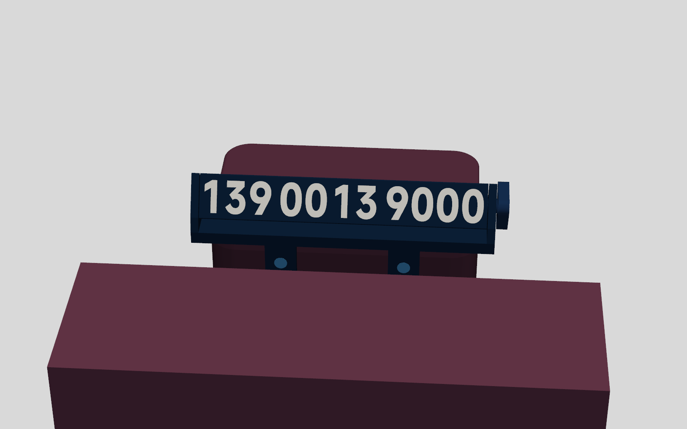
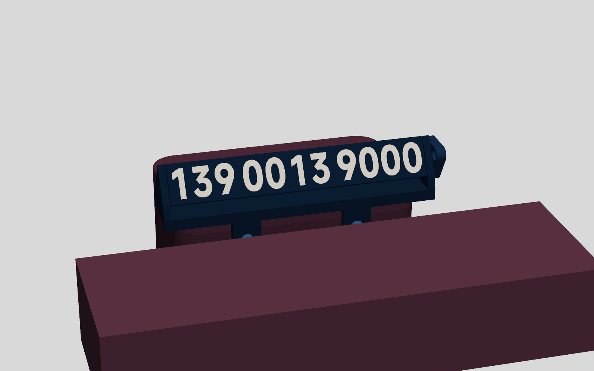
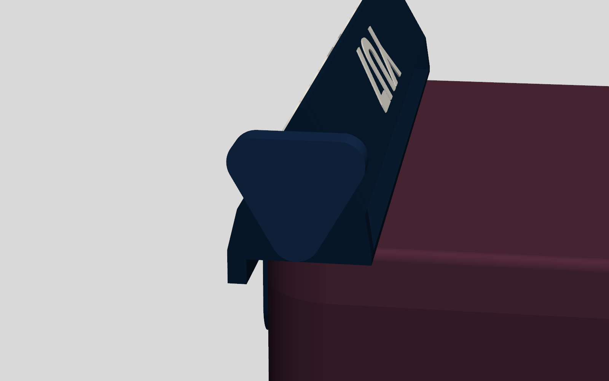
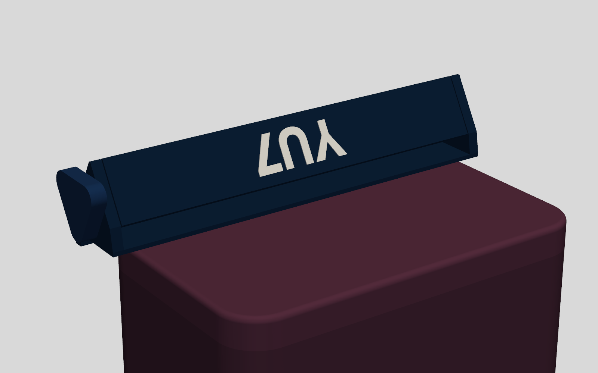
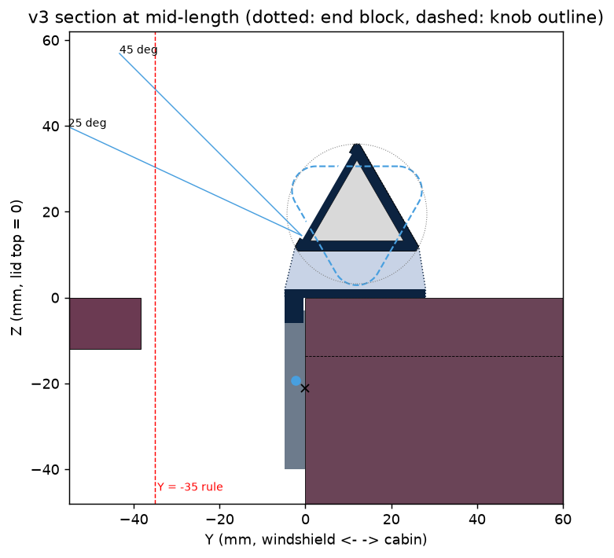
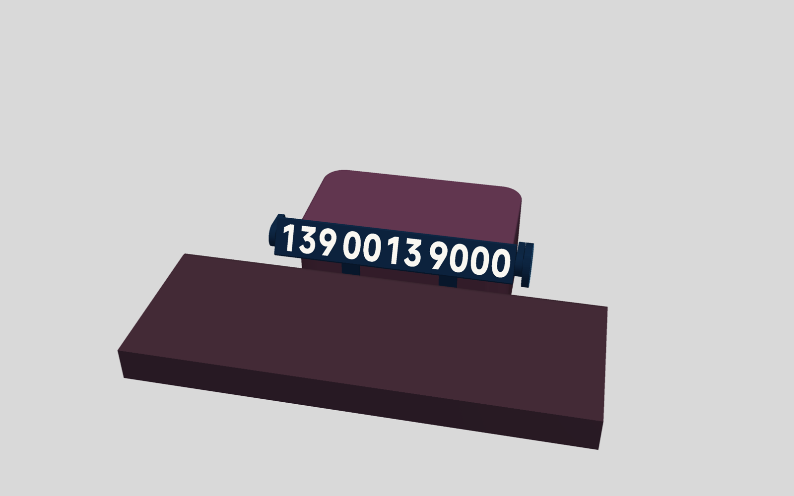
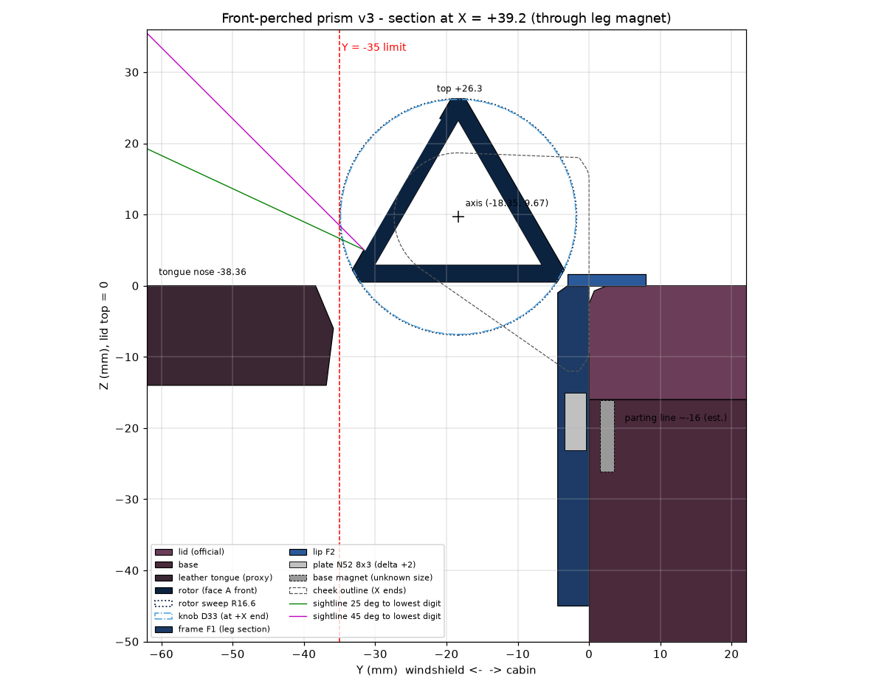
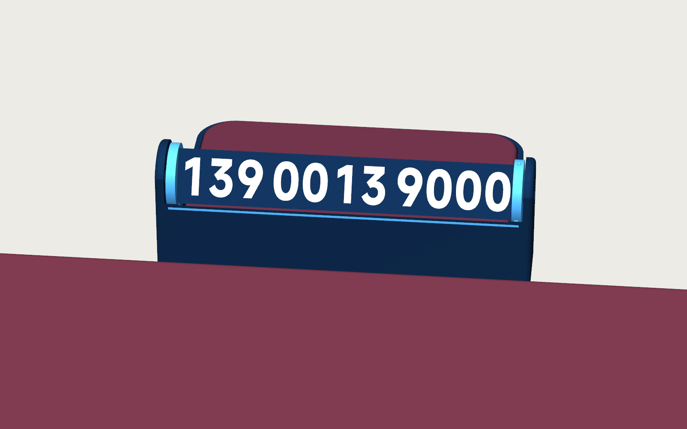
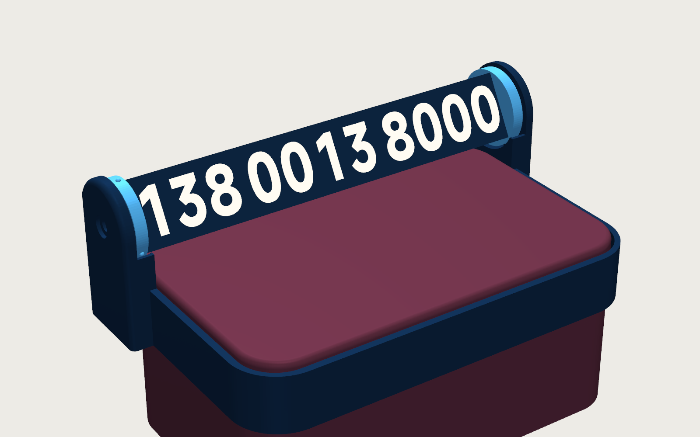
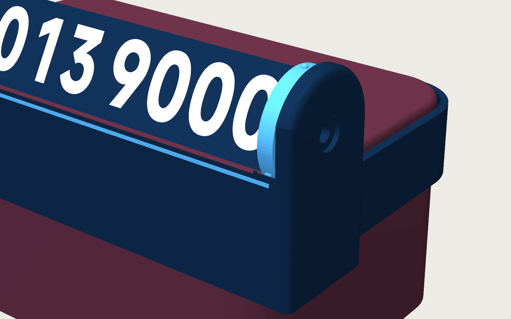

# YU7 纸巾盒旋转挪车号码牌 — v3 技术设计文档（待评审）

## 1 设计目标

站在车头往挡风玻璃里看，纸巾盒上盖前沿横卧着一根约 20 cm 长的藏青三棱柱，白色号码字高 20.9 mm（v2 是 15 mm，大 39%）。俯视 25–45°、左右斜看 45° 以内都能完整读出。棱柱下方是一条带天蓝细线的藏青横梁，两片圆头挂片正好吸在底座原厂磁点上，看上去像原厂配件。坐在主驾，伸手往下按主驾端倒三角（∇）旋钮的一个角，"咔"一声换一面：按后角依次 A → B → Logo；按前角反向，转出去的正是车内此刻看到的那一面。旋钮顶边的字母和凸点告诉你现在朝外的是哪一面。补纸时照常提上盖，牌子坐在盖上一起走，盖回去时挂片自己吸回磁点。整件约 75 g，不用工具，不在盒上涂胶，1 秒取下。夏天暴晒、正常过坎都不松、不跳。

验收目标：字高 ≥ 20 mm；任何零件都在 Y ≥ −35 以内；总长 ≤ 200 mm；重量靠盖顶机械承担；80 ℃、底座磁铁按最弱假设时，所有正常操作仍有 ≥ 1.5 倍余量；不加支撑即可打印；不超过 10 颗磁铁。

## 2 已验证的事实与约束

**2.1 用户 2026-10-13 车内验证**（v2 的纸样测试、HUD 高度决策表、后罩、"不许前伸"等限制，均因这次验证而取消）
- 天际屏/HUD 不受影响：盒子在中控屏后方，且远低于屏幕上沿，因此高度不设上限。
- 车内面的倒影只出现在前挡右上角（纸样实测是 YU7 面），用户可接受，所以不需要后罩。纸巾倒伏、主驾够不着端部，都不成问题。
- 盒前侧面到皮面舌尖 38.36 mm（盖顶高度）。舌下镀铬饰条：照片估计到 Z −35 都 ≥ 38 mm，Z −60 处约 23 mm。
- 两端无障碍，总长（含旋钮）软上限 200 mm。上方空旷。
- 车外站姿能看到盒子上半部及以上部分；行人俯视约 25–45°，距离 0.5–2 m；纸样号码清晰可读（照片 011617）。
- 底座前侧两个磁点是磁铁（试验 N52 一面吸、一面斥），各点极性未知。
- 凹槽夏季实测 66–76 ℃，官方称可能 > 90 ℃。Bambu ABS 的 HDT 为 84/87 ℃；N52 薄片从 60–70 ℃ 起有不可逆退磁。

**2.2 测量表**（英制一栏是卡尺显示值，末尾的 5 表示再加 0.0005 in）

| 项目 | 英制读数 | mm | 来源 |
|---|---|---|---|
| 前磁点中心 → 最近端面 | 1.852 in | 47.04 → X = ±39.21 | 照片 013600 |
| 前磁点中心 → 盖顶 | 0.829(5) in | 21.07 → Z = −21.07 | 照片 013640 |
| 上盖外宽 / 内宽 | 4.226(5) / 4.013(5) in | 107.35 / 101.94 | 照片 012505 / 012435；裙边壁厚约 2.7 |
| 底座开口内宽 | 3.830 in | 97.28 | 照片 012350，用户确认 |
| 上盖裙边高（盖顶 → 接缝） | — | 13.62 | 毫米档，照片 095859；磁点在接缝下 7.45 |
| 盒前侧面 → 皮面舌尖 | — | 38.36 | 毫米档，照片 012056 |
| 小米磁吸按键直径 | 1.171 in | 29.74 | 用于推算俯视圆角：内约 15.5、外约 18（±1.5） |
| 盒外形 | — | 172.5 × 107.5 × 77.5（铭牌）；长度卷尺量约 172 | |

未验证（估计值）：盖顶前棱圆角 2–3 mm；出纸口前沿距前侧面 44–49 mm；底座磁铁的规格和上方壁厚（2–3 mm）。

**2.3 设计规则**：Y ≥ −35（v3 实际 ≥ −4.8）；重量走机械路径，磁铁只负责定位、档位和防跳；不用常载的塑料弹片或卡扣；磁铁一律打印后再压入，并先试极性；磁铁孔壁 ≥ 1.2 mm；轴承用闭口孔 + 轴向插销 + 带键六角；转子用斜接管；每一步装配动作都要做构型检查；号码只存在本地。

## 3 方案总览

**推荐：盖顶卧式三棱柱 + 底座磁点挂片 + ∇ 摇杆旋钮。**

来历：4 个设计 agent 各从一个角度出概念（前悬式、盖顶冠式、机构花样、一体化造型），两位评审分别从用户价值和工程两个角度复核数字、打分。推荐方案综合分最高，也没有致命缺陷。它以"机构花样"为底，嫁接了其他方案的长处：
- 磁铁比磁点高 1.75 mm，产生向下的预紧。
- 旋钮端面印 A / B / ◆，并做触觉码。
- 端块不超出棱柱轮廓，首末位数字不会被挡。
- 平整的藏青前脸，加一条天蓝细线。

评审核实的错误都已修正，例如前悬式的扫掠半径算错，离 −35 线只剩 0.02 mm；围圈式的磁铁偏置方向反了。盖顶冠式要在出纸口里插槽键，会夹纸，而且依赖没量过的槽位，不采用。

| | **推荐 v3** | 备选 1：前悬式 | 备选 2：围圈式（Halo） |
|---|---|---|---|
| 位置 | 盖顶前沿，转轴在盖面上方 | 整件悬在盒前（Y −35…0） | 藏青围圈像领口一样套住上盖，前端升起数字板 |
| 字高 / 总长 / 高出盖顶 | 20.9 / 199.8 / 36.1 | 20.5 / 199.4 / 26.3 | 19.9 / 198 / 38 |
| 重量 / 磁铁 | 约 72–77 g / 6 颗 | 68 g / 6 颗 | 122 g / 12 颗 |
| 补纸 | 直接提盖，牌子随盖走 | 必须先摘牌，否则会翻进前缝 | 围圈随盖走，或先摘下 |
| 外观 | 干净的工具感，上盖其余部分保持原样 | 最低调，盖顶上什么都没有 | 最像原厂配件、最大气；上盖四周多一圈藏青 |
| 主要代价 | 往前推棱柱是弱方向，1.2–1.9 N 就会撬离磁点（松手自动吸回） | 防前翻长期靠磁铁；重心悬在前缝上 | 围圈与上盖只有 0.25–0.6 mm 配合，依赖盒长、圆角的精确值，要先打一圈约 5 g 的薄试配环；盒子后方要有约 3 mm 余量（未确认） |

推荐方案（示意渲染，号码为示例号）：







备选 1 前悬式 / 备选 2 围圈式：







**怎么选**：想要最稳、最轻、补纸最省事，选推荐方案。更看重"原厂配件感"、愿意多打一个试配环，选围圈式。后续可以把推荐方案的 ∇ 旋钮、挂片磁铁偏置和大字排版移植过去。

## 4 详细设计

**4.1 坐标**：X 沿盒长，+X 为主驾侧；Y 由前挡指向座舱，盒前侧面 Y = 0；Z 向上，盖顶 Z = 0。转角 θ 绕 +X 轴，从主驾侧看为逆时针。

**4.2 零件**（全部"打完再压磁铁"，打印不暂停）

| 件 | 内容 | 颜色 | 打印方向 |
|---|---|---|---|
| C 托架 | 唇板 + 两端三角端块（含闭口轴孔、定子孔、内止推环），一体 | 藏青 | 唇板底面贴床；轴孔、定子孔做泪滴 |
| F 前横梁 | 横梁 + 两条 U 形挂片（含磁铁孔） | 藏青 + 天蓝细线 | 前表面贴纹理 PEI；磁铁孔底为 0.8 mm 桥接 |
| PA / PB / PL | 三块面板：号码 A、号码 B、Logo（YU7 + 天蓝线） | 藏青 + 白字 | 正面朝下，四角 mouse ear |
| E ×2 | 三角端塞：近端带键六角孔，远端为 Ø6 销孔 | 藏青 | 三角面朝下 |
| K | ∇ 旋钮，与 Ø6 轴颈、带键六角一体 | 藏青 + 白字 + 天蓝环 | 外端面朝下 |
| P | 远端销 Ø6 × 13，带 Ø2.5 拔销孔（多打 1 根备用） | 藏青 | 竖打，外端朝下 |
| D ×2 | 挂片盖片 Ø8.2 × 0.8 | 天蓝 | 平放 |
| M ×6 | N52 Ø8×3：挂片 2、旋钮 3、定子 1 | — | 压入 + 502 |

**4.3 托架与安装**
- **唇板**：厚 2.0，X −96…+96，Y −4.8…+28。在 Y 2.5–28 范围压住盖顶前带，避开前棱圆角，承担全部重量。重心在盖前沿后 9.6 mm，不靠磁铁也坐得稳。
- **前横梁**：Z −6…0，与盖裙之间留 0.4 mm，平时不接触，提盖时才兜住牌子。用 3 段 1.75 mm 耗材作定位销，再用 ABS 浆或 502 粘到唇板前沿下方，粘接面 4.4 × 192 mm。
- **挂片**：宽 20，下端 R10 到 Z −40，背面贴底座前侧面。磁铁孔从正面开口，朝盒一侧留 0.8 mm 底：磁力把磁铁压在底上，属于机械锁住，不靠胶；装车后这层底由盒面顶住，不受弯。这层底比 1.2 mm 规则薄，是有意的例外，盘 0 验证。孔口压天蓝盖片。
- **偏置**：磁铁中心比底座磁点高 1.75 mm（Z −19.32），剪切力把整件往下拉，防跳。
- **吸力**（底座磁铁未知，按 Ø8×2 N35 到 Ø15×3 N38、壁厚 2–3 mm 估算，磁荷模型按简报 8.6 N 校准）：每点法向 1.62–4.21 N、下拉 0.58–1.30 N（20 ℃）；80 ℃ 时为 1.40–3.62 N 和 0.50–1.12 N。改叠 2 颗为 2.21–5.98 N。
- **刚体 LP 校核**（80 ℃ 最弱 / 20 ℃ 典型，μ = 0.35）：往下按旋钮角不限；捏扭 98 / 156 N·mm（需 56）；旋钮端下压 13.8 / 20.7 N（需 5）；刹车 2.4 / 3.8 g；离地需总加速度 4.6 / 6.4 g；侧向 2.1 / 3.3 g。弱方向是往前推棱柱顶：1.22 / 1.94 N。μ 取 0.25 时捏扭 82 N·mm、前推 1.06 N。
- **拆装**：竖直放下，挂片顺盒面滑下后"啪"地吸正；竖直提起约 3–7 N（含自重）。

**4.4 转子**
- 正三角 s = 30，棱倒角 1.2，面平宽 27.6，真扫掠半径（倒角角点）16.29。三块 2.4 mm 面板 30° 斜接，长 181.0（X ±90.5），两端塞三角端塞；静平衡，振动不自转。
- 轴心 Y +12.0、Z +19.5；静止时底面水平（Z 10.84），显示面法线朝前挡、仰 30°。扫掠圆到唇板 1.21；近端到内止推环 0.2，远端 0.5。
- 闭口轴孔：近端 Ø6.3、远端 Ø6.1。旋钮销穿过近端块，以单向键六角（AF 5.0）轻压进近端塞；远端销轻压进远端塞。

**4.5 档位与 ∇ 旋钮**
- **旋钮**：3 个 R5.6 圆角（中心 r 11），角尖 r 16.6，厚 7，内侧凸台高 0.8。三个角各压一颗 N52；近端块轴心正下方 r 11.5 处压一颗定子（外移 0.5 mm）；磁铁面间距 1.2。
- **磁荷模型**：峰值 42.7 N·mm @20°（80 ℃ 36.7，再计 15% 不可逆损失为 31.2）；刚度 4.76 N·mm/°；轴向吸力 8.33 N；径向下压 1.0 N，近端轴颈不响。干摩擦 12.8 N·mm，峰值/摩擦 = 3.3，停位 ±2.7°（凸台涂 PTFE 约 ±1.3°）。
- **死区与回摆**：中点死区干摩擦 ±6.6°、PTFE ±4.0°；过死区后自动吸到下一档，干摩擦过冲约 23°、回摆 4 次、0.13 s 停稳。止推面抹一点阻尼脂（可选）可几乎无过冲。
- **手势**：按后角（靠座舱）一下为 A → B → Logo；按前角为反向，即把车内看到的那面转出去。任意两态之间只需按一下。往下按约 4–5 N，捏住扭转约 56 N·mm。
- **状态**：旋钮顶边对应当前朝外的面，外端面印 A / B / ◆（白字）；三条边分别做 1 点、2 点、1 横棱，盲摸也能分辨。

| 朝外 | 车内看到（倒置） | 旋钮顶边 |
|---|---|---|
| A | Logo | A，1 点 |
| B | A | B，2 点 |
| Logo | B | ◆，横棱 |

**4.6 字体与排版**
- MiSans Bold，em 26.73，横向压缩 0.86：平头字高 20.85 mm，圆头 21.60 mm。等宽格 13.98 + 1.8，3-4-4 分组，组间另加 3.5；格框 X −90.37…+88.37。首位必然是"1"，远端墨迹距转子端 3.2，近端 2.13；面上下留白 3.0。
- 光栅形态学检查：笔画 ≥ 2.8 mm（"1"的竖笔 3.84），字孔 ≥ 0.6 mm。白字嵌入 0.8 mm（4 层）。号码不满足"11 位、以 1 开头"直接报错，不自动缩字。

**4.7 配色**：藏青 40602 是主体；白 40100 用于号码、字母和 YU7；天蓝 40601 只用在横梁细线、挂片盖片、旋钮外环和 Logo 线条。

**4.8 关键参数表**

| 参数 | 值 | 参数 | 值 |
|---|---|---|---|
| 总长 X | −96.0…+103.8 = 199.8 | 高出盖顶 | 35.8（静止）/ 36.1（扫掠） |
| 最前点 Y | −4.8（距 −35 线 30.2，距舌尖 33.6） | 最低点 Z | −40（挂片底） |
| 端块 | X ±91…±96，厚 5 | 旋钮 | X 96.8…103.8 |
| 车外可见 | 俯视 15–45°、侧偏 ±45° 内 100%；侧偏 50–60° 时近端才开始被遮 | 最低字线 | Z 14.5，25° 视线越过舌尖时高 32 mm |
| 旋钮扫掠 → 盒子 / 横梁 | 11.9 / 6.6 | 转子 → 横梁 | 6.8 |
| 挂片磁铁 | 中心 Z −19.32（+1.75），孔底 0.8 | 档位磁铁面距 | 1.2（凸台 0.8 是手感参数） |

**4.9 重量**（切片为纯藏青实测，CAD 为体积 × 填充率估算）：面板 3 × 11.0 g（CAD 11.7）、托架 17.0、前横梁 8.4、旋钮 + 2 端塞 + 2 销 6.8、磁铁 6.8、盖片 0.1，合计约 72 g（CAD 76.5，实心上限 80.8）。转子组件约 46 g，绕轴转动惯量 4.8e-6 kg·m²。

## 5 打印方案

通用设置：P1S、0.4 喷嘴、Bambu ABS、0.20 mm Standard、纹理 PEI 90–100 ℃ 并涂胶；关门、盖顶盖，开打前预热 10–15 min；耗材 80 ℃ 烘 8 h；收缩率设 99.4%。**全程不暂停、不埋磁铁。** AMS 槽位：1 白、2 天蓝、3 藏青。以下时间由 Bambu Studio CLI 纯藏青切片得出，换色时间为估计值。

| 盘 | 内容 | 设置 | 时间 / 用料 |
|---|---|---|---|
| 0 试配 | ① 挂片 + 40 mm 横梁段，分 1 颗、2 颗磁铁深度两版；② 近端块切片 + 正式旋钮，测手感和死区；③ 孔径条 Ø6.0–6.3 + 2 根销，与托架同向打印；④ 2 字面板段，白字 3/4/5 层对比；⑤ 30 mm 三面短管 + 端塞 | 藏青，④ 加白 | 约 1 h（估） |
| 1 | PA / PB / PL 三块面板同盘 | 100% 填充，白字前 4 层 | 50 min / 33 g，另加换色约 15–25 min |
| 2 | 托架 C | 4 墙，25% gyroid，brim 5 | 56 min / 17 g，无警告 |
| 3 | 前横梁 F + 旋钮 K + 2 端塞 + 2 销 + 2 盖片 | 4 墙；横梁细线、旋钮字占前 3–4 层 | 44 min / 15 g，另加换色约 10–15 min |

可选：未装磁铁的面板在平整支撑上 80 ℃ 退火 1 h。

## 6 装配与使用

1. **统一极性**：6 颗磁铁吸成一摞，在朝上一面画点。
2. **挂片磁铁**（每个磁点单独试）：拿一颗磁铁靠近左侧磁点，记下被吸的那一面，让这一面先进、朝盒子方向压入左挂片孔，压上盖片。右侧重复，两侧可以不同。
3. **档位磁铁**：旋钮 3 颗画点面朝外，压入点 502；定子先干压，旋钮贴上去转一圈，三下清脆吸合才点胶，被推开就翻面。
4. **前横梁**：插好 3 段定位耗材，接触面涂 ABS 浆或 502，压到托架唇板前沿下方，固化。
5. **粘管**：三块面板正面朝上排成一排（A、B、Logo），A 的字底边接 B 的字头边，B 的字底边接 Logo 的字头边。两道缝贴胶带后翻面，V 槽填 ABS 浆或凝胶 502，折成三角封第三道缝；立即塞入端塞，近端塞的键（箭头）对准 A 字头那条棱。每 30 mm 绕一道橡皮筋，在玻璃上固化，再滚动检查各面平整。
6. **装转子**：转子从上方竖直放进两端块之间。远端销从 −X 外侧穿过远端孔，木槌轻敲进远端塞。远端夹一张开口纸垫（0.5 mm），把旋钮销从 +X 外侧穿过近端孔，转到键对上后压入，直到凸台贴住端块；抽出纸垫，这样远端间隙 0.5、近端 0.2。
7. **自检**：A 朝外时旋钮顶边应显示 A；三档都应清脆；转一圈不擦唇板。
8. **上车**：把牌子竖直放到盖顶前沿，挂片自己吸正。
9. **换号码**：拔下旋钮；往远端销 Ø2.5 孔里拧 M3 自攻螺钉，拔出远端销；取出转子，换管。
- 以上竖直放入、两根销轴向插入、整件放下、带牌提盖，均经构型检查：交体积为 0。

**补纸（默认：牌子随盖走）**：照常捏住上盖两短边，保持大致水平提起，牌子坐在盖上一起走，挂片离开磁点时多出 2–7 N。补完盖回去，挂片自己吸回。限制有两条：上盖前倾超过 19–27° 时牌子会滑落（倾覆角 42°）；挂片比接缝低 26 mm，带着牌子的上盖不能平放。要把盖子放下时，先竖直取下牌子（1 秒）再开盖。

## 7 软件实现与交付物

- **模型**：build123d 0.13 参数化工程，把 `concept/v3/verify_v3.py` 的几何和检查拆成 `params / text_layout / rotor / cradle / front_bar / knob / checks / export / bambu` 几个模块。一条命令完成：建模 → 检查 → 导出 → 切片 → 渲染。字体只从本地 `fonts/` 读取，所有 Text 都显式传 `font_path`。
- **config.toml**（号码只在本地，已在 .gitignore 中）：

```toml
[numbers]          # local only, never upload
a = "13800138000"
b = "13900139000"
[display]
logo = "YU7"       # YU7 | XIAOMI | pattern
condense = 0.86
white_layers = 4
[mount]
stack = 1          # 2 if pull test < 2 N per point
delta_up = 1.75    # magnet centre above base point
[detent]
boss_h = 0.8       # 0.8 -> 1.1 lowers torque ~12 %
[box]              # measured mm
skirt = 13.62
mag_from_end = 47.04
mag_below_top = 21.07
top_fillet = 2.5   # estimate
```

- **每次生成都跑的自动检查**：① 排版（长度、面宽、留白、笔画、字孔、号码格式）；② 扫掠半径按倒角角点算，到唇板 ≥ 1.0；③ 静态干涉为 0，0–120° 扫掠间隙达标；④ 包络 Y ≥ −32（离规则线留 3 mm）、总长 ≤ 200；⑤ 构型路径（放下、转子放入、两根销、提盖）；⑥ 车外射线：俯视 15–45° × 侧偏 ±45° 全部可见；⑦ 磁荷模型：安装吸力范围、峰值/摩擦 ≥ 2.5、死区与回摆；⑧ 刚体 LP（80 ℃ 最弱）：捏扭 ≥ 1.5 倍、按压 ≥ 2 倍、刹车 ≥ 1.5 g、离地 ≥ 3 g；⑨ 孔壁 ≥ 1.2（挂片孔底除外）；⑩ 每盘 CLI 切片无警告，报告时间和克重。
- **交付物**：`plate0…3.3mf`（带好耗材分配）、STEP/STL、渲染图、`report.md`（检查结果 + 切片时间/克重/换色次数），另附中文装配卡。
- **隐私**：含号码的 3MF 只在本地切片，用局域网或 SD 卡打印，不上传 MakerWorld；拓竹云打印也会上传 3MF，不要用。

## 8 风险与对策

| 风险 | 对策 | 级别 |
|---|---|---|
| 底座磁铁未知，80 ℃ 最弱时每点只有 1.4 N | 盘 0 挂片实测；常温 < 2 N/点就改叠 2 颗（stack = 2，挂片加厚 3.2） | 中 |
| 往前推棱柱或旋钮会撬离磁点（1.2–1.9 N） | ∇ 造型引导往下按；撬起时唇板仍压在盖上，松手自动吸回；说明书写明 | 中 |
| N52 高温不可逆退磁 | 已按 −15% 校核，档位仍有 31 N·mm；有条件换 N42SH/N38SH，尺寸相同 | 中 |
| 181 mm 粘接管弯或扭 | 胶带铰链、端塞定形、在玻璃上固化；装前空转检查；径向留 1.2 | 中 |
| 托架 2 mm 唇板平打翘曲 | brim 5 mm、涂胶、90–100 ℃、关门；装配时用纸垫设定间隙；转子销把两端块连成一体 | 中 |
| 干摩擦档位有 ±6.6° 死区，回摆 0.13 s | 正常按压会一路越过死区；可涂 PTFE 缩小死区，或抹阻尼脂消除回摆 | 低-中 |
| 远端轴颈只靠重力，大坑可能轻"嗒" | 盘 0 选最紧的孔；可选毛毡垫或一点硅脂 | 低 |
| 提盖时前倾超过 19° 牌子滑落 | 保持水平；需要翻盖放下时先取牌 | 低 |
| 近端块长期受 8.3 N 磁力偶，高温蠕变 ≤ 0.2 mm | 后果是扭矩约 +10%，可接受；可选退火 | 低 |
| 左挂片可能压住底座 xiaomi life 标（位置未测） | 盘 0 试件时看；挂片宽度是参数 | 低 |
| 端块 60° 斜面竖打有层纹，与面板的纹理面不一致 | 托架改 0.16 mm 层高，或接受 | 低 |

## 9 需要你确认的事（其余都由盘 0 试配件在实车上直接验证）

0. **方向**：推荐方案 / 备选 1 前悬式 / 备选 2 围圈式（见 §3）。选围圈式的话，再确认盒子后方（朝座舱一侧）上盖高度处有没有 ≥ 3 mm 空隙。
1. 手势与面序：后角 = A → B → Logo，前角 = 反向。A 朝外时车内看到的是倒置的 Logo。Logo 用默认的 YU7 + 天蓝线可以吗？
2. 补纸默认"带牌提盖"可以吗？（另一种是先取牌 1 秒再开盖。）
3. 手上 N52 Ø8×3 是否 ≥ 8 颗（6 颗用 + 2 颗备用）？家里有没有丙酮？没有的话粘接全部改用凝胶 502。PTFE 干膜和阻尼脂都是可选项。

## 10 实施计划

1. 评审通过后建参数化工程，自动检查全部通过。
2. 出盘 0（约 1 h 打印 + 10 min 实车）。请回传：两侧磁点的拉力和极性、档位手感（死区/回摆）、白字层数、选定的孔径。
3. 按回传结果调参，出盘 1–3 的 3MF、STEP/STL、装配卡和切片报告。
4. 装车用一周，反馈异响和手感，再微调凸台高度、孔径和 stack。

## 附录

**A 参考**：设计输入 `concept/v3/2026-1013-1040-v3-design-brief.md`；4 个概念与 2 份评审的完整结果 `concept/v3/concepts_and_judgements.json`；数值复核脚本 `concept/v3/verify_v3.py`（全部数值可复跑，输出 `verify_output.txt`、`report.json`）；切片 `concept/v3/run_slice.py` 与 `slice_summary.json`；渲染图 `concept/renders/v3_*.png`；v2 文档已归档到 `docs/archive/`；外部资料（字体授权、官方资料、Bambu ABS TDS、N52 数据表）同 v2 附录 A。

**B 文档信息**
- 状态：**待用户评审**（需要选定方向：推荐 / 备选 1 / 备选 2）。作者 Claude，完成于 2026-10-13 10:57。
- 版本历史：
  - **v1**（10-12 14:39）：三棱柱面板用燕尾插槽，U 形卡入轴承，打印中途埋磁铁。审查确认：槽会切穿棱、卡扣没有过盈、热床会让磁铁退磁，被推翻。
  - **v2**（10-12 16:37）：改为斜接管转子、闭口轴承 + 键六角、定位塞 + 锁销，并加后罩，配纸样测试和 HUD 高度决策表；15 mm 字，约 46 g。用户实车验证后指出这些限制是臆测，整体过于保守。
  - **v3**（本稿）：删去已被车内验证排除的纸样测试、HUD 决策表、后罩和"不许前伸"；按用户要求改用底座前磁点固定；4 个概念经两位评审打分后综合，并修正评审核实的错误。结果：字高 15 → 20.9 mm，约 75 g，磁铁 6 颗，打印件 8 种；全部数值由 `verify_v3.py` 和 CLI 切片复核。
