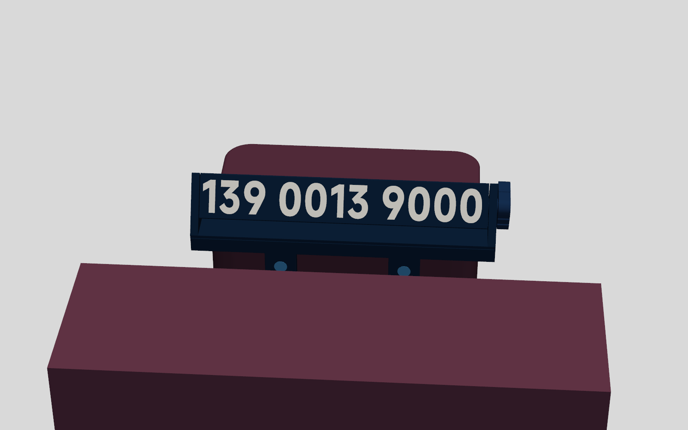
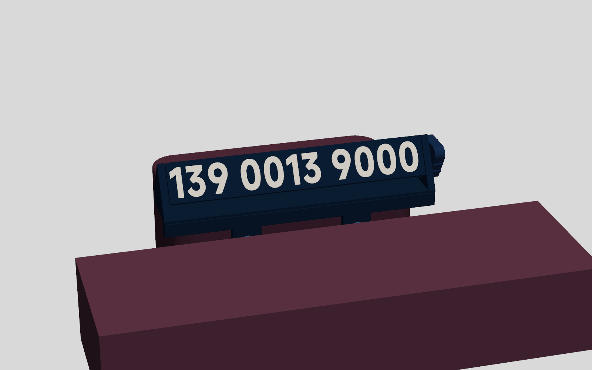
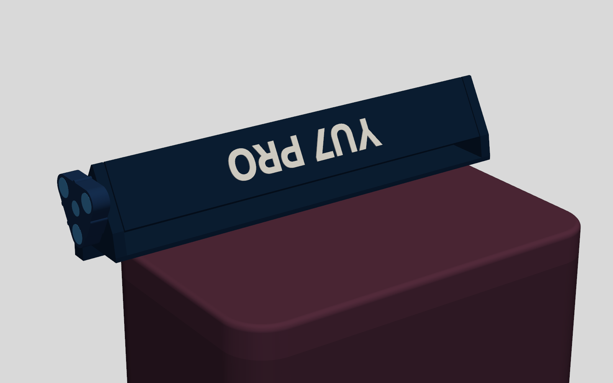
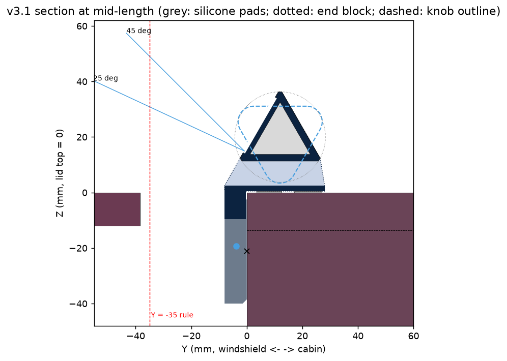
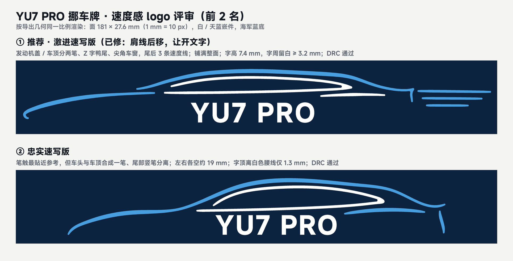

# YU7 纸巾盒旋转挪车号码牌 — v3.1 技术设计文档（评审修订稿，待确认 §9）

## 1 设计目标

站在车头往挡风玻璃里看，纸巾盒上盖前沿横卧着一根 20 cm 长的藏青三棱柱，白色号码字高 20.9 mm（v2 是 15 mm，大 39%），按 3-4-4 分组、组间留出明显空隙，俯视 25–45°、左右斜看 45° 以内都能完整读出。棱柱下方是带天蓝细线的藏青横梁，两片圆头挂片吸在底座原厂磁点上，看上去像原厂配件。坐在主驾伸手，竖直往下（或往自己这边）按 ∇ 旋钮靠座舱的角，"咔"一声换到下一面 A → B → Logo；竖直按靠前挡的角回到上一面；不用往前推。不用看，摸旋钮顶边就知道朝外的是哪一面：1 条棱是 A，2 条棱是 B，宽棱是 Logo。补纸时双手捏住上盖两短边水平提起，牌子靠底下的硅胶防滑条坐在盖上一起走，盖回去时挂片自己吸回磁点。整件约 90 g，不用工具，不在盒上涂胶，1 秒取下；夏天暴晒、正常过坎都不松、不跳、不响。

验收目标：字高 ≥ 20 mm；任何零件都在 Y ≥ −35 以内；总长 ≤ 200 mm；重量靠盖顶机械承担；80 ℃、底座磁铁按最弱假设（含不可逆退磁）时，文档写明的手势 ≥ 1.5 倍、竖直按 ≥ 2 倍、捏扭 ≥ 1.5 倍、刹车 ≥ 1.5 g、离地 ≥ 3 g；每颗磁铁都由磁力压在打印的底或壁上，胶只作辅助；不加支撑即可打印；粘接只用凝胶 502。

## 2 已验证的事实与约束

**2.1 用户 2026-10-13 车内验证**（v2 的纸样测试、HUD 决策表、后罩、"不许前伸"等限制均已取消）
- 天际屏/HUD 不受影响：盒子在中控屏后方且远低于屏幕上沿，高度不设上限；车内面倒影只在前挡右上角，可接受，不要后罩；纸巾倒伏、够不着端部都不是问题。
- 盒前侧面到皮面舌尖 38.36 mm（盖顶高度）。舌下镀铬饰条照片估计到 Z −35 都 ≥ 38 mm，但它在盒中部（X ≈ +1…+16），不在挂片前方。
- 两端无障碍，总长软上限 200 mm；上方空旷。车外行人俯视约 25–45°、距离 0.5–2 m；纸样号码清晰可读（照片 011617）。
- 底座前侧两个磁点是磁铁（N52 一面吸、一面斥），各点极性未知。
- 凹槽夏季实测 66–76 ℃，官方称可能 > 90 ℃；Bambu ABS HDT 84/87 ℃；N52 薄片 60–70 ℃ 起有不可逆退磁。
- N52 Ø8×3 充足；家里没有丙酮。

**2.2 测量表**（英制一栏是卡尺显示值，末尾的 5 表示再加 0.0005 in）

| 项目 | 英制读数 | mm | 来源 |
|---|---|---|---|
| 前磁点中心 → 最近端面 | 1.852 in | 47.04 → X = ±39.21 | 照片 013600 |
| 前磁点中心 → 盖顶 | 0.829(5) in | 21.07 → Z = −21.07 | 照片 013640 |
| 上盖外宽 / 内宽 | 4.226(5) / 4.013(5) in | 107.35 / 101.94 | 照片 012505 / 012435；裙边壁厚约 2.7 |
| 底座开口内宽 | 3.830 in | 97.28 | 照片 012350，用户确认 |
| 上盖裙边高（盖顶 → 接缝） | — | 13.62 | 毫米档，照片 095859；磁点在接缝下 7.45 |
| 盒前侧面 → 皮面舌尖 | — | 38.36 | 毫米档，照片 012056 |
| 小米磁吸按键直径 | 1.171 in | 29.74 | 推算俯视圆角：内约 15.5、外约 18（±1.5） |
| 盒外形 | — | 172.5 × 107.5 × 77.5（铭牌）；长度卷尺量约 172 | |

未验证（估计值）：盖顶前棱圆角 2–3 mm；出纸口前沿距前侧面 44–49 mm；底座磁铁规格和上方壁厚（2–3 mm）；挂片位置（X ±29…49）盒前方到 Z −40 有没有 8 mm 空间。

**2.3 设计规则**：Y ≥ −35（v3.1 实际 ≥ −8.0）；重量走机械路径，磁铁只负责定位、档位和防跳；不用常载的塑料弹片或卡扣；**磁铁一律装在吸力把它压向打印底的方向，胶只作辅助**；打印后再装磁铁并先试极性；磁铁孔壁 ≥ 1.2 mm（受压 0.8 底除外）；水平孔一律泪滴；闭口轴孔 + 轴向插销 + 带键六角；斜接管转子；每一步装配都做构型检查；号码只在本地；**只用凝胶 502，不用丙酮或 ABS 浆**。

## 3 方案总览

**已选定：盖顶卧式三棱柱 + 底座磁点挂片 + ∇ 摇杆旋钮**（用户 2026-10-13 选"推荐方案"；与前悬式、围圈式的比较见 v3 稿 §3）。

**3.1 用户决定（2026-10-13）**：① 方向 = 推荐方案；② 面序 A → B → Logo 保留；Logo 面为 YU7 车身侧面流线 + "YU7 PRO"，用户选了流线方案 B 并要求更有速度感，已出 3 个速写变体待选（§4.6）；③ 补纸默认"牌子随盖走"保留（评审有新证据，见 §9-1）；④ 磁铁充足 → 挂片默认每片 2 颗、全件 11 颗；没有丙酮 → 全部粘接用凝胶 502 或从设计上取消。

v3.1 渲染（示例号码；渲染里的 Logo 面是占位，速度感 Logo 见 §4.6）：







**3.2 评审修订（v3 → v3.1）**：四路评审（机构装配、安装受力与高温、打印制造、可见性与使用）复核后，确认的问题按最佳方案改，存疑的改起来便宜就改、否则做盘 0 试验。

1. **档位磁铁反装**（MA-1/PM-7）：原稿磁铁开口相对，8.3 N 把磁铁往孔外拉、只靠 502；改为吸力压在 0.8 底/壁上（旋钮孔从外端面开、每角 2 颗加盖片；定子孔从块内侧开、背后垫片），凸台 0.6、面距 2.2；峰值 42.7 → 36.9 N·mm，比值 3.33 → 3.53，死区 ±6.6° → ±3.7°。
2. **轴向链**（MA-3）：原六角滑配、端塞无止口也不粘，转子可窜 0.7 mm；改为 16 mm 近端塞 + 键六角盲孔（孔底定近端间隙 0.2）+ M3×25 轴向自攻螺钉锁住旋钮与转子，端塞凝胶 502 粘平。
3. **横孔泪滴、远端销固定**（PM-4/MA-5）：三个水平孔改 45° 泪滴；远端销轻压在端块里不转，转子远端塞的竖打 Ø6.1 圆孔作转动面，装销不再隔着转子敲。
4. **唇板硅胶防滑条**（MLH-1/VU-1）：斜按时整件先偏转撬离近端磁点；唇板下贴两条 0.5 mm 硅胶条（μ≈0.8），挂片孔同步下移 0.5；80 ℃ 最弱前倾极限（1.5 倍）30° → 44°。
5. **手势改写**（VU-1）：下一面 = 竖直或往自己方向按座舱侧角；上一面 = 竖直按前挡侧角；不要往前推；删去"∇ 造型引导下按"这条对策。
6. **检查⑧改 3D 刚体 LP**（VU-1/MLH-1）：真实盖顶平面（R15.5 角）、两挂片分开、沿转角路径扫按压方向并计入按压自带摩擦；原 2D LP 合并两挂片，看不到偏转。
7. **离地公式**（MLH-3）：离地所需向下加速度 = λ/W，原稿多算 1 g（4.6 → 3.6 g）。
8. **挂片默认 stack 2**（MLH-2）：复核认为按盘 0 规则 stack 1 也够，但 v3.1 加重到约 90 g 后 stack 1 在 80 ℃ 最弱离地只要 2.8 g（< 3 g），stack 2 为 3.3 g，不可逆退磁 ≤ 2.3%（stack 1 为 3–16%）；挂片厚、孔深、前脸由 stack 推导，校核计入不可逆系数。
9. **档位力偶回路**（MLH-4）：横梁加深到 10 mm 并全长连续涂胶，I 402 → 1988 mm⁴；90 ℃、E 100 MPa 时近端唇板抬起 0.8–2.1 → 0.07–0.20 mm；远端孔默认抹硅脂；热检查改为转子平衡 + 托架梁模型。
10. **挂片导向倒角**（MLH-5/VU-3）：背面四周 1.5 × 45°，回装不卡接缝；下端 Z −40 改为配置项。
11. **全用凝胶 502**（MA-4/PM-6/PM-9）：分步粘管、端塞当型芯；横梁加 3 个 Ø1.9 定位销孔、玻璃上夹紧、全长连续胶线；前脸周边 0.4 倒角（吃象脚、藏胶缝）。
12. **触觉码落到 CAD**（VU-4）：三条边做沿 X 的竖棱，A 1 条、B 2 条、Logo 8 mm 宽棱，打印无悬垂。
13. **比例排版**（VU-5）：等宽格让"1"两边空隙和组间一样大；改为组内墨迹间距 2.8、组间 9 mm（≥ 2 倍），放不下才回到等宽格，字号不变。
14. **近端塞止推面朝上打**（PM-10）：顶面光滑；μ 0.45 时比值 2.75、死区 ±4.8°。
15. **Logo 可打印规则**（PM-2）：写入 §4.6。
16. **切片规则**（PM-1/PM-3/PM-11）：多色件导出为"一个对象 + 多个零件"（否则象脚补偿在字边切出空槽）；擦料塔位置和冲洗矩阵显式设置；收缩 99.4% 写入配置；§5 用实测时间。

不采纳（复核不成立）：象脚补偿改 0（PM-1）；为唇板翘曲改几何（PM-5，只在粘横梁时压平）；为手指被端块挡住加倒角（VU-2）。可选未做：两端"耳朵"防侧滑（VU-3），要另粘零件，防滑条已把侧滑角提到 39°。

**盘 0 试验与通过条件**：
- ① 挂片（stack 2、stack 1 各一件 + 40 mm 横梁段 + 防滑条样片）上车：测各点极性、拉脱力、竖直上滑力，倾斜法测 μ；8 mm 厚挂片贴盒面滑到 Z −40 不碰东西。通过：stack 2 每点拉力 ≥ 2.2 N、上滑力 ≥ 1.5 N、μ硅胶 ≥ 0.6；否则按 §4.3 回退。
- ② 近端块切片 + 正式旋钮 + 近端塞 + M3：转一圈三下清脆、不蹭；每角竖直按 20 次，停在两面之间 0 次。不通过先涂 PTFE，再考虑角心半径加到 13。
- ③ 孔与销：泪滴横孔条 Ø5.85–6.35（每档 0.05）——近端选能自由转的最紧档，远端选要用力推入的档；竖打孔条 Ø6.05–6.20 选间隙 0.05–0.1；键六角 AF 5.00/5.05/5.10 选推得进又不晃的。
- ④ 2 字面板段（白字 3/4/5 层）+ Logo 阶梯试块（按"一个对象 + 两个零件"切片）：选白字层数，确认 §4.6 下限。
- ⑤ 30 mm 短管 + 端塞，用手上的凝胶 502 按 §6-5 演练：棱处错台 ≤ 0.2 mm、端塞平齐、正面不发白。
- ⑥ 防滑条贴在上盖不显眼处晒一天：无压痕、不粘手；否则换 PU 胶垫或不贴（前倾极限回到约 30°）。
- 装车验收：主驾盲按 20 次，0 次停在棱上、0 次挂片翘起；过减速带远端不"嗒"。

## 4 详细设计

**4.1 坐标**：X 沿盒长，+X 为主驾侧；Y 由前挡指向座舱，盒前侧面 Y = 0；Z 向上，盖顶 Z = 0。转角 θ 绕 +X 轴，从主驾侧看为逆时针。

**4.2 零件**（全部"打完再装磁铁"，打印不暂停）

| 件 | 内容 | 颜色 | 打印方向 |
|---|---|---|---|
| C 托架 | 唇板（Y −8.0…28）+ 两端三角端块，一体；泪滴轴孔、朝内开口的泪滴定子孔、内止推环；3 个 Ø1.9 定位销孔 | 藏青 | 唇板底面贴床 |
| F 前横梁 | 10 mm 高横梁 + 两片 U 形挂片（每片 2 颗磁铁、背面导向倒角）；前脸 0.4 倒角 | 藏青 + 天蓝细线 | 前脸贴纹理 PEI；孔底 0.8 桥接 |
| PA / PB / PL | 三块面板：号码 A、号码 B、Logo（速度感流线，§4.6） | 藏青 + 白（Logo 可加天蓝） | 正面朝下，四角 mouse ear |
| EN / EF | 近端塞 16 mm（键六角盲孔 + Ø2.5 螺钉底孔）；远端塞 10 mm（Ø6.1 盲孔，转动面） | 藏青 | 近端止推端朝上；远端开孔端朝上 |
| K 旋钮 | ∇ 三角厚 7.4，三角各一个 2 颗磁铁孔（外端面开口、0.8 底朝内）；中心 Ø3.3 螺钉孔 + Ø6.4 沉孔；三边触觉棱；与 Ø6 轴颈、键六角一体 | 藏青 + 白字 | 外端面朝下 |
| P 远端销 | Ø6 × 13，固定在远端块，带 Ø2.5 拔销孔（多打 1 根） | 藏青 | 竖打，外端朝下 |
| D / S | 盖片：挂片 Ø8.2×0.8 ×2、旋钮 Ø8.2×0.6 ×3、轴盖 Ø6.4×0.6 ×1；定子垫片 Ø8.2×1.2 | 天蓝 / 藏青 | 平放 |
| 外购 | N52 Ø8×3 ×11（挂片 4、旋钮 6、定子 1）；M3×25 盘头自攻螺钉；0.5 mm 背胶硅胶条（144×9、164×10）；硅脂 | — | — |

**4.3 托架与安装**
- **唇板**：厚 2.0，X −96…+96，Y −8.0…+28；底下两条硅胶条（前 Y 3.5–12.5、X ±72；后 Y 17–27、X ±82），都在盖顶平面内，避开前棱圆角和 R15.5 俯视圆角。重量全经防滑条压在盖顶，重心在盖前沿后 7.5 mm。
- **前横梁**：Z −9.5…0.5（仍在接缝 −13.62 之上），与盖裙之间留 0.4 mm；3 根 1.75 耗材定位，凝胶 502 沿 192 mm 全长连续粘在唇板前沿下方，I ≈ 1988 mm⁴（只点胶为 657）。
- **挂片**：宽 20，背面贴底座前侧面，下端 R10 到 Z −40（配置项），背面四周 1.5 × 45° 导向倒角。每片叠 2 颗：挂片厚 8.0、孔深 7.2，孔从正面开、0.8 底朝盒子，磁力把磁铁压在底上，装车后底由盒面顶住；孔口压天蓝盖片。
- **偏置**：磁铁中心比磁点高 1.75（Z −19.32），剪切力把整件往下拉，防跳；防滑条抬高的 0.5 已在孔位里扣除。
- **吸力**（底座磁铁按 Ø8×2 N35 到 Ø15×3 N38、壁厚 2–3 mm 估算，磁荷模型按 8.6 N 校准；高温含可逆和不可逆损失）：stack 2 每点法向 2.21–5.98 N、下拉 0.75–1.71 N（20 ℃），最弱角 80 ℃ 1.87 / 0.63 N、90 ℃ 1.82 / 0.61 N；stack 1 为 1.62–4.21 N，80 ℃ 最弱 1.26 / 0.45 N。
- **3D 刚体 LP**（80 ℃ 最弱 / 20 ℃ 典型；盒面 μ 0.35、防滑条 μ 0.8；质量按 CAD 98.7 g，偏保守）：捏扭 168 / 275 N·mm（需 39 / 45）；竖直按任一角 ≥ 4.1 / 5.7 倍；往前推棱柱顶 2.28 / 3.64 N；刹车 3.5 / 5.6 g；离地需向下 3.3 / 5.0 g；侧向 3.6 / 5.6 g。90 ℃ + 不可逆：刹车 3.4 g、离地 3.2 g。盒面 μ 0.25：离地 2.97 g、捏扭 147 N·mm。不贴防滑条：前倾极限约 30°，往前推 1.47 N 即撬离。
- **拆装**：竖直放下，挂片顺盒面滑下"啪"地吸正；竖直提起除自重 1 N 外再多 2.8–9.5 N。
- **回退**：盒前方不到 8 mm，或 stack 2 每点拉力 > 6 N，改 stack 1（挂片厚 4.8；80 ℃ 最弱离地 2.8 g，略低于 3 g，其余达标）。挂片只能到 Z −30 时，stack 2 捏扭仍 3.2 倍、刹车 2.9 g（stack 1 为 2.4 倍、2.3 g）。

**4.4 转子**
- 正三角 s = 30，棱倒角 1.2，面平宽 27.6，真扫掠半径 16.29。三块 2.4 mm 面板 30° 斜接，长 181.0（X ±90.5），两端塞凝胶 502 粘平管端；静平衡，振动不自转。
- 轴心 Y +12.0、Z +20.0（含防滑条 0.5）；静止时底面水平（Z 11.34），显示面法线朝前挡、仰 30°；扫掠圆到唇板 1.22。
- **轴向链**：旋钮凸台被档位吸力（6.8 N）拉住、贴在近端块外侧面；键六角插到近端塞盲孔底，孔底把近端塞止推面定在内止推环外 0.2；M3×25 沿轴锁住旋钮和转子，不窜不晃，拆旋钮只需拧螺钉。远端间隙 0.5，吸收管长误差，太紧就磨远端管口。35–85° 时轴向力反向（≤ 1.03 N），由近端塞顶住 r ≤ 4.6 的内止推环。
- **轴承**：近端 Ø6.3 泪滴孔套旋钮 Ø6 轴颈，径向 0.66 N 把它压在下半圆。远端 Ø6 销压在端块泪滴孔里，转子远端塞的竖打 Ø6.1 盲孔在销上转。档位力偶把远端孔往上顶（20 ℃ 0.07–0.25 N），车身向上 0.4–1.3 g 时换向，所以选最紧的孔并抹硅脂阻尼。

**4.5 档位与 ∇ 旋钮**
- **旋钮**：3 个 R5.6 圆角（中心 r 11），角尖 r 16.6，厚 7.4（X 96.6…104.0），内侧凸台高 0.6。每角叠 2 颗 N52，孔从外端面开、0.8 底朝内，天蓝盖片封口；近端块轴心正下方 r 11.5 处一颗定子（外移 0.5），孔从块内侧开、0.8 壁朝旋钮、背后打印垫片。磁铁面距 2.2，7 颗都被吸力压在打印的底或壁上。
- **磁荷模型**：峰值 36.9 N·mm @20°（80 ℃ 31.8，再计 15% 不可逆为 27.0）；刚度 3.21 N·mm/°；轴向吸力 6.80 N；径向下压 0.66 N。干摩擦 10.4 N·mm，峰值/摩擦 3.53，停位 ±3.3°（凸台涂 PTFE ±1.6°）；μ 0.45 时比值 2.75。受压底 2.7 MPa，E 100 MPa 时蠕变凸出 ≤ 0.13 mm，小于 0.6 间隙的一半。
- **死区与回摆**：中点死区干摩擦 ±3.7°、PTFE ±2.4°；过死区后自动吸到下一档，过冲约 25°、回摆 4 次、0.13 s 停稳；抹阻尼脂几乎无过冲。
- **手势**：**下一面**（A → B → Logo）= 竖直往下、或往自己方向按靠座舱的角；**上一面** = 竖直按靠前挡的角（前倾 ≤ 20°），或按两次"下一面"。按到"咔"为止，约 4.5 N；捏扭约 45 N·mm；不要往前推。80 ℃ 最弱时：竖直按 4.2 / 4.4 倍，往自己方向 50° 以内 ≥ 2.4 倍，前倾 44° 以内 ≥ 1.5 倍。
- **状态**：旋钮顶边对应当前朝外的面。三条边上的竖棱：A 1 条（R1，凸 0.8），B 2 条（相距 8），Logo 一条 8 mm 宽棱（凸 0.6），盲摸可分辨；外端面另印 A / B / ◆ 供装配对照。摸到顶上是角不是平边，说明停在两面之间，再按一下。

| 朝外 | 车内看到（倒置） | 旋钮顶边 |
|---|---|---|
| A | Logo | 1 条棱（端面 A） |
| B | A | 2 条棱（B） |
| Logo | B | 宽棱（◆） |

**4.6 字体、排版与 Logo**
- MiSans Bold，em 26.73，横向压缩 0.86：平头字高 20.85 mm，圆头 21.60 mm。字号由面宽决定（26.73 < 长度限 26.77），排版检查仍按最宽字"4"的等宽格（X −90.37…+88.37）。
- **比例排版**：组内墨迹间距 2.8，组间 9 mm（≥ 2 倍）；示例号 13900139000 墨迹长 175 mm；最坏的 14444444444 压到 2.59 / 5.19 仍满足 2 倍，放不下才回到等宽格。号码不满足"11 位、以 1 开头"直接报错，不自动缩字。
- 光栅形态学检查：笔画 ≥ 2.8 mm（"1"的竖笔 3.84），字孔 ≥ 0.6 mm。白字嵌入 0.8 mm（4 层）。
- **Logo 面：YU7 侧面速度感流线 + "YU7 PRO"**。轮廓描自小米汽车官网选配器的正侧面图（经用户同意下载，只作描线参考，不进项目）。3 个速写变体已按下列规则检查通过，待用户选定：

  

  - ① 激进速写版（推荐）：拉长 1.3 倍、发动机盖与车顶分两笔、Z 字鸭尾、尖角车窗、车尾 3 条速度线，铺满整面；字高 7.4 mm。
  - ② 忠实速写版：比例最接近实车（拉长 1.2 倍），两侧各空约 19 mm。
  - ③ 极简版：两条长笔触 + 车窗弧，字距拉开（`../concept/renders/v3_logo_speed_minimal.png`）。
  - 笔触两端收成 ≥ 0.6 mm 圆头（不是尖尾），满足下面的硬下限；几何为可直接拉伸的轮廓多边形（`concept/v3/logo/speed/`）。
- **Logo 可打印规则**（打印评审用 CLI 切阶梯试块实测：0.4 喷嘴、classic 墙、象脚补偿 0.15、按"一个对象 + 多个零件"导出）：
  - 线宽建议 ≥ 0.8，硬下限 0.6（0.5 只剩 92%，≤ 0.4 首层消失，从外面看是一条发灰的凹线）。
  - 两块嵌色之间的藏青缝 ≥ 0.8，硬下限 0.6；白和天蓝可直接相接，不要留 0.2–0.6 的藏青细条。
  - 封闭藏青孔和字怀 ≥ 1.0，硬下限 0.6。
  - 线条等宽、圆头，中心线弯曲半径 ≥ 1；不要渐细尖尾（窄于 0.4 的部分会被截掉）。
  - 离面边和转子两端各 ≥ 3 mm，可用区约 21.6 × 175 mm。
  - 白色嵌 0.8（4 层）、天蓝 0.6–0.8；所有颜色从正面开始、在前 4 层内结束，不叠色。每多一种颜色，前 4 层每层多 2 次换色；Logo 只用白色约省 10 min、1.8 g。
  - "YU7 PRO"（MiSans Bold）字号建议 ≥ 10 mm（大写高 7.8、笔画 1.5、字怀 2.0），硬下限 8 mm（笔画 1.2、字怀 1.6）。
  - 定稿前在盘 0 打同样的阶梯试块确认。

**4.7 配色**：藏青 40602 是主体；白 40100 用于号码、字母和 Logo 白色部分；天蓝 40601 只用在横梁细线、挂片和旋钮盖片、Logo 线条（旋钮原天蓝外环改为三颗盖片 + 轴盖）。

**4.8 关键参数表**

| 参数 | 值 | 参数 | 值 |
|---|---|---|---|
| 总长 X | −96.0…+104.0 = 200.0 | 高出盖顶 | 36.3（静止）/ 36.6（扫掠） |
| 最前点 Y | −8.0（距 −35 线 27.0，距舌尖 30.4） | 最低点 Z | −40（挂片底，配置项） |
| 端块 | X ±91…±96，厚 5 | 旋钮 | X 96.6…104.0 |
| 车外可见 | 俯视 15–45°、侧偏 ±45° 内 100%；侧偏 50–60° 时近端才开始被遮 | 最低字线 | Z 15.0，25° 视线越过舌尖时高 32 mm |
| 旋钮扫掠 → 盒子 / 横梁 | 11.9 / 6.6 | 转子 → 横梁 | 6.8 |
| 挂片磁铁 | 2 颗，中心 Z −19.32（+1.75），孔底 0.8 | 档位磁铁面距 | 2.2（0.8 底 + 0.6 凸台 + 0.8 壁） |
| 轴向间隙 | 近端 0.2（盲孔定），远端 0.5 | 横梁 | Z −9.5…0.5，I 1988 mm⁴ |

**4.9 重量**（切片为纯藏青实测，CAD 为体积 × 填充率估算）：面板 3 × 11.0 g、托架 18.3、前横梁 14.5、旋钮 + 2 端塞 + 2 销 + 6 盖片 + 垫片 8.0、磁铁 12.4、防滑条 1.8、螺钉 1.4，合计约 89 g（CAD 98.7，LP 用 CAD 值，偏保守）。转子组件约 51 g，绕轴转动惯量 5.2e-6 kg·m²。

## 5 打印方案

通用设置：P1S、0.4 喷嘴、Bambu ABS、0.20 mm Standard、纹理 PEI 90–100 ℃ 并涂胶；关门、盖顶盖，开打前预热 10–15 min；耗材 80 ℃ 烘 8 h；收缩率 99.4%（已写入 CLI 配置）。**全程不暂停、不埋磁铁。** AMS 槽位：1 白、2 天蓝、3 藏青。多色件必须导出为"一个对象 + 多个零件"（CLI assemble_index 从 1 开始，result.json 里每件只有 1 个对象）；擦料塔放在床内（如 205/170，默认 165/250 在床外会报错）；冲洗量按 Bambu 颜色公式写入（藏青 → 白 642 mm³；CLI 默认一律 280，会低报）。

| 盘 | 内容 | 设置 | 时间 / 用料 |
|---|---|---|---|
| 0 试配 | §3.2 试验 ①–⑤ | 藏青，④ 加白 | 约 1.5 h（估） |
| 1 | PA / PB / PL 三块面板同盘 | 100% 填充，白字前 4 层 | 约 91 min / 37 g / 换色 8 次（打印评审实测，占位 Logo；随 Logo 设计变化） |
| 2 | 托架 C | 4 墙，25% gyroid，brim 5 | 58.5 min / 18.3 g，无警告 |
| 3 | 前横梁 F + 旋钮 K + 2 端塞 + 2 销 + 6 盖片 + 垫片 | 4 墙；横梁细线、旋钮字、盖片都在前 3–4 层 | 纯藏青 61 min / 22.5 g，无警告；换色约 6 次、+15 min |

可选：未装磁铁的面板在平整支撑上 80 ℃ 退火 1 h。

## 6 装配与使用

1. **统一极性**：11 颗磁铁吸成一摞，在朝上一面画点。
2. **挂片磁铁**（每个磁点单独试）：两颗叠成一对靠近左侧磁点，记下被吸的那一面；这一面朝盒子方向压入左挂片孔，盖片边缘点一滴凝胶 502 压平。右侧重复，两侧可以不同。
3. **档位磁铁**：旋钮每角 2 颗，画点面一律朝内，盖片点胶封口。定子先干放：从近端块内侧放入、贴住 0.8 壁、垫片顶住；装上旋钮转一圈，三下清脆吸合才给垫片点胶，被推开就把定子翻面。
4. **前横梁**：先在玻璃上查唇板翘曲 ≤ 0.3 mm。插好 3 根定位耗材，横梁顶面挤一条全长连续的凝胶 502（离可见前缘 2 mm，不要点胶）；唇板主体平放玻璃上、前带伸出台边，横梁从下面贴上，5–6 个夹子夹满固化。
5. **粘管**（凝胶 502，先用盘 0 短管演练）：① 三块面板正面朝上排成 A、B、Logo（A 的字底边接 B 的字头边，B 的字底边接 Logo 的字头边），两道缝贴 PP 打包胶带（不用美纹纸），翻面；② 两个端塞干放在 B 内面两端当型芯，近端塞的键对准 A 字头那条棱，两端各放一块平挡块；③ 两道 V 槽和一侧自由斜面各打一条约 1 mm 的胶，20 s 内卷合，胶带封第三道缝，两端顶住挡块，每 30 mm 套一道橡皮筋，放在玻璃上；④ 10 min 后从两端往端塞四周滴稀 502。少用胶、通风，正面附近不用促进剂，挤出的胶立即擦掉；最后滚动检查各面平整。
6. **装转子**：转子竖直放进两端块之间。远端销抹硅脂，从 −X 外侧推过远端孔插进远端塞（手托住远端块推，不要敲）。旋钮从 +X 外侧穿过近端孔，对上键推到六角顶住盲孔底，拧 M3×25（贴紧即可，别滑牙），压上轴盖。
7. **自检**：A 朝外时顶边是 1 条棱；三档都清脆；转一圈不擦唇板；远端有间隙。
8. **上车**：竖直放到盖顶前沿，挂片顺导向倒角滑下吸正。
9. **换号码**：撬下轴盖、拧下 M3、拔出旋钮；往远端销 Ø2.5 孔里拧 M3 自攻螺钉拔出销；取出转子，换整根管（含端塞）。
- 竖直放入、转子放入、销与旋钮轴向插入、整件放下、带牌提盖，均经构型检查：交体积为 0。

**补纸（默认：牌子随盖走，用户选定）**：双手捏住上盖两短边、大致水平提起，牌子靠防滑条坐在盖上，倾斜 39° 以内不滑（倾覆角 43°），挂片离开磁点时多出 2.8–9.5 N；盖回去时挂片自己吸回。**不要从一边掀**：上盖会绕前裙下沿转，转 2–6° 后横梁的 0.4 间隙就用完，挂片被撬离磁点，牌子可能掉进前缝。挂片比接缝低 26 mm，带着牌子的上盖不能平放；要放下盖子就先竖直取下牌子（约 2 s）。

## 7 软件实现与交付物

- **模型**：build123d 0.13 参数化工程，把 v3.1 版 `verify_v3.py` 拆成 `params / text_layout / rotor / cradle / front_bar / knob / checks / export / bambu`。一条命令完成：建模 → 检查 → 导出 → 切片 → 渲染。字体只从本地 `fonts/` 读取，所有 Text 都显式传 `font_path`。
- **config.toml**（号码只在本地，已在 .gitignore 中）：

```toml
[numbers]          # local only, never upload
a = "13800138000"
b = "13900139000"
[display]
logo = "speed_dramatic"  # speed-sketch YU7 side line art + "YU7 PRO" (4.6); pending user pick
condense = 0.86
white_layers = 4
layout = "proportional"  # ink gap 2.8, group gap <= 9; fixed cells as fallback
[mount]
stack = 2          # 1 only if < 8 mm free in front of the tabs or pull > 6 N per point
delta_up = 1.75    # magnet centre above base point
tab_bottom = -40.0 # from the measured clearance (-35 / -30 still OK with pads)
pad_t = 0.5        # silicone strips under the lip
[detent]
knob_stack = 2
boss_h = 0.6       # keep >= 0.6: two 0.8 floors may creep 0.12 each
[box]              # measured mm
skirt = 13.62
mag_from_end = 47.04
mag_below_top = 21.07
top_fillet = 2.5   # estimate
```

- **每次生成都跑的自动检查**：① 排版（长度、面宽、留白、笔画、字孔、号码格式、组间 ≥ 2 倍组内间距）；② 扫掠半径按倒角角点算，到唇板 ≥ 1.0；③ 静态干涉为 0，0–120° 扫掠间隙达标；④ 包络 Y ≥ −32、总长 ≤ 200；⑤ 构型路径（放下、转子放入、销、旋钮、提盖）；⑥ 车外射线：俯视 15–45° × 侧偏 ±45° 全部可见；⑦ 磁荷模型：两种 stack 的吸力（计不可逆）、峰值/摩擦 ≥ 2.5、死区与回摆、受压底凸出 < 凸台间隙一半；⑧ 3D 刚体 LP（80 ℃ 最弱）：文档手势沿转角路径 ≥ 1.5 倍、竖直按 ≥ 2 倍、捏扭 ≥ 1.5 倍、刹车 ≥ 1.5 g、离地 ≥ 3 g，并报告前倾极限；⑨ 孔壁 ≥ 1.2（受压 0.8 底除外）、水平孔为泪滴；⑩ 档位力偶回路：远端轴颈力与换向加速度、托架抬起量；⑪ 每盘 CLI 切片无警告、每个多色件只有 1 个对象，报告时间、克重和换色次数。
- **交付物**：`plate0…3.3mf`（带好耗材分配）、STEP/STL、渲染图、`report.md`（检查结果 + 切片时间/克重/换色次数），另附中文装配卡（写明：按到"咔"、别往前推、补纸双手水平提）。
- **隐私**：含号码的 3MF 只在本地切片，用局域网或 SD 卡打印，不上传 MakerWorld；拓竹云打印也会上传 3MF，不要用。

## 8 风险与对策

| 风险 | 对策 | 级别 |
|---|---|---|
| 底座磁铁未知 | 默认 stack 2，最弱角也达标；盘 0 实测拉力和上滑力 | 低 |
| 硅胶条在 PU 皮面留印或老化 | 盘 0 ⑥ 晒一天；不行换 PU 胶垫或不贴（前倾极限回到 30°，说明书写明） | 中 |
| 挂片前方空间未量（stack 2 需 8 mm、到 Z −40） | 盘 0 前先量；不够改 stack 1 或把下端缩到 −35 / −30 | 中 |
| 远端轴颈被力偶上顶，向上 0.4–1.3 g 时可能"嗒" | 选最紧的竖打孔 + 硅脂；装车过坎听；仍响加毛毡圈 | 中 |
| 凝胶 502 粘管走样 | 分步粘、型芯、挡块；盘 0 ⑤ 演练 | 中 |
| 补纸时从一边掀，牌子被撬离 | 双手水平提；防滑条把滑落角提到 39°；习惯单边掀就改先取牌 | 中 |
| N52 高温不可逆退磁 | 挂片 stack 2 ≤ 2.3%；档位按 −15% 校核仍有 27 N·mm；可换 N42SH/N38SH | 低 |
| 托架唇板翘曲 | 粘横梁时在玻璃上压平（残余约 5%）；粘前验收 ≤ 0.3 mm | 低 |
| 档位死区 ±3.7°，可能停在棱上 | 按到"咔"为止；摸到顶上是角就再按；可涂 PTFE（±2.4°） | 低 |
| 左挂片可能压住底座 xiaomi life 标（位置未测） | 盘 0 试件时看；挂片宽度是参数 | 低 |
| 端块 60° 斜面竖打有层纹，与面板纹理面不一致 | 托架改 0.16 mm 层高，或接受 | 低 |

## 9 需要你确认的事（其余由盘 0 在实车上直接验证）

1. **补纸默认"带牌提盖"**：照片 124311 / 124526 里上盖是从一端掀起的；从一边掀，转 2–6° 就会把挂片撬离磁点。加了防滑条并改成双手水平提后，可以保留这个默认；如果平时习惯单手掀，建议改为"先竖直取牌（约 2 s）再开盖"。请二选一。
2. **凝胶 502**：手上有没有凝胶型（果冻胶）502？没有就买，或改用 30 min 环氧 AB 胶（填缝好、不发白）。
3. **要买的小件**：0.5 mm 背胶硅胶防滑条（宽约 10 mm、长约 35 cm，背胶耐温 ≥ 100 ℃）；M3×25 盘头自攻螺钉 2 颗（装旋钮、拔远端销各 1）；硅脂少许；PTFE 干膜可选。
4. **量一下**：在距盒两端 47 mm 处（左右各一），把 8 mm 厚的卡片贴着盒前侧面往下滑，能否滑到盖顶以下 40 mm 而不碰东西？碰到的话告诉我停住的深度。
5. **Logo**：在 §4.6 的 3 个速度感变体里选一个（推荐 ①），或提出调整（去掉速度线、改拉长倍数、换色、字重/字距）。

## 10 实施计划

1. §9 确认后建参数化工程，自动检查全部通过。
2. 出盘 0（约 1.5 h 打印 + 15 min 实车）。请回传：两侧磁点拉力、上滑力和极性，两种 μ，挂片前方空间，档位手感和盲按结果，白字层数，选定的孔径和六角，短管演练照片。
3. 按回传结果调参，出盘 1–3 的 3MF、STEP/STL、装配卡和切片报告（Logo 用选定的速写变体）。
4. 装车用一周，反馈异响和手感，再微调凸台高度、孔径和 stack。

## 附录

**A 参考**：设计输入 `concept/v3/2026-1013-1040-v3-design-brief.md`；概念与评审 `concept/v3/concepts_and_judgements.json`；v3 稿 `docs/2026-1013-1057-yu7-parking-plate-v3-design.md`；v3.1 复核脚本 `concept/v3.1/verify_v3_1.py`（输出 `verify_output.txt`、`report.json`，stack 1 对照 `verify_output_stack1.txt`；切片 `run_slice.py` 与 `slice_summary.json`）；4 路评审与复核结果 `concept/v3.1/review_findings_and_verdicts.json`；Logo 脚本与几何 `concept/v3/logo/`；渲染图 `concept/renders/v3.1_*.png`、`v3_logo_*.png`；外部资料（字体授权、官方资料、Bambu ABS TDS、N52 数据表）同 v2 附录 A。

**B 文档信息**
- 状态：**评审修订稿，待用户确认 §9**。作者 Claude，完成于 2026-10-13 17:57。
- 版本历史：
  - **v1**（10-12 14:39）：三棱柱面板用燕尾插槽，U 形卡入轴承，打印中途埋磁铁。审查确认：槽会切穿棱、卡扣没有过盈、热床会让磁铁退磁，被推翻。
  - **v2**（10-12 16:37）：改为斜接管转子、闭口轴承 + 键六角、定位塞 + 锁销，并加后罩，配纸样测试和 HUD 高度决策表；15 mm 字，约 46 g。用户实车验证后指出这些限制是臆测，整体过于保守。
  - **v3**（10-13 10:57）：删去已被车内验证排除的限制；按用户要求改用底座前磁点固定；4 个概念经两位评审打分后综合。字高 20.9 mm，约 75 g，6 颗磁铁。
  - **v3.1**（本稿，10-13 17:57）：用户选定推荐方案，并确认面序、补纸方式、磁铁充足、无丙酮。按 4 路评审修订：档位磁铁反装（磁力压在打印底上）、盲孔 + M3 轴螺钉定轴向、横孔泪滴 + 远端销固定、唇板硅胶防滑条 + 3D LP 校核手势、挂片默认 stack 2、横梁加深、比例排版、触觉棱、粘接全部改凝胶 502、补充 Logo 可打印规则。约 89 g、11 颗磁铁、总长 200.0；80 ℃ 最弱角全部判据通过（v3.1 版 `verify_v3.py` 与 CLI 切片复核）。
