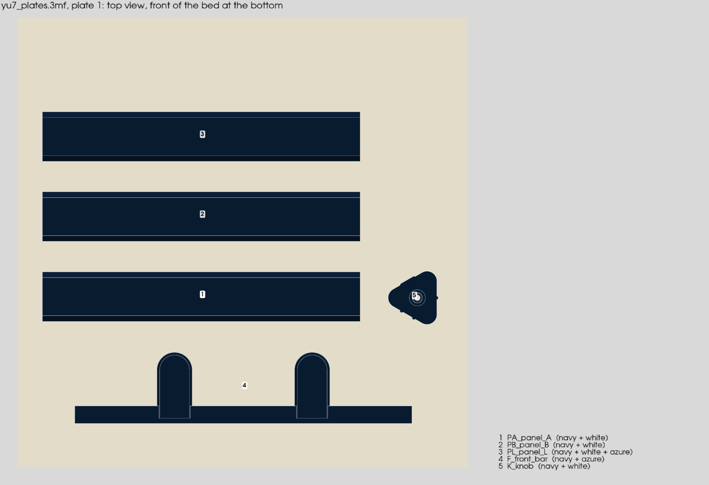
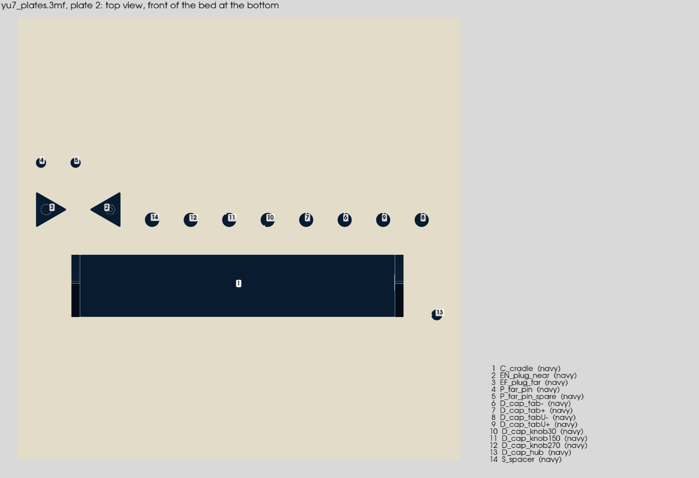

# YU7 挪车号码牌：一个 3MF、两盘打完（出盘修订，已实施）

**设计目标**：以后打印只用一个文件 `out/plates/yu7_plates.3mf`，在 Bambu Studio 里打开就有两盘：

- **盘 1「彩色」**：所有带白字、天蓝线的零件，即三块号码面板 PA / PB / PL、前横梁 F、旋钮 K。
  - 约 2 h 17 min、55.8 g，换色 9 次。
- **盘 2「藏青」**：其余全藏青的零件，即托架 C、近端塞 EN、远端塞 EF、远端销 P ×2、盖片 D ×8、垫片 S。
  - 约 1 h 15 min、23.4 g，不换色，也不打擦料塔。
- **两盘合计**：约 3 h 32 min、79.1 g、换色 9 次。比现在三个文件、三盘少约 34 分钟、4.5 g、9 次换色，少开一次机。

零件几何、每件的打印设置（填充、brim、鼠耳、层高）、AMS 槽位、收缩补偿都不变；已打过的盘 0、盘 0b 不动。

> **10-17 修订**：盘 1 加了陪打柱 Q，盘 1 变为 156.6 min、57.82 g，换色仍是 9 次。原因是 10-16 实打时旋钮 K 卡死在 EN 里（§5 最后一条风险成真）。设计和实测见 `docs/2026-1019-2303-yu7-parking-plate-knob-cooling-design.md`。装配卡里只重打几件的做法也跟着改了：要打的小件都挪到 Q 的盘上一起打（卡 §1-5、§14-1），不再是本稿 §4 的「盘 2 只留 EN、EF」。

> **依据**：所有数字都用 `config.example.toml`（示例号码）算出。
> - 原型脚本：`concept/v3.3/plates2/pack_proto.py`，输出在 `pack_proto.json`。
> - 每件占地：`footprints.py` / `footprints.json`。
> - 原型 3MF 和切片只放在 /tmp。
> - 对照的是 10-16 04:23 的三盘构建（`out/plates/slice_report.json`）。

## 1 现状（三个文件、三盘）

| 盘 | 文件 | 内容 | 时间 | 克重 | 换色 |
|---|---|---|---|---|---|
| 1 | `plate1.3mf` | PA PB PL | 93.1 min | 38.03 g | 9 |
| 2 | `plate2.3mf` | C | 64.4 min | 18.30 g | 0 |
| 3 | `plate3.3mf` | F K EN EF P×2 D×8 S | 88.5 min | 27.34 g | 9 |
| 合计 | 3 个文件 | | 246.0 min | 83.67 g | 18 |

盘 1 和盘 3 各自都在第 1–4 层换色 9 次：白字和天蓝线都是正面朝下打在头 4 层。也就是同样一轮换色做了两遍。

## 2 分盘规则：多色件一盘，单色件一盘

- **规则**：有嵌色（两种以上颜色）的件放盘 1，只有藏青的件放盘 2。
  - 嵌色件都只在头 4 层换色，放在同一盘里，这一轮换色就由它们共用：5 件一起只换 9 次。
  - 盘 2 只用一种料，Bambu 不生成擦料塔，也不换色。
- **每件占地**：下表是排版用的占地框，含 brim / 鼠耳和收缩余量（`footprints.json`）。

| 件 | 盘 | 占地 mm | 高 mm |
|---|---|---|---|
| PA / PB / PL | 1 | 193.0 × 39.6（各） | 2.4 |
| F | 1 | 204.0 × 52.5 | 8.0 |
| K | 1 | 36.5 × 38.3 | 22.2 |
| C | 2 | 204.0 × 48.0 | 35.8 |
| EN / EF | 2 | 25.5 × 28.2 | 16.0 / 10.0 |
| D ×8、S | 2 | 约 16 × 16（各） | 0.4–1.2 |
| P ×2 | 2 | 14.0 × 14.0 | 13.0 |

- **原型实切结果**：一个 3MF 两盘，CLI 一次切完（`pack_proto.json`）。

| 盘 | 内容 | 时间 | 克重 | 换色 | 层数 |
|---|---|---|---|---|---|
| 1 彩色 | PA PB PL F K | 137.2 min | 55.77 g（白 5.61、天蓝 1.47、藏青 48.69） | 9（第 1–4 层） | 111 |
| 2 藏青 | C EN EF P×2 D×8 S | 74.5 min | 23.35 g | 0 | 179 |
| 合计 | 1 个文件 | 211.7 min（3 h 32 min） | 79.12 g | 9 | |

两盘都没有切片警告。省下的约 34 分钟来自两处：少 9 次换色（每次连冲洗约 2 分钟），少一次开机准备（加热、调平）。

## 3 摆法

**排版**：用新函数，规则如下。

1. 先按占地框深度从深到浅排。每件放进第一个放得下（深度和剩余宽度都够）的"层架"；都放不下就在上方开一个新层架。
2. 横向遇到禁区就跳过。
3. 排完把整块往床中心挪，挪到碰禁区或床边留白为止。
4. 件与件、件到床边仍各留 6 mm。

这样小件会塞进长件旁边的空档，比如盘 1 的 K 就在 PA 右边。现在的办法是一行排满才换行、小件另起一行，所以排不下两盘。

**禁区**：
- P1S 的左前角（18 × 28，外加 6 mm）。
- 擦料塔：从塔角向左、向前各留 10 mm，一直到床的右后角。

**擦料塔**：
- Bambu 的塔位置是按盘分别存的。
- 盘 1 放在右后角（211, 211）。原型实测塔的范围是 X 207.8–253.2、Y 207.8–252.5，没有警告。原来的 (205, 170) 会压住第 4 行面板，放不下。
- 盘 2 只有藏青，没有塔。

**旧函数不动**：`export3mf.arrange` 原样保留，盘 0b 脚本还在用它，保证重建时和已打的盘 0b 完全一样。新排法只给正式件用。

**原型摆盘**（俯视，和切片软件准备页一样，正面朝下的嵌色看不到；擦料塔不画）：

- **盘 1**：F 在最前一排，往后依次是 PA（K 在它右边）、PB、PL；擦料塔在右后角。
- **盘 2**：C 居中，上面一排是 EN、EF、S 和 8 片盖片，再上面是两根 P。轴盖在 C 的右边。

## 4 输出和检查

**文件**：
- 只出一个 `out/plates/yu7_plates.3mf`，两盘分别命名为 `1 colour`、`2 navy`。
- 每盘有自己的第 1 层先打顺序：盘 1 照旧是藏青先打。
- 构建时删掉旧的 `plate1–3.3mf` 和各自的切片目录，不留过期文件。

**切片和检查**：
- CLI 读回一次、切一次（所有盘）。
- 每盘照旧检查：
  - 每件一个切片对象，耗材分配读回不变，位置和排版一致（按盘在工程里的原点换算）；
  - 无警告，G-code 换色次数和结果一致，换色只在嵌色层；
  - 擦料塔不碰零件，brim 只在零件周围且用藏青，鼠耳在面板四角。
- 新增两条：擦料塔在床内；单色盘没有擦料塔。

**报告和装配卡**：
- `slice_report.json` 的两盘都指向同一个文件，并记盘号；合计照旧。
- 俯视图变成 `plate_yu7_plates_1.png`、`plate_yu7_plates_2.png`（渲染代码已经支持多盘工程）。
- 报告 §3 改为两盘，加一行"三盘方案"对照。
- 装配卡里写到盘号的地方跟着改：
  - 打印表；
  - S 在盘 2；
  - 只重打 C 时，盘 2 只留 C；
  - 轴盖撬坏了，盘 2 只打一片；
  - 换号码时，盘 1 只留 PA、PB、PL，盘 2 只留 EN、EF，其余对象在 Bambu Studio 里删掉再切。
- v3.3 设计稿的 §4 加一句指向本稿。

## 5 风险

- **盘 1 变长**：2 h 17 min，五个大件在同一盘。一件翘起被喷嘴刮到，可能连累整盘。
  - 每件的 brim、鼠耳照旧，件间留 6 mm。
  - 真要分开，在 Bambu Studio 里把对象拖到新盘即可，文件本身不用改；10-17 起 K 必须和陪打柱 Q 同盘（装配卡 §1-5）。
- **擦料塔贴着右后角**：离床边约 3 mm，在可打印范围内，CLI 没有报警。
- **后半程只打旋钮**：K 高 22.2 mm，盘 1 的后 70 层只打它，和现在盘 3 的情况一样。
  - 10-16 实打出了问题：每层只有 2–3 s，六角很可能过热打胖，卡死在 EN 里。10-17 起加陪打柱 Q（`docs/2026-1019-2303-yu7-parking-plate-knob-cooling-design.md`）。
- **两盘的塔位置在同一组参数里**：如果你在 Bambu Studio 里手动挪塔，只影响当前盘。

## 6 实施清单

- **`model.py`**：盘号改为 PA、PB、PL、F、K → 1；C、EN、EF、P×2、D×8、S → 2。
- **`export3mf.py`**：
  - 新增层架排版 + 居中的函数，`arrange` 不动；
  - 每盘的塔位置写进 `wipe_tower_x/y`；
  - 写一个两盘工程、读回一次、切一次；
  - 每盘检查改为从同一次切片里按盘号取（位置减去盘原点）；
  - 删旧文件；`PLATE_CONTENTS` 改成两盘。
- **`report.py`、`assembly_card.py`、装配卡模板**：两盘的表格和文字（见 §4）。
- **v3.3 设计稿**：§4 和定稿记录各加一句。
- **项目记忆**。

## 7 验收

- `scripts/build_all.py --config config.example.toml` 退出码 0：几何、检查 ①–⑩、两盘切片都通过。
- `out/plates/` 下只有一个 3MF，里面两盘、19 个对象；8 片盖片和 S 在盘 2，都是 3 号槽。
- 两盘的时间、克重、换色和原型一致（±1 %）。
- 盘 0、盘 0b 的文件和两张试验卡前后 sha256 不变。
- 俯视图两张，装配卡和报告里没有"盘 3"的旧说法。

## 8 实施记录（10-16 17:07）

- 你 10-16 确认后按 §6 实施；`config.example.toml` 完整构建：退出码 0，几何、检查 ①–⑩ 和两盘切片的检查全部通过。
- 文件：`out/plates/yu7_plates.3mf`（`out/plates/` 下只有这一个 3MF，旧的 `plate1–3.3mf` 和切片目录已删）。
- 盘 1 彩色：137.1 min、55.77 g、换色 9 次、5 个对象；擦料塔 [207.79, 207.8, 253.24, 252.53]。
- 盘 2 藏青：74.5 min、23.35 g、换色 0 次、14 个对象；没有擦料塔。
- 合计 211.6 min（3 h 32 min）、79.12 g、换色 9 次（原型 211.7 min、79.12 g、9 次；三盘时 246.0 min、83.67 g、18 次）。
- 俯视图 `out/renders/plate_yu7_plates_1.png`、`plate_yu7_plates_2.png`；装配卡 `out/2026-1016-1706-装配卡.md`；报告 `out/report.md` §3。
