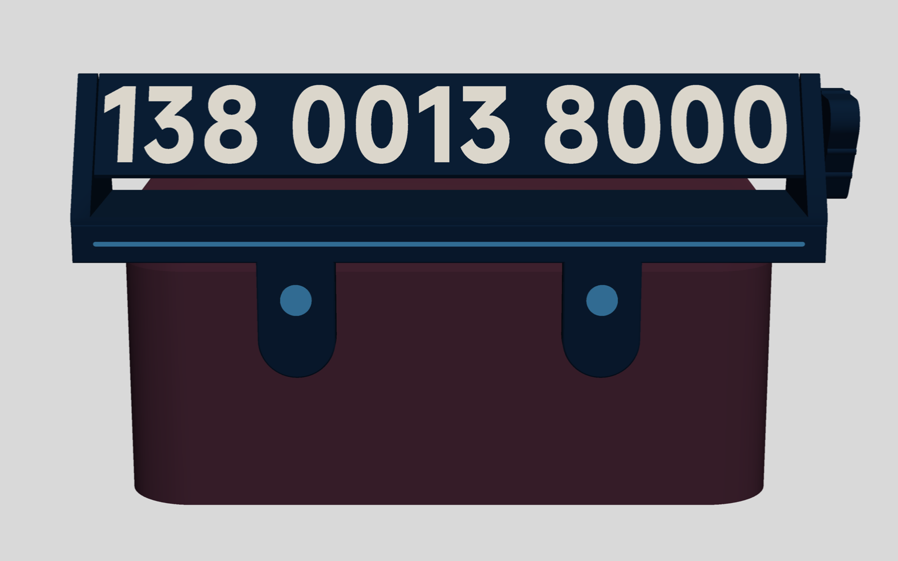
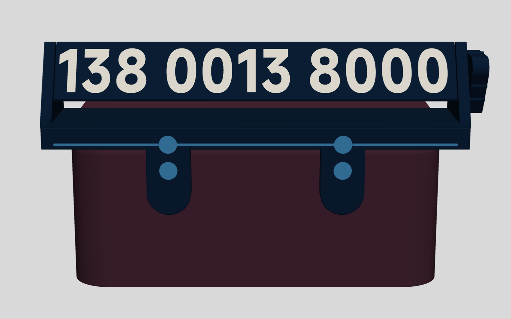
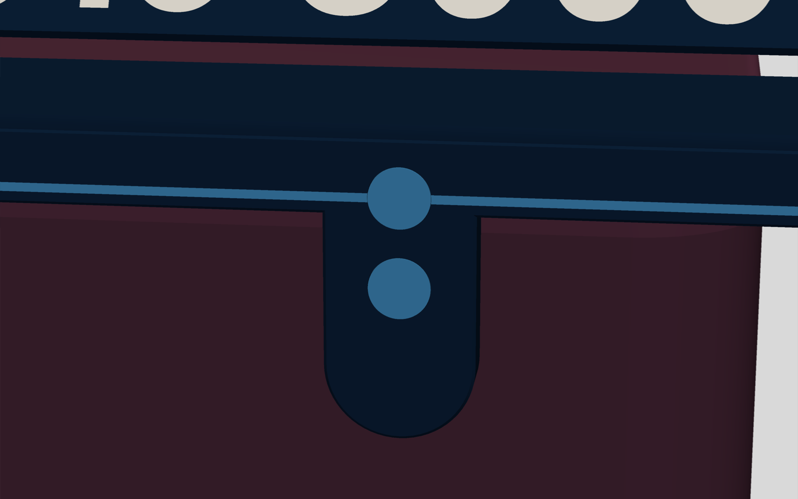
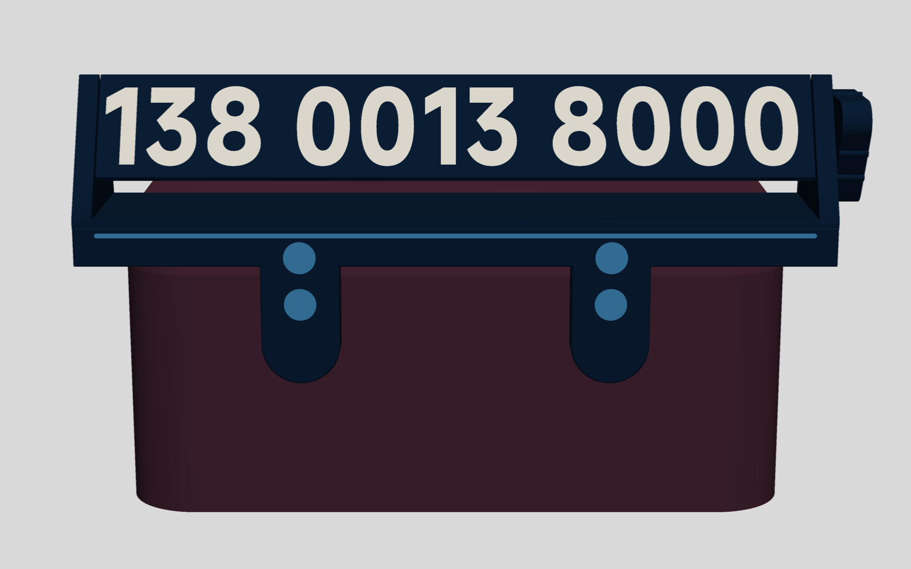
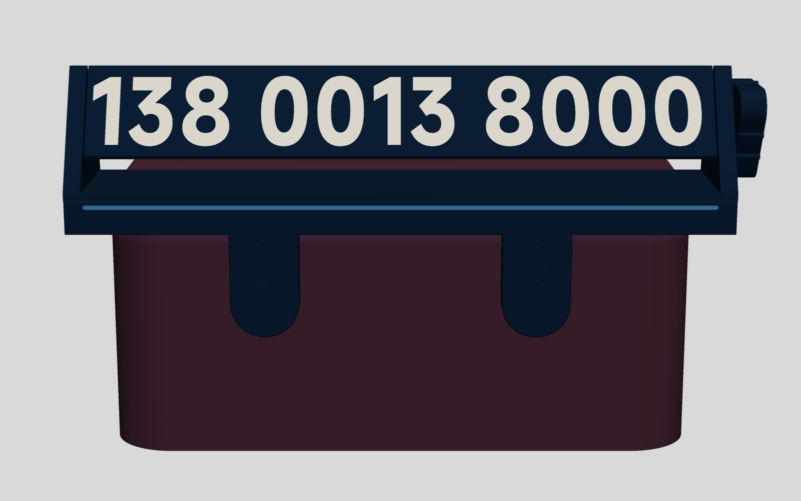
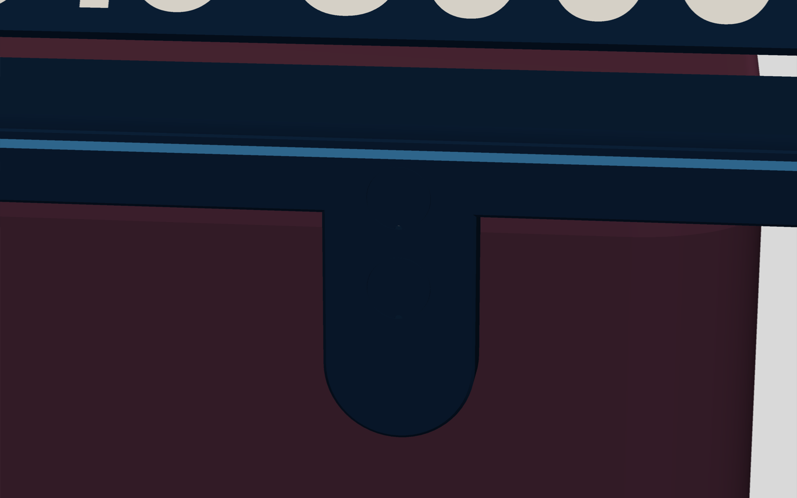
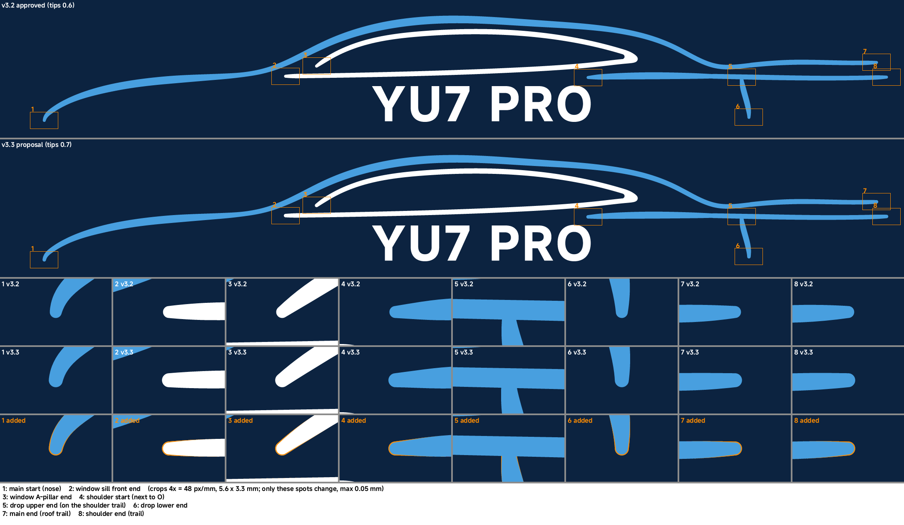

# YU7 纸巾盒旋转挪车号码牌 — v3.3 技术设计文档（定稿）

**设计目标**：v3.3 按盘 0 的实测定型。从车外看和 v3.2 几乎一样：藏青三棱柱、20.9 mm 白色号码，A → B → Logo 三面"咔"地换。不同的是盖片全部用藏青，正面没有圆点，新加的磁铁也藏在藏青盖片后面（近看只有盖片外一圈细缝和 1 mm 的撬口）；天蓝细线上移到横梁上沿，仍是一整条（装饰线方案 E，10-16 你定的）。牌子吸得更牢：每片挂片 4 颗磁铁，下面 2 颗照旧吸底座磁点，上面 2 颗吸你量到的盖子磁铁（盖顶下 9 mm）；两片完全一样，不用翻面。夏天 80 ℃、盒内磁铁按最弱估算时，离地和刹车的余量都约为 v3.2 的 2 倍。吸得牢了，装取手势也要变：取牌时捏住一端的端块，先把这一端掰开；装牌改在整盒拿出来以后做，牌子端平，从前面水平推到贴合再松手。盖片和轴盖按你说的放大一点、轴盖加厚：挂片和旋钮盖片 Ø8.25，轴盖 Ø6.40×0.8，每片边上一个撬口，以后能用针撬下来（盘 0b 选定）。盘 0b（32 分钟、纯藏青）已经打完试过松紧；盖磁点没有重量，按 9 mm。都不做受力测试。

**定稿记录**（2026-10-16 01:55）
- 2026-10-15 你批准本稿，并回传了盘 0b（`docs/test-results/2026-1015-0529-盘0b试验卡.md`）。
- 盘 0b 选值：唇板销孔用方案 (b)（盲孔 1.4 + 0.2 倒角），Ø1.95（"195 才能插进去，比较稳，200 晃"）；端块销孔 Ø1.95（盲孔 3.0 + 0.4 倒角，"同 195 更稳固一些，200 可以不晃"）；横梁销孔仍是盘 0 JB 的 Ø1.75。挂片盖片 Ø8.25×0.8、旋钮盖片 Ø8.25×0.4（三个角一样）、轴盖 Ø6.40×0.8；"我的意思是一个缺口够了，直径按 8.25 打"：每片盖片只有 1 个 Ø1.0 撬口。垫片 S Ø8.4×1.2 压配不变。
- §6 的四件都已定：装 / 取手势按 §5；盖片按上一条，挂片和旋钮盖片整圈薄胶 + 背后一小点，轴盖点一点胶；装饰线方案 A（10-16 改为方案 E，见下）；唇板销孔方案 (b)。
- 截销：盘 0b 按本稿 4.2 / 5.5 mm 剪的销三种都偏长（"需要我剪的时候再往短剪一点点"），改为唇板 4 × 3.9 mm、端块 2 × 5.2 mm。压进横梁后用卡尺深度尺量伸出：唇板 0.7–1.1、端块 2.0–2.4，长了锉短，不把托架硬压到冒头的销上。
- 没再量的两项按当前设计（"/ 项无需调整按当前设计"）：M3 头高 k = 2.4 → 旋钮沉孔 3.4、近端塞底孔 6.9；盖磁点 9.0（Z −9.0）。盘 0b 里 0.8 轴盖在 3.0 沉孔里装上螺钉后平齐，说明 k ≤ 2.2，所以轴盖下的空隙至少 0.4（按 2.4 设计是 0.2），不影响平齐。
- 已实施并完整构建（10-16 01:47，`config.example.toml`）：退出码 0；几何 52/52、静止干涉 93 对为 0、两对标定配合通过；检查 ①–⑩ 硬性项全过、警告 0，⑩ 胶完好 0.068 / 0.201；盘 1–3 切片合计 246 min、83.66 g、换色 18 次。结果见 `out/report.md`（这次的装配卡已被下一条方案 E 的构建取代）。实施评审对 §5 做法和配置校验的更正见附录 A.7，§5 已按此改。
- **10-16 04:25 修订：方案 E**。你看了渲染图，A–D 都不要：8 片盖片全部改藏青；天蓝细线上移到 Z −1.5（离顶边倒角 1.0、离上孔口 1.0），全长一整条（§2.2）；盖磁点可建范围随之变为 8.8–11.55（§2.1；评审实切后把线离上孔口的下限定为 0.8）。你本机 `config.toml` 按你的要求由我改好：删掉 v3.2 的 `[fit]` 四行，号码没动（还是示例号码）。重新构建（`config.example.toml`）：退出码 0；几何 52/52、静止干涉 91 对为 0（线不再碰上盖片，少 2 对）；检查 ①–⑩ 硬性项全过、警告 0；盘 3 88.5 min / 27.34 g（天蓝 1.48 → 1.25 g）/ 换色 9，盘 1–3 合计 246.0 min、83.67 g、换色 18 次。装配卡 `out/2026-1016-1706-装配卡.md`。
- **10-16 17:07 出盘修订**：按你的要求改为一个 3MF 两盘（`out/plates/yu7_plates.3mf`）：盘 1 彩色 137.1 min、55.77 g、换色 9 次、5 个对象，盘 2 藏青 74.5 min、23.35 g、换色 0 次、14 个对象；合计 211.6 min、79.12 g、换色 9 次。设计和实测见 `docs/2026-1017-0046-yu7-parking-plate-2plates-design.md`。
- **10-17 旋钮修订**：10-16 你用两盘工程打完后，旋钮六角插进 EN 拔不出来，断在里面。原因是 K 在盘 1 的 8 mm 以上单独打，每层只有 2–3 s（盘 0 ≥ 11 s）。现在旋钮旁加陪打柱 Q，EN 六角孔 AF 5.15 → 5.20，并加了「小件每层 ≥ 10 s」的检查。设计和实测见 `docs/2026-1019-2303-yu7-parking-plate-knob-cooling-design.md`。

**验收目标**（v3.2 判据不变，措辞按实测更正）：字高 ≥ 20 mm；零件都在 Y ≥ −35 以内；总长 ≤ 200 mm；重量由盖顶承担。80 ℃、盒内磁铁按最弱候选（含不可逆退磁）时：文档手势 ≥ 1.5 倍、竖直按 ≥ 2 倍、捏扭 ≥ 1.5 倍、刹车 ≥ 1.5 g、离地 ≥ 3 g。静止时，挂片、定子和旋钮当前角的磁铁都被磁力压在打印的底或壁上；其余情况（旋钮另两角、换档、竖直装取）的外推力由压配垫片 S 或整圈粘牢的盖片承担（§2.4）。90 ℃、胶完好时近端唇板抬起 ≤ 0.20 mm（按两位小数，硬性；剪力取候选全集的最小值，§2.5）。不加支撑可打印；嵌色满足盘 0 实测下限（§2.6）。

> **依据**：数字都来自脚本输出，括号里注明文件。`tabs4/`、`fits/`、`logo/`、`review/` 指 `concept/v3.3/` 下的同名目录（`review/` 是这一轮补算），`.json` 一般由同名 `.py` 生成；`report` 指 v3.2 构建报告（原 `out/report.md`，v3.3 构建后归档为 `docs/archive/2026-1014-0143-yu7-parking-plate-v3.2-report.md`；v3.3 的构建报告是新的 `out/report.md`）。全部用 `config.example.toml`（示例号码）计算。本稿只写与 v3.2 不同的地方，没提到的按 v3.2 稿、`report` 和 v3.2 装配卡（归档为 `docs/archive/2026-1014-0143-yu7-parking-plate-v3.2-assembly-card.md`）。给实施看的细节放在附录 A。

## 0 变更摘要（v3.2 → v3.3）

| 项 | v3.2（as built） | v3.3 | 见 |
|---|---|---|---|
| 挂片磁铁 | 每片 2 颗，下摞 Z −19.32 | 每片 4 颗：下摞不变，加上摞 2 颗，Z −7.25（盖磁点 −9.0 上方 1.75）；两片相同 | §2.1 |
| 全件磁铁 | 11 | 15（挂片 8、旋钮 6、定子 1） | §4 |
| 挂片背面导向倒角 | 四周 1.5×45° | 取消顶边那段，两侧和 R10 底边保留 | §2.1 |
| 横梁装饰 | 天蓝细线 Z −4.5 + 2 颗天蓝盖片 | 方案 E（10-16 定稿）：8 片盖片全藏青，正面没有圆点；细线移到 Z −1.5，全长一整条（离顶边倒角、上孔口各 1.0） | §2.2、§6-3 |
| 轴承孔、六角 | 名义 6.30 / 6.00 / 6.10 / AF 5.00 | 试条选值：近端 5.90、远端 5.95、远端塞 6.10、AF 5.00 | §2.3 |
| 盖片 | 天蓝：挂片 Ø8.1×0.8、旋钮 Ø8.1×0.4、轴盖 Ø6.2×0.4 | 藏青（方案 E）；盘 0b 选值：挂片 Ø8.25×0.8、旋钮 Ø8.25×0.4、轴盖 Ø6.40×0.8（加厚）；每片 1 个 Ø1.0 撬口；S Ø8.4×1.2 不变 | §2.4、§6-2 |
| 旋钮沉孔 / 近端塞底孔 | 深 3.0 / 6.5 | 3.4 / 6.9（M3 头高 k 没量，按 2.4） | §2.4 |
| 盖片粘接 | 整圈涂胶；轴盖点一点胶 | 整圈涂胶，背后再点一小点；轴盖仍点一点胶（点在沉孔壁上，不点螺钉头）；撬口里不留胶 | §2.4、§5、§6-2 |
| 横梁销孔 | Ø1.9 泪滴 | Ø1.75 泪滴（JB 选值） | §2.5 |
| 托架销孔 | Ø1.9 盲孔（唇板 1.4、端块 3.0） | 唇板方案 (b) 盲孔 1.4 + 0.2 倒角、端块盲孔 3.0 + 0.4 倒角，都是 Ø1.95（盘 0b）；截销 3.9 / 5.2 mm | §2.5、§6-4 |
| 检查⑩ | 胶软 + 销间隙：0.205 / 0.617 mm，警告 | 按胶完好判，硬性 ≤ 0.20（两位小数），剪力取候选全集最小：0.068 / 0.201；胶软、脱粘列为 info | §2.5 |
| Logo | 笔尖 0.6 圆头 | 笔尖 0.7 圆头，其余几何不动 | §2.6 |
| 嵌色硬下限（线 / 缝 / 孔） | 0.6 / 0.6 / 0.6 | 0.7 / 0.5 / 0.8（盘 0 阶梯 L） | §2.6 |
| 白字 | 4 层（名义） | 4 层（你选定） | §1 |
| 装 / 取 | 竖直放下 / 竖直提起 | 整盒拿出后水平推到贴合 / 从一端掰下；车内只能竖直装 | §5、§6-1 |
| 质量 | CAD 98.6 g（实重约 89 g） | CAD 102.5 g（约 93 g） | §4 |

## 1 盘 0 结果 → 结论

| 试验 | 你的结果 | 结论 / v3.3 处理 |
|---|---|---|
| ① 极性 | 两侧底座磁点都吸**画点面**；底座点正上方的上盖裙边另有一颗磁铁，吸**无点面**（照片 210136） | 两片挂片完全相同，不用翻面；用盖磁铁加上摞（§2.1） |
| ① 盖磁点位置 | "盖顶下 9 mm"（单颗磁铁 + 卡尺量中心）→ Z −9.0（接缝上 4.62，和底座点不对称）；两点中心距 12.07 | 单颗磁铁贴在盒面上有摩擦，只从一个方向推到停住时，可以停在离真中心 ±1.2–1.5 mm 内的任何位置（`review/measure_band.json`），比上次估的 ±0.5 大。灵敏度按这个范围算（§2.1）；当时请你按盘 0b 卡 ④ 从上、下各停一次重量，你决定按当前设计，不重量，设计值仍是 −9.0。X 没测，假设和底座点相同（±39.21） |
| ① 拉脱力、上滑力、μ、T1 | 未测："现在的 T2 设计的基础上变成上下各两个磁铁单侧盖片共 4 个磁铁，目前测下来已经很稳了，这样只会更稳，我的防滑垫也合适，所以不用再测了" | 按你的决定，不再做受力测试；判据按盒内磁铁最弱候选计算，v3.3 最弱角各项约为 v3.2 的 2 倍（§2.1）；不再需要 stack 1 回退 |
| ① 前方空间、xiaomi life 标 | 没有影响 | 挂片厚 8.0、下端 Z −40 不变 |
| ①⑥ 防滑条 | 合适；晒一天无压痕、不粘手 | 保留 0.5 mm 硅胶条 |
| ①② 磁铁进孔 | 都正好放进取出 | Ø8.3 孔不变，上孔同径 |
| ①② 盖片 | 0.8 的进挂片孔、0.4 的进旋钮孔合适；问到轴盖时补充："加厚一倍，然后除了 压配的垫片 s 其它垫片都可以大一点点，现在有点松" | 理解和提议分开写在 §2.4，你已确认（§6-2）；盘 0b 选 Ø8.25 / 8.25 / 6.40，每片 1 个撬口 |
| ② 档位 | 三下清脆丝滑；每角 20 次不停在两面之间；盲摸分得出三面 | 档位几何不变 |
| ② 垫片 S | 要用点力 | 符合设计，Ø8.4 压配不变 |
| ③ 孔与六角 | 近端 590、远端 595、竖打 610、六角 AF 5.00 | 照用；近端在托架打好后先试转（§2.3、§5） |
| ③ 销孔 | JB 175；JL 1.70–1.90 都塞不进，"建议打个 180 到 200 的，并且加高……洞太浅" | 横梁销孔 Ø1.75。唇板只有 2.0 厚，不打通最多 1.4 深，所以给了两个方案（§2.5、§6-4），定为 (b)；盘 0b 按正式件的伸出长度重测 1.80–2.00，唇板、端块都选 Ø1.95 |
| ③ P、N 翘边 | 没有 | brim 不变 |
| ④ 白字 | 4 层 | white_layers = 4 |
| ④ L 阶梯 | 白线 0.7 起合格（0.5、0.6 断）；藏青缝 0.5 就合格；藏青圆孔 0.8 起合格；"YU7 PRO" 8 mm 和定稿 6.9 都清楚 | 新硬下限 0.7 / 0.5 / 0.8；v3.2 Logo 有 7 个笔尖不合格，改 0.7（§2.6） |
| ⑤ 粘管演练 | 完美（棱处平齐、端塞平齐、不溢胶）；可操作 5 min；标签耐温 100 ℃ | 粘管做法不变；横梁一次上胶要先干演练（§5） |
| 未做 / 后做 | M3×25 头高 k 没量；天蓝嵌色下限没测；装车验收要等成品 | k、盖磁点都没再量，按当前设计（k 2.4、盖磁点 9.0）；天蓝按白色同一规则；验收见新装配卡 §10 |

## 2 设计变更

### 2.1 挂片四磁铁（上摞吸盖磁铁）

**为什么**：这是你的决定（§1 原话）。盖磁铁本来就在：v3.2 实物在真盒上，下摞还被盖磁铁往下拉，80 ℃ 最弱下拉由设计的 0.63 N 变成 0.87 N（`tabs4/summary_numbers.json`）。

**改什么**（`tabs4/v33_tabs4.py`；几何、干涉、路径等检查结果见附录 A.3）：
- **上孔**：X ±39.21、Z −7.25、Ø8.3，从正面开口，0.8 底朝盒子，深 7.2；放 2 颗 N52，无点面朝盒子。盖片只在正面一侧（你说的"单侧盖片"），与正面齐平，背后留 0.4 空隙（和下孔一样）。下孔 Z −19.32 不动。
- **背面导向倒角**：两侧和 R10 底边保留 1.5×45°，只取消顶边那段（顶边在任何装取动作里都不会先碰到东西）。平的贴盒面一直到 Z −2.5，托住整个上孔底：144 条射线测得底厚都是 0.80，都止于 Y = 0；底的最高点 Z −3.10，盒面在 −2.5 以下是平的。
- **为什么偏置 +1.75**：和下孔相对底座点的 +1.75 一样，让剪力把整片往下拉（防跳，检查⑩也变好）。上限 1.95：再高，上孔口离方案 E 的细线就不到 0.8（只看平背面是 2.35，孔顶再高就超出平背面 −2.5，底托不住）；方案 A 时还要求线离横梁底倒角 ≥ 0.8、偏置 ≥ 1.3，E 没有这条。所以盖磁点高于约 −8.8 时，上孔就保不住 +1.75，要重算（载入配置时就检查：上偏 1.75、示例尺寸下盖磁点 8.8–11.55 能建，更深时两孔之间的壁不足 1.2；超出直接报配置错误，不自动改偏置）。1.25 / 1.75 / 2.25 三档：80 ℃ 最弱离地 5.75 / 5.97 / 6.14 g，20 ℃ 最弱拉力 4.92 / 4.76 / 4.57 N，变化平缓（`tabs4/study_statics.json`、`tabs4/study_magnets.json`）。
- **盒内磁铁之间的交叉作用**：两点中心距 12.07。交叉项在法向是吸力（典型时底座磁铁吸上摞 0.23 N、盖磁铁吸下摞 0.34 N）；在竖直方向把两摞撑开：盖磁铁把下摞往下推，底座磁铁把上摞往上推。全部 285 组候选、盖磁点 −10.9…−7.1 内，**整片**的剪力都向下（`review/lid_set.json`）。**上摞自身**的剪力不一定向下：盖磁点在 −9.0、盖磁铁和底座同款时为正；如果盖磁铁是 Ø5–6 的小磁铁、底座又强，上摞自身会被往上推（盖磁点 −9.0 时 20 ℃ 最多 0.21 N，285 组里有 9 组），但整片仍向下，最少 0.83 N。

**数字**（每片挂片；盖磁铁和底座同款；20 ℃ 为最弱 / 典型 / 最强候选，80 / 90 ℃ 为最弱角，含可逆和不可逆系数；`tabs4/summary_numbers.json`）

| 项（N） | v3.2 设计 | v3.2 实物（真盒含盖磁铁） | v3.3 |
|---|---|---|---|
| 法向拉力 20 ℃ | 2.21 / 3.34 / 5.98 | 2.41 / 3.68 / 6.61 | 4.76 / 7.25 / 13.13 |
| 下拉力 20 ℃ | 0.75 / 1.05 / 1.71 | 1.04 / 1.56 / 3.42 | 1.74 / 2.54 / 4.27 |
| 上滑力 20 ℃（最弱 / 典型） | 1.52 / 2.21 | 1.88 / 2.85 | 3.40 / 5.07 |
| 80 ℃ 拉力 / 下拉 / 上滑 | 1.87 / 0.63 / 1.28 | 2.04 / 0.87 / 1.59 | 4.02 / 1.46 / 2.87 |
| 90 ℃ 拉力 / 下拉 | 1.82 / 0.61 | 1.98 / 0.85 | 3.91 / 1.43 |
| 整件竖直往上拔要的手力（20 ℃，两片合计，含自重和盒面摩擦） | 4.35 / 6.02 / 10.5 | 5.66 / 8.37 / 16.1 | 9.04 / 13.5 / 25.8 |

- 最后一行来自 `review/install_lift.json`，本稿的提起力都按这一个口径。最强一栏是盖磁铁取和底座同款的上限：盖磁铁实际最大约 Ø9.2，只取 Ø8 以下时 20 ℃ 拉力最多 12.2 N。

**3D 刚体 LP**（80 ℃ 最弱，盖磁点 −9.0；`tabs4/study_statics.json`，v3.2 一栏与 `report` 完全一致；把每摞自身力偶也算进去，变化 ≤ 2 %）

| 项 | 限值 | v3.2 | v3.3 |
|---|---|---|---|
| 文档手势 | ≥ 1.5× | 2.44× | 4.68× |
| 竖直按角 | ≥ 2× | 4.17× | 8.38× |
| 捏扭（需 38.8 N·mm） | ≥ 1.5× | 168 N·mm（4.32×） | 317 N·mm（8.17×） |
| 刹车 | ≥ 1.5 g | 3.49 g | 7.44 g |
| 离地 | ≥ 3 g | 3.30 g | 5.97 g |
| 侧向 | — | 3.61 g | 6.75 g |
| 往前推棱柱顶 | — | 2.28 N | 5.00 N |
| 前倾极限 @1.5×（下一面 / 上一面） | — | 44.4° / 46.3° | 48.9° / > 50° |

90 ℃ 加不可逆：刹车 3.42 → 7.26 g、离地 3.24 → 5.85 g。盒面 μ 0.25：离地 2.97 → 5.29 g。不贴防滑条：往前推 1.47 → 3.51 N。整盒倾斜：两版都撑到 90°。

**灵敏度：盖磁点位置**（上孔固定在 −7.25，盖磁铁和底座同款，80 ℃ 最弱；`review/lp_band.json`、`review/check10_v33.json`）

| 真实盖磁点 Z | −10.9 | −10.5 | −9.0（测量值） | −7.5 | −7.1 |
|---|---|---|---|---|---|
| 每片拉力 / 下拉（N） | 3.28 / 2.09 | 3.47 / 1.98 | 4.02 / 1.46 | 4.25 / 0.81 | 4.25 / 0.63 |
| 文档手势 / 竖直按 | 4.84× / 8.78× | 4.86× / 8.78× | 4.68× / 8.38× | 4.17× / 7.09× | 3.99× / 6.62× |
| 刹车 / 离地 | 7.05 / 6.62 g | 7.20 / 6.55 g | 7.44 / 5.97 g | 7.08 / 4.97 g | 6.88 / 4.65 g |
| ⑩ 中心（盖磁铁同款 / 候选全集最小剪力） | 0.181 / 0.195 | 0.182 / 0.195 | 0.187 / 0.201 | 0.198 / 0.213 | 0.203 / 0.220 |

- 单方向停住的误差带：试磁铁吸附力 1.5–7.2 N、回中刚度 0.3–1.9 N/mm，μ 0.3 时 ±1.2–1.5 mm（μ 0.2 / 0.4 时 ±0.8–1.0 / ±1.5–1.9）。底座磁铁对读数的影响一般 ≤ 0.1 mm；只有底座是 15×3 这种强磁铁时，读数会比真点高 0.4–0.7，真点更低，这是对我们有利的方向（`review/measure_band.json`）。
- 结论：±1.5 内 LP 各项都过线，最差也有 4.17× / 7.09× / 4.97 g；⑩ 在盖磁铁同款时都 ≤ 0.198，只有"真点比测量高 1.5、盖磁铁又是 Ø5 小磁铁"时到 0.213，超过 0.20。所以当时请你重量（盘 0b 卡 ④）；你决定按当前设计，设计值仍是 −9.0，构建的⑩是 0.068 / 0.201。
- 盖磁点 X 偏 1.5 mm：拉力、下拉各少约 4 %，侧向 0.56 N（`review/lid_set.json`）。

**灵敏度：盒内盖磁铁的大小**（`review/lid_set.json`、`review/lp_band.json`）
- 盖磁铁中心在接缝上 4.62，所以直径最多约 9.2；这只是上限，也可能是 Ø5–6 的小磁铁。候选全集：底座 5 种 × 壁厚 3 档；盖磁铁取和底座同款，或 Ø5–8 的 6 种（8×3 N52、8×2 / 8×1.5 / 6×3 / 6×2 / 5×2 N35）× 壁厚 3 档；共 285 组。
- 盖磁点 −9.0 时，20 ℃ 每片拉力最小 3.52 N（5×2 盖磁铁配最弱底座），整片下拉最小 0.83 N（5×2 盖磁铁配 15×3 底座）。
- LP（80 ℃，底座最弱）：6×2 / 5×2 盖磁铁时文档手势 3.95× / 3.59×、竖直按 6.94× / 6.23×、捏扭 6.94× / 6.34×、刹车 6.09 / 5.42 g、离地 5.01 / 4.54 g，都过线。最坏的组合（5×2、真点 −7.1）也还有 3.24× / 5.47× / 5.62× / 5.15 g / 3.88 g。

**风险**
- 盒内磁铁模型（沿盒面法向的圆片）没实测，盖磁点 X 也没测；盖磁点 Z 的误差比上次估的大，你决定不重量（按 −9.0）。上面的范围里各判据都过线，只有⑩在最坏组合下略超。
- 竖直贴盒面装取时，下孔磁铁把盖片往外顶，每片 2.7 / 4.0 / 6.9 N，上孔 0.17 / 0.31 / 0.79 N；两片合计把整片往外推 5.7 / 8.6 / 15.4 N（v3.2 实物同样有，`review/install_lift.json`；典型值 8.6475，原稿四舍五入了两次，写成 8.7）。盒子 ≥ 60 ℃ 时，这一段让下摞越过拐点的体积升到 4–18 %（60 ℃）/ 26–41 %（80 ℃）。对策：默认用水平手势；盖片整圈粘牢（§2.4）；盒子烫时不竖直装（§5）。
- 取下需力约为 v3.2 的 2 倍，改成从一端掰（§5）。贴合吸力最大约 26 N，手指别夹在挂片和盒面之间。
- 极性装错时会被推开。装配写明盖片前的正面目视检查：上孔看得到点，下孔看不到点（§5）。
- 检查⑩的梁模型是等截面（唇板 + 10 mm 横梁），没计挂片向下到 Z −40 的深截面，也没扣上孔。上孔背后有 0.8 的底、两侧有 5.85 的实心壁，和下面的挂片连成一体，按截面判断偏保守，但没有算过；实施时加一个分段截面复核（附录 A.5），结果变差就报给你。

### 2.2 装饰线（定稿：方案 E，10-16）

**为什么**：v3.2 的天蓝细线在 Z −4.5（宽 1.2），新上孔顶到 Z −3.10，细线会被上孔切断，不能留在原处。

**改什么**：四个方案，渲染图在 `concept/renders/`，每个方案 3 张：`_outside35` / `_front_closeup` / `_tab_closeup`（`tabs4/render_accents.py`；E 和对照图由 `tabs4/render_navy_caps.py` 生成）。








- **A**：细线下移到上盖片中心高度 Z −7.25，在上孔口断开，由天蓝盖片接上，像一串珠子；离横梁底倒角 1.25。
- **B**：不要细线，只留 4 个天蓝圆点。
- **C**：连续细线移到上盖片上方 Z −1.50，到孔和到顶边的藏青缝各 1.00。
- **D**：同 C，但上盖片用藏青，保持 v3.2 "一条线 + 两个点"的样子，把新磁铁藏起来。
- **原定 A**（推荐，你没有异议）：线和点都保留，新加的盖片成了线的一部分，不像后加的；间隙都满足 §2.6 的实测规则，没有细藏青条。
- **10-16 改定 E**：你看了渲染图，A–D 都不要。E = 8 片盖片全藏青（挂片 4、旋钮 3、轴盖 1）+ 一条天蓝细线：线移到 C / D 的高度 Z −1.5，离顶边倒角 1.0、离上孔口 1.0，全长一整条；正面没有圆点，新磁铁也藏起来了。另渲了"线留在 A 的高度、盖片改藏青"作对照：线在两个上孔处各断开约 8 mm、成三段；你选了 E。
- **E 的实现**：`beam_line_z = z0 − front_chamfer − beam_line_top_seam − beam_line_w / 2`（`beam_line_top_seam` 1.0；防滑条 0.5 时 Z −1.5），线离顶边始终 1.0，跟着防滑条厚度走；`check_layout` 加一条：线离上孔口 ≥ 0.8（`beam_line_pocket_gap`），不满足就报配置错误。为什么不用盘 0 的 0.5：切片首层有象脚补偿，孔口每边再大 0.15；评审实切盘 3，名义 0.5 / 0.6 时首层（就是车外看到的正面）孔口上方的藏青打不出来，0.7 起才完整；0.8 和线到倒角、字到盖片孔的缝一致。默认配置是 1.0，首层实测还剩 0.87。不贴防滑条（`pad_t` 0）时线在 Z −2.0，盖磁点要 ≥ 9.3 才放得下（9.0 会报配置错误）；你贴防滑条，不受影响。





**数字**：四个方案都通过打印姿态检查（嵌色在前 0.8 mm 内），实体都有效（`tabs4/check_geometry.json`）。俯视可见角（`tabs4/cap_visibility.py` 输出）：上盖片 ≥ 20.5° 整片可见；下盖片 ≥ 26.6° 开始露出、≥ 37.6° 整片可见（和 v3.2 相同）；A 的线 ≥ 14.5°，C / D / E 的线 ≥ 4.0°，v3.2 的线 ≥ 9.5°。E 的盖片是藏青，看不出来，可见角不再要紧。

**风险**：E 的线上沿离横梁和唇板之间的胶缝只有 1.4 mm（0.4 倒角 + 1.0），粘横梁前沿前脸贴美纹纸盖住细线，用约 Ø1 的细胶线，前缝挤出的胶趁软刮净（装配卡 §7-4、§7-5）。藏青盖片和藏青垫片 S 不再靠颜色区分：S 没有撬口、厚 1.2，盖片 0.8 / 0.4 厚；盘 3 取件时先把 S 单独装袋，压 S 时不用力就进去了多半是拿错（装配卡 §1、§5-3）。撬口是通的，下面露出一点亮银色的磁铁边（轴盖是螺钉头），粘盖片前用黑色记号笔涂黑（装配卡 §11）。（原 A 的风险：线比 v3.2 低，要俯视 14.5° 以上才看得到。）

### 2.3 孔径按试条选值

**为什么**：你在盘 0 ③ 选了近端 5.90、远端 5.95、远端塞 6.10、六角 AF 5.00。前两个比 Ø6 轴颈 / 销小，CAD 里会重叠，现在的检查会报干涉、中止构建（`fits/fits_v33.json`）。

**改什么**：数值照用选值，只改检查的判法：这两对配合登记为"标定配合"，重叠只能出现在轴和孔段之间、体积等于解析值；真干涉照样抓得到（细节见附录 A.1）。

**数字**（`fits/fits_v33.json`）：⑧ 各项变化 ≤ 0.5 %；泪滴屋顶 45°。模型算出的档位比值从 3.53 变成 3.62（μ 0.45 时 2.75 → 2.81），这只是因为摩擦模型把凸台接触环的内径取成 near_hole / 2；轴颈在孔里配得更紧会多出摩擦，这部分没有建模。所以这不算改进，比值按不变（约 3.5）看。

**风险：近端轴颈可能发紧**
- 余量小：20 ℃ 时轴颈还能多承受约 4 N 径向力；80 ℃ 最弱时档位比值只有约 2.6（门槛 2.5），只能再多承受约 0.35 N。所以必须完全转得开。
- 两个选值看上去是反的：按 G-code 计划值，Ø6.03 的轴颈在 5.90 孔里能自由转，Ø6.01 的销在 5.95 孔里却要用力（`fits/gcode_caps.json`、`fits/gcode_pin.json`）。这说明 5.90 附近手感差别很小，要装起来才知道。
- 偏心不会卡：两轴承跨距 180.25，六角 AF 间隙 0.15（径向浮动 ±0.075、可倾 0.93°）。10-17 起 EN 六角孔改为 AF 5.20，间隙 0.20（径向浮动 ±0.10、可倾约 1.25°；旋钮修订）。主要风险是拧 M3 时近端塞盲孔底不正、把旋钮带歪：轴颈在 5 mm 长的孔里，打印后实际间隙 0.02 / 0.05 / 0.10 时只允许倾斜 0.23° / 0.57° / 1.15°。
- 对策（装配顺序已改，§5）：托架打好就先把不带磁铁的旋钮插进近端孔转；粘横梁之前再装整根转子空转。发紧就手拧 Ø6.0 钻头铰孔，或用 Ø5 圆棒卷 400 目砂纸磨；还不行就把 near_hole 改 5.95 或 6.00，只重打托架 C（65 min、18.3 g），这时横梁还没粘，不用重做。也可以现在就用 5.95，省掉这一步风险，但比你选的松一档。

### 2.4 盖片、轴盖、沉孔（并关闭待办②）

**你说的**："加厚一倍，然后除了 压配的垫片 s 其它垫片都可以大一点点，现在有点松"（回答轴盖那个问题时说的）。盘 0 的 G-code 计划尺寸也对得上"有点松"：Ø8.3 孔是 8.347、Ø6.4 沉孔是 6.436，Ø8.1 盖片是 8.145、Ø6.2 轴盖是 6.232，计划间隙都是 0.20（`fits/gcode_caps.json`）。

**我的理解**（你已确认，§6-2）
- 轴盖 0.4 → 0.8 厚，仍和端面平齐（沉孔加深，见下）。
- 除压配垫片 S（Ø8.4×1.2 不变）外，直径都放大一点，由盘 0b 选：挂片、旋钮盖片 Ø8.1 → 8.15 / 8.20 / 8.25（计划间隙 0.16 / 0.11 / 0.06）；轴盖 Ø6.2 → 6.25 / 6.30 / 6.35 / 6.40 / 6.45（计划间隙 0.15 / 0.10 / 0.06 / 0.00 / −0.05，最后一档是过盈；`fits/gcode_plate0b.json`）。盘 0b 选定：挂片、旋钮盖片 Ø8.25，轴盖 Ø6.40。
- 挂片盖片不能加厚：挂片厚 8.0 = 0.8 底 + 2 × 3.0 磁铁 + 0.4 余量 + 0.8 盖片，盖片加到 1.6，挂片就是 8.8，超过你量的前方 8 mm。
- 旋钮盖片仍 0.4：旋钮厚 7.4 = 0.8 底 + 2 × 3.0 磁铁 + 0.2 余量 + 0.4 盖片（`params.py`）。如果"加厚一倍"也指旋钮盖片，旋钮要加厚到 7.8，需要另算。

**我额外提议的**（不是你说的；§6-2 已定：点胶 + 撬口）
- **轴盖怎么固定**：
  - 推荐：照 v3.2 装配卡"点一点胶"（不涂满），直径取盘 0b 里手指压得进、压平后不晃的最紧一档。好处是车里 80 ℃ 时 ABS 压配会慢慢松，点胶不怕这个；坏处是换号码时要撬，所以要撬口。
  - 备选：不粘，只靠压配（盘 0b 里 6.40 / 6.45 倒过来不掉的那档）。好处是拆装方便；坏处是夏天可能慢慢松掉。掉了只是少一片盖，M3 仍锁着旋钮。
- **撬口**：轴盖边上 1 个 Ø1.0 的半圆缺口，换号码时针从这里撬。坏处是从车内看，旋钮端面中心会多一个约 1 mm 的小缺口，露出下面的螺钉头。不要撬口的话，换号码时只能把轴盖钻掉，重打一片（0.03 g）。定稿：8 片盖片（挂片 4、旋钮 3、轴盖 1）每片都只有 1 个 Ø1.0 撬口，位置让针的支点落在藏青实体上：挂片盖片都朝下（上孔也朝下），旋钮盖片朝旋钮中心（3.65 的壁，不压外侧 1.45 的薄壁），轴盖朝 270° 那个角。
- **背后点一小点胶**：7 片盖片都整圈涂胶，另外在磁铁上用牙签点一小点胶，不超过背后空隙的一半（旋钮约 5 mm³，约 Ø2.5 的半球；挂片约 10 mm³，约 Ø3.5）。胶在磁铁落在孔底时固化，磁铁、胶、盖片连成一体，档位几何和设计一致，换档时磁铁也不会在底和盖片之间窜。点多了，多余的胶会从撬口冒出来（要挑净，撬口堵死就撬不出来了），盖片也会压不平或回弹，所以宁少勿多。

**沉孔**（`fits/caps_v33.json`）：沉孔深 = k + 0.2 余量 + 0.8 轴盖。k 还没量，按 2.4 设计：沉孔 3.0 → 3.4，近端塞底孔 6.5 → 6.9。

| 量（M3×25） | v3.2（沉孔 3.0） | v3.3（沉孔 3.4） |
|---|---|---|
| 孔底位置 X | 101.0 | 100.6 |
| 孔底所在打印层（悬空跨度 1.55 不变） | 第 16 层 | 第 18 层 |
| 孔底下面的旋钮材料 | 4.4 | 4.0 |
| 螺钉尖位置 X | 76.0 | 75.6 |
| 在近端塞底孔里的旋入长度 | 5.8 | 6.2 |
| 螺钉尖到底孔底（底孔不变时） | 0.7 | 0.3 |

- 底孔加深到 6.9 后，螺钉尖余量恢复到 0.7，近端塞那一端的底从 0.8 变成 0.4。
- 不同 k 需要的沉孔深：k 1.8 / 2.0 / 2.2 / 2.4 / 2.6 → 2.8（取 3.0）/ 3.0 / 3.2 / 3.4 / 3.6。k > 2.4 时底孔不再加深（近端塞底保持 ≥ 0.4），螺钉尖余量相应变小（k 2.6 时 0.5）。
- 用盘 0 的旋钮（沉孔 3.0）顺便估 k：拧好螺钉再放 0.8 轴盖，k = 2.4 时高出 0.2，k = 2.2 时平齐，k = 2.0 时凹进 0.2。
- 不变：旋钮厚 7.4、磁铁、六角、端面白字、磁铁孔到沉孔的壁 3.65。干涉 83 对通过，打印姿态通过，总重 +0.007 g。

**待办② 关闭：换档时旋钮磁铁顶盖片**
- 力（检查⑦，`fits/caps_v33.json`）：旋钮磁铁换档时最多往外顶 0.618 N；静止时另两个角也各有 0.078 N 往外；定子换档时推向垫片 1.032 N，由压配 S 承担（你确认"要用点力"）。
- 只靠整圈粘接就够：旋钮盖片外圈粘接面 10.3 mm²，0.618 N 只需 0.06 MPa；挂片盖片外圈约 20.6 mm²，竖直装取时最大 6.9 N，约 0.34 MPa，水平装取时为 0。背后那一小点胶是为了让磁铁停在孔底，不是为了强度。
- 检查⑦这一项保持 info，说明改为"由整圈粘牢的盖片承担"。轴盖不受磁力。

**风险**：k 没量（你定按当前设计），3.4 是按 2.4 设计的；盘 0b 里 0.8 轴盖在 3.0 沉孔里装上螺钉后平齐，说明 k ≤ 2.2，轴盖下的空隙至少 0.4，轴盖不靠螺钉头托着，靠沉孔壁上那点胶固定；盖片粘死后磁铁拆不下来，所以极性和档位要在粘之前验收（§5）。

### 2.5 横梁销与检查⑩（并关闭待办①）

**为什么**：待办①（`report` §5）：胶变软时现在的 Ø1.9 孔有间隙，销不传力，⑩ 报警告。盘 0 给了新信息：你的 AB 胶标 100 ℃；横梁侧 JB 选了 1.75；托架侧 JL 没得出结果，而且你说"洞太浅、塞进去没感觉"。

**先回答"洞太浅"**
- 唇板只有 2.0 厚，正对车外。不打通最多做到 1.4 深：顶上要留 0.6（3 层），孔才不会从顶面透出来。所以想加深只有一个办法：打通。
- 按下面⑩的结论，高温刚度靠连续的胶线，销子主要负责粘的时候对位。真脱粘时，几种销孔的刚度差 < 1 %，深浅不影响结果（`review/check10_v33.json`）。
- 两个方案（§6-4，定为 (b)）：
  - **(a) 唇板通孔**：2.0 打通 + 贴床面 0.4 倒角，销 4.9 mm（藏青耗材），装好后销顶比唇板顶面低约 0.1，不用修；圆柱段啮合约 1.5，只比盘 0 的 JL（1.4）深一点，因为唇板总共就 2.0 厚。盘 0b 上无倒角的 T 如果也好对准，倒角可以去掉，啮合到约 1.9。代价：唇板前沿看得见 4 个 Ø1.75 的藏青小点，车外俯视 15–45°、侧偏 ±60° 都看得见，驾驶位看不到（`fits/dowel_visibility.json`）。
  - **(b) 唇板盲孔**：1.4 深 + 0.2 倒角，销 4.2 mm（截后用卡尺量，宁短勿长），圆柱段啮合约 1.0；定稿截 3.9 mm（盘 0b 剪 4.2 偏长），啮合约 0.7。外观不变，但比 JL 还浅，手感不会更"有感觉"。
  - 两个方案的端块孔都是盲孔 3.0（打通会穿到端块前斜面），销 5.5 mm，啮合 2.1–2.3；定稿 0.4 倒角、截 5.2 mm，啮合约 1.8。
  - 定 (b)：外观不变，功能上两者一样；盘 0b 的 B 条 Ø1.95 你说"插进去比较稳"。

**检查⑩改法**
- 选 `report` §5 的 (b)，但依据改了：不是靠标签上的 100 ℃，而是连续的胶线即使过了玻璃化温度，也能保持组合刚度。5 分钟环氧的玻璃化温度常常低于 90 ℃，过了之后进入橡胶态，剪切模量通常还有 1–10 MPa（文献典型值，这支胶没测）。真正的风险是脱粘。
- 90 ℃、ABS E 100 时近端唇板抬起（低点 / 中心，mm；候选全集最小剪力，盖磁点 −9.0；`review/check10_v33.json`）：

| 接缝状态 | 抬起 |
|---|---|
| 胶完好（刚性） | 0.068 / 0.201 |
| 胶软但连续，G 1–10 MPa | 0.066–0.067 / 0.201 |
| 胶软，G 0.3 / 0.1 MPa | 0.069 / 0.210；0.086 / 0.250 |
| 脱粘，6 根销无间隙（(a)、(b) 一样） | 0.121 / 0.350 |
| 脱粘，销间隙 0.05 | 0.194 / 0.440 |
| v3.2 现状（Ø1.9 孔，间隙 0.15）= 完全不连接 | 0.205 / 0.610 |

- 判据：硬性 ≤ 0.20，按两位小数（即 < 0.205），沿用 `report` §5 (b) 的写法，不放宽。它的意思是"高温刚度不比 v3.2 设计差"，不是强度；超过一点，只是 90 ℃ 时近端唇板多抬起约 0.01 mm。
- 剪力取候选全集（含 Ø5–8 的盖磁铁）的最小值，因为剪力越小抬起越大：盖磁点 −9.0 时最小 0.70 N/片（5×2 盖磁铁配 15×3 底座），⑩ = 0.201；按最弱角（1.46 N/片）是 0.187。盖磁点误差带内的值见 §2.1。盖磁点没有重量，按 −9.0，构建的⑩是 0.068 / 0.201，过线；判据不放宽。
- 胶软、脱粘、不连接几行改为 info；间隙用盘 0b 试配的结果（选"不晃"的一档，按 0 算）。定稿构建（截销 3.9 / 5.2、倒角 0.2 / 0.4，啮合 0.7 / 1.8）：脱粘无间隙 0.123 / 0.355、间隙 0.05 0.194 / 0.444，仍是 info。

**销孔改什么**：横梁孔 Ø1.75 泪滴（JB）；托架唇板孔 Ø1.95（盘 0b B，盲孔 1.4 + 0.2 倒角）、端块孔 Ø1.95（盘 0b E，盲孔 3.0 + 0.4 倒角），参数分开（`dowel_d_lip` / `dowel_d_block`）。

**风险**：高温下的粘接没有实测；万一脱粘，靠销子是 0.35，约为现在判据的 1.7 倍，近端在高温下可能轻微翘起、过坎时"嗒"一下，不影响强度。

### 2.6 Logo 与嵌色规则

**为什么**：盘 0 阶梯 L 给出新的硬下限：线 ≥ 0.7、缝 ≥ 0.5、封闭孔 ≥ 0.8。按它查，v3.2 定稿 Logo 只有 7 个笔尖不合格（`logo/drc33_report.json`）。

**改什么**：笔尖从 0.6 改成 0.7 圆头，改动只在 8 个笔端附近，每侧最多加宽 0.05 mm，其余几何不动，PL 照常能建出（`logo/panel_build_check.json`）。v3.2 稿 §4.6 的规则按盘 0 实测重写（全文见附录 A.2）：线 ≥ 0.7、缝 ≥ 0.5、封闭孔 ≥ 0.8，天蓝按白色同一规则。检查方法和逐项结果也在附录 A.2。



| 规则（线 / 缝 / 孔） | v3.2 | v3.3 |
|---|---|---|
| v3.2 硬下限 0.6 / 0.6 / 0.6 | 0 违规 | 0 违规 |
| **v3.3 硬下限 0.7 / 0.5 / 0.8** | **7 个笔尖 < 0.7** | **0** |
| v3.3 建议 0.8 / 0.6 / 0.9 | 7 个笔尖 | 7 个笔尖（< 0.8 的部分 ≤ 0.96 mm 长，按笔尖条款允许） |

- 其它嵌色都合格（`logo/other_inlays.json`）：号码最细笔画约 3.2、"1" 竖笔 3.84，最小字怀 2.69（"4"）；旋钮"A"字怀 **0.894**，过 0.8 硬下限、低于 0.9 建议，余量 0.09；横梁天蓝线 1.2 × 181 圆头。

**风险**：天蓝没单独测，假设和白色相同；0.5 是测过的最窄一档，不是失效点；旋钮"A"字怀余量只有 0.09。

## 3 盘 0b

**状态**：已打完并回传（10-15，`docs/test-results/2026-1015-0529-盘0b试验卡.md`）。① B、E 都选 Ø1.95（TC 同 E，方案 (a) 没用上）；② 挂片、旋钮盖片 Ø8.25，轴盖 Ø6.40，每片一个撬口，装上螺钉后 0.8 轴盖平齐；③ k、④ 盖磁点没做，按当前设计。三种销段插上去都偏长，截销改短约 0.3（定稿记录）。下面是当时的说明。

- **是什么**（15 个对象，纯藏青）：
  - 4 条竖孔销孔试条，打法和托架 C 完全一样（唇板面贴床、4 墙、25 % gyroid、5 mm brim、0.2 层高），孔径 Ø1.80 / 1.85 / 1.90 / 1.95 / 2.00：**E**（6 mm 高块、3.0 深盲孔 + 0.4 倒角）定端块孔；**B**（唇板 2.0、1.4 盲孔 + 0.2 倒角）定方案 (b) 的唇板孔；**TC**（唇板 2.0 通孔 + 0.4 倒角）定方案 (a) 的唇板孔；**T**（通孔无倒角）只用来和 TC 比倒角。
  - 11 片盖片，打法同盘 3、每片一个对象：挂片 Ø8.15 / 8.20 / 8.25×0.8、旋钮同径 ×0.4（边上 1 / 2 / 3 个缺口区分）；轴盖 Ø6.25 / 6.30 / 6.35 / 6.40 / 6.45×0.8，每片 1 个撬口，背面 1–5 个小凹点区分大小。
- **怎么试**：按正式装配的样子，销子先压在盘 0 的 JB 横梁段 175 孔里，只露出正式件的伸出长度（B 1.2、E 2.5、TC 1.9），再把试条套上去，看贴平后晃不晃、有没有"插住了"的感觉。盖片按卡上的选法挑。另外请用卡尺量 M3×25 的头高 k、头径、长度。
- **④ 重量盖磁点**（不用打印）：1 颗磁铁无点面朝盒子，从上往下、从下往上各推到停住（边推边用笔杆轻敲盒面），量两次的中心深度，再量中心到端面的距离；两侧都做。我取中点做设计值。
- **为什么**：JL 没得出结果，你要求 1.80–2.00、孔更深；盖片"有点松"；沉孔深取决于 k；盖磁点的误差比上次估的大。横梁那侧（JB）的孔深没变，不加横梁试块；不做受力测试。
- **时间**：CLI 切片 31.5 min、藏青 7.32 g、换色 0 次、无警告、15 个对象；自检全部通过（每件一个对象、设置回读不变、位置正确、只用藏青；试条 brim 约 4.6 mm，盖片无 brim）。G-code 计划直径已核对：B 孔圆柱段在第 2–7 层（1.2 mm），轴盖 6.40 / 6.45 在盘 0 旋钮沉孔里的计划间隙 +0.002 / −0.049（`out/plate0b/slice_summary.json`、`fits/gcode_plate0b.json`）。
- **文件**：试验卡 `out/plate0b/2026-1015-0529-盘0b试验卡.md`；3MF `out/plate0b/plate0b_coupons.3mf`；脚本 `scripts/build_plate0b.py`。
- **什么时候打**：它不依赖 v3.3 的实施，现在就能打。盘 0b 定托架销孔（盘 2）和盖片、沉孔（盘 3）；盘 1 面板不依赖盘 0b。


## 4 制造

> **10-16 17:07 出盘修订**：正式件改为一个 3MF 两盘（盘 1 彩色：PA PB PL F K；盘 2 藏青：C EN EF P×2 D×8 S），设计和实测见 `docs/2026-1017-0046-yu7-parking-plate-2plates-design.md`。下表是三盘时的记录。

| 盘 | 内容 | v3.2 实测（`report` §3） | v3.3 变化 | v3.3 实测（`out/report.md` §3） |
|---|---|---|---|---|
| 0b | 试件 15 个 | — | 31.5 min / 7.32 g / 换色 0 | 已打（同左） |
| 1 | 面板 PA PB PL | 93 min / 38.03 g / 换色 9 | Logo 墨迹 +0.28 / +0.73 mm²（白 / 天蓝），白字 4 层不变：基本不变 | 93.1 min / 38.03 g / 换色 9 / 3 个对象 |
| 2 | 托架 C | 65 min / 18.29 g / 换色 0 | 近 / 远孔 5.90 / 5.95；唇板 4 个、端块 2 个销孔 Ø1.95 加倒角（方案 (b)）；体积 +0.09 % | 64.4 min / 18.30 g / 换色 0 / 1 个对象 |
| 3 | F、K、EN、EF、2 × P、盖片、S | 88 min / 27.03 g / 换色 9 | 横梁多 2 个上孔（体积 −3.4 %）；圆片 7 → 9（多 2 片挂片盖片，对象 13 → 15）；轴盖 0.8；每片盖片 1 个撬口、全藏青（方案 E）；旋钮沉孔 3.4 | 88.5 min / 27.34 g / 换色 9 / 15 个对象（方案 E） |

- v3.2 盘 1–3 合计 245 min、83.37 g、换色 18 次；v3.3 实施后重新切片（检查⑪，10-16 01:47）：合计 246 min、83.66 g、换色 18 次；方案 E 重建（10-16 04:25）：合计 246.0 min、83.67 g、换色 18 次。体积来自 `tabs4/check_geometry.json` 和 `fits/v33_scope_model.json`。
- **磁铁**：N52 Ø8×3 共 15 颗：挂片 8（每片上 2、下 2）、旋钮 6、定子 1。
- **圆片**：挂片盖片 Ø8.25×0.8 ×4、旋钮盖片 Ø8.25×0.4 ×3、轴盖 Ø6.40×0.8 ×1（10-16 起都是藏青，每片 1 个 Ø1.0 撬口）、垫片 S Ø8.4×1.2 ×1（藏青，没有撬口、更厚，别和盖片混）。
- **其它**：M3×25 盘头自攻螺钉；0.5 mm 硅胶条 144×9、164×10；硅脂；1.75 藏青耗材截销 4 × 3.9 mm + 2 × 5.2 mm（方案 (b)；截后用卡尺量，宁短勿长）；5 分钟 AB 胶，另备一支慢干 AB 胶（横梁那一步干演练超过 3 分钟时用）；铰孔用 Ø6.0、Ø2.0 钻头（手拧）、400 目砂纸和 Ø5 圆棒；尖嘴钳（拔销）。
- **隐私**：号码只在你本机的 `config.toml`。含号码的 3MF（盘 1）和含号码的 STL / STEP / 渲染图只在本地切片，用局域网或 SD 卡打印；不用拓竹云打印（会上传 3MF），也不传 MakerWorld。盘 0b 和本稿的渲染图都不含你的号码。

## 5 装配变化（相对 v3.2 装配卡，归档在 `docs/archive/2026-1014-0143-yu7-parking-plate-v3.2-assembly-card.md`）

新装配卡 `out/2026-1016-1706-装配卡.md` 按本节写成（定稿时按附录 A.7 更正了几处，下面已改），章节号和 v3.2 卡不同；下面的"卡 §x"指 v3.2 卡。

**极性**（15 颗吸成一摞，朝上一面画点；盘 0 已画点的 10 颗一起放进去核对）

| 位置 | 颗数 | 朝盒子 / 朝内的面 | 盖片前从外面看 |
|---|---|---|---|
| 挂片下孔（底座磁点，两片相同） | 2 | 画点面朝盒子 | 看不到点 |
| 挂片上孔（盖磁点，两片相同） | 2 | 无点面朝盒子 | 看得到点 |
| 旋钮三个角 | 各 2 | 画点面朝内（朝孔底） | 看不到点 |
| 定子 | 1 | 无点面朝旋钮（贴 0.8 壁） | 从内侧看得到点 |

**步骤**（顺序改了：先试转，再粘横梁。5 分钟胶每批单独调）
0. **先试近端孔**：托架 C 和旋钮 K 打好后，先把不带磁铁的旋钮轴颈插进 C 的近端孔转几圈，应该转得开、不发涩。发紧就按 §2.3 铰孔；仍紧就改 near_hole 只重打 C。
1. **粘管（卡 §5）**：按盘 0 ⑤ 演练的 5 分钟分步做法，不变。
2. **定子（卡 §4-4）**：定子无点面朝旋钮放好，用 2 颗画点面朝它的磁铁从旋钮一侧靠近，应被吸住；然后压入垫片 S，外圈补一圈胶，用牙签刮平、不高出端块内侧面（转子端面离它只有 0.5，转动时会扫过 S），初固后再做第 3 步。旋钮这时先不装磁铁。
3. **装转子并空转检查（横梁还没粘）**：转子放进两端块之间；远端销按 5.95 压配，要用力，手掌托住远端块推，不要敲；销本身干插，硅脂在放转子之前用牙签抹进 EF 的 Ø6.10 孔（抹在销上会先被压配孔刮掉、带进压配段）。不带磁铁的旋钮插进轴孔、对上键推到底，拧 M3（第 1 次；以后每次重装都先反拧，听到"咔"一声对上旧牙再正拧）。用一根手指拨转子，应连续转一整圈、阻力均匀、没有发紧处。发紧：拆下旋钮，用 Ø6.0 钻头手拧在孔里转 2–3 圈（别用电钻），或用卷在 Ø5 圆棒上的 400 目砂纸磨孔的下半圈，吹净再试；仍紧就改 near_hole 只重打 C。
4. **前横梁（卡 §3）**：转子留在托架上，不用拆。
   - 先截销：唇板 4 × 3.9 mm、端块 2 × 5.2 mm，压进横梁 Ø1.75 孔到底，用卡尺深度尺量伸出：唇板 0.7–1.1、端块 2.0–2.4；长了用小锉锉短或拔出重剪，短了换一根，别把托架硬压到冒头的销上。
   - **不调胶，计时干演练一遍**：托架唇板平放玻璃、前沿伸出台边，横梁从下面顶上去，6 根销都进倒角孔、接缝合严、前脸齐平，再上 5–6 个夹子。夹子预先张开排好，从前面夹在唇板前沿那条（转子底面在它上方约 9 mm），夹口别伸到转子下面碰它。哪个孔进不去，就用 Ø2.0 钻头手拧铰一下；唇板孔是 1.4 深的盲孔，钻尖碰到孔底就停，别钻穿顶面。
   - 干演练（从拿起横梁到最后一个夹子夹好）在 3 分钟内做得完，才用 5 分钟胶一次上胶：前脸先贴美纹纸盖住细线；横梁顶面一条全长细胶线（约 Ø1，离前缘 2 mm）→ 合上 → 夹子 → 用牙签刮掉前缝挤出的胶，别抹到细线上，胶初凝后撕掉美纹纸。超过 3 分钟，就换慢干胶（可操作时间比干演练多 2 分钟以上）。不分段粘：6 根销都已压在横梁上，中段粘好后两端的接缝已经合上，涂不进连续胶线。
   - 1 h 内别动，24 h 后再受力。
5. **磁铁试装（卡 §4）**：旋钮不用拆，磁铁从外端面直接放进孔里（孔从外端面开口）：每个角转到正下方对准定子时放，画点面朝内，应被吸到孔底，放好一个角用美纹纸压住再转下一个；挂片磁铁按上表放。盖片前先看：挂片上孔看得到点、下孔看不到点。盖片先用美纹纸临时压住（撬口：挂片朝下、旋钮朝中心）。转一圈应三下清脆。
6. **上车验收（卡 §8-2）**：盖片粘好前只用水平手势（第 8 步）：盒子拿出来，牌子推到贴合，再把整盒放回凹槽。不在车内竖直装：下孔磁铁会把盖片顶开，挂片进了盒面前的空隙后拇指也按不到盖片。然后盲按 20 次，过减速带听远端；要涂 PTFE 就放到第 7 步拆旋钮时一起涂。
7. **粘盖片（验收后）**：先用针从撬口把试装的盖片撬出，把撬口下面会露出的磁铁边（轴盖是螺钉头）用黑色记号笔涂黑；5 分钟胶每批粘 2–3 片。盖片外圈涂一薄圈胶（撬口两侧约 1 mm 不涂），磁铁上用牙签点一小点（§2.4，宁少勿多），纹理面朝外按进，用硬币压到和孔口平齐，先用针挑净撬口里的胶，再擦掉挤出的胶。
   - 挂片 4 片：整盒拿出来放在桌上，牌子吸在盒上（盒磁铁把磁铁拉在孔底），挂片周围的盒面先贴美纹纸。车内挂片前方只有 8 mm，手和硬币放不进去。
   - 旋钮 3 片：拆下旋钮，外端面朝上平放（磁铁靠重力落在孔底）。固化后装回旋钮，拧 M3（每次重装都这样）：先反拧，听到"咔"一声对上旧牙，再正拧到贴紧就停。近端塞已经粘在管里，底孔滑牙就得重做整根管。
   - 轴盖（§6-2 定为点胶）：在沉孔口内壁、撬口对面点一小点胶，别点在螺钉头上（十字槽进了胶以后拧不出来），按进、压平，挑净撬口。
8. **装牌（卡 §8-1、§9 改写）**：
   - 推荐（整盒在桌上或手里）：牌子端平，唇板贴着盖顶、旋钮在主驾侧，挂片在正确位置前方约 1 cm，水平往后推，**一直推到贴合再松手**。中途别松手：牌子离正确位置超过约 4.6 mm 时，重心已经越过盖顶前沿，松手会往前翻（`review/install_lift.json`）。贴合时吸力 9.5 / 14.5 / 26.1 N，全程只有吸力和向下力，磁铁始终压在孔底。手指别夹在挂片和盒面之间。
   - 车内（盒在凹槽里）：前方只验证过 8 mm，水平推需要约 18 mm，所以只能竖直放。挂片贴着盒面往下滑时会被往外推（两片合计 5.7 / 8.6 / 15.4 N），离座约 12 mm 到 19 / 20.5 / 24.5 mm 那段还会被往上托（最多 2.4 / 3.7 / 7.4 N，比自重 1.0 N 大），要按住、多压 1.4 / 2.7 / 6.4 N 穿过去；过了约 12 mm 就被吸下去，约 4 mm 处向下最大 6.5 / 10.3 / 21.4 N（`tabs4/study_install.json`、`tabs4/study_install_extra.json`）。两只手各在一片挂片上方：手指按唇板前沿往下压；挂片还在凹槽口上方时用拇指把挂片正面往盒面压，进了盒面前的空隙拇指就放不进去了，只靠手指压唇板；别碰转子和旋钮，碰了会换面。盒子很烫时别这样装。
9. **取牌（卡 §9-2 改写）**：捏住任一端的端块（别捏旋钮），先把这一端往前掰开，需力 4.4 / 6.5 / 11.1 N（`tabs4/peel_estimate.json`），再拉开另一端。不要竖直往上拔（9.0 / 13.5 / 25.8 N），也不要整体往前拉（13.1 / 19.4 / 33.3 N）。补纸流程不变：整盒拿出 → 取牌 → 开盖补纸 → 水平装回 → 整盒放回；整盒倾斜到 90° 牌子也不滑。不要带着牌子掀盖：上孔吸在上盖的磁铁上、下孔吸在底座上，一掀盖就会把挂片撬开（v3.2 卡"上盖转 2–6°"的说法作废）。
10. **换号码（卡 §10）**：从撬口撬下轴盖（§6-2），先看螺钉十字槽里有没有胶，拧 M3 用第 7 步的手法；远端销是压配，往它的 Ø2.5 孔里拧 M3 后用尖嘴钳夹住螺钉头拔，其余不变。

## 6 已确认（2026-10-15，原"待你确认"）

下面保留当时的 4 件，每件后面是结果。

1. **装 / 取手势**：取牌从一端掰开；装牌整盒拿出后水平推到贴合再松手；车内只能竖直装（会被往外推、往上托，要按住唇板和挂片，§5-8）。推荐：按此。可选：量一下车内挂片前方到盖顶下 40 mm 有没有 18 mm 空间，有的话车内也能水平装。**定**：按此（§5）；没有量 18 mm。
2. **盖片**（§2.4）：
   - 你说的，我的理解：轴盖加厚到 0.8；除 S 外，挂片盖片、旋钮盖片、轴盖的直径都放大一点，按盘 0b 选；旋钮盖片仍 0.4（如果你也要加厚，旋钮要从 7.4 改 7.8，我再另算）；挂片盖片受 8 mm 前方空间限制，不能加厚。
   - 我提议的：轴盖照 v3.2 点一点胶，加 1 个撬口（旋钮端面中心会多一个约 1 mm 的小缺口）；备选是不粘、只靠压配；也可以不要撬口，换号码时钻掉重打。7 片盖片背后各点一小点胶。推荐：点胶 + 撬口。**定**：轴盖 0.8 厚；挂片、旋钮盖片 Ø8.25（旋钮盖片仍 0.4），轴盖 Ø6.40；点胶；8 片盖片每片都只有 1 个撬口（"一个缺口够了"）。
3. **装饰线**（§2.2）：A / B / C / D。推荐 A。**定**：A；10-16 你看了渲染图改为 E（盖片全藏青，细线上移到 Z −1.5、一整条）。
4. **唇板销孔**（§2.5）：唇板只有 2.0 厚，两种都不会比 JL 深多少。(a) 通孔，啮合约 1.5（去掉倒角约 1.9），唇板前沿看得见 4 个藏青小点；(b) 盲孔，外观不变，啮合约 1.0。高温刚度靠胶线，两者功能一样。推荐 (b)；盘 0b 的 B 条插上去你仍觉得没感觉，就选 (a)。**定**：(b)；B 条 Ø1.95"插进去比较稳"，端块 E 条也是 Ø1.95。

**其余默认按此执行，有异议再说**：近端孔照你选的 5.90，托架打好先试转（§2.3）；Logo 笔尖 0.7、天蓝按白色同一下限、旋钮"A"字怀 0.894 不改（§2.6）；⑩ 按胶完好判、≤ 0.20（§2.5）；粘接和装配顺序按 §5。

**已完成**：盘 0b 已回传（④ 没做，按当前设计），已按附录 A.5 实施并构建（定稿记录）。你本机 `config.toml` 里 v3.2 留下的 `[fit]` 四行，10-16 已按你的要求由我删掉（号码没动）。

## 7 版本历史

- **v1**（10-12 14:39）：燕尾插槽面板 + U 形卡入轴承 + 打印中途埋磁铁；审查推翻。
- **v2**（10-12 16:37）：斜接管转子、闭口轴承 + 键六角；15 mm 字，约 46 g；限制过于保守。
- **v3**（10-13 10:57）：删去被车内验证排除的限制，改用底座前磁点固定；字高 20.9 mm，6 颗磁铁。
- **v3.1**（10-13 17:57）：按 4 路评审修订（档位磁铁反装、M3 轴螺钉、泪滴孔、防滑条 + 3D LP、挂片 stack 2 等），11 颗磁铁。
- **v3.2**（10-13 20:27）：写入用户确认；Logo 定稿；横梁销 3 → 6 根。10-14 01:43 构建完成（`report`，§4 为实际做法）；盘 0 于 10-14 / 15 实测并回传。
- **v3.3**（本稿，10-15 05:48）：挂片 4 磁铁（上摞吸实测的盖磁铁）；装饰线推荐 A；孔径按试条，先试转再粘横梁；盖片放大、轴盖加厚、沉孔 3.4；横梁销 Ø1.75，唇板销孔通孔 / 盲孔二选一；检查⑩按胶完好判、≤ 0.20，剪力取候选全集最小；Logo 笔尖 0.7、嵌色规则按盘 0；装 / 取手势改为水平推入、从一端掰下；盖磁点误差按实际摩擦重估，请你重量；新增盘 0b；更正 v3.2 稿的过时文字。04:18 初稿，同日按第二轮评审修订。
- **v3.3 定稿**（10-16 01:55）：10-15 你批准；盘 0b 定盖片 Ø8.25 / 8.25 / 6.40（每片 1 个撬口）、托架销孔 Ø1.95 / 1.95，截销改 3.9 / 5.2；k 2.4、盖磁点 9.0 按当前设计；按附录 A.5 实施并完整构建（`out/report.md`、当时的装配卡 `out/2026-1016-0147-装配卡.md`，已被方案 E 的构建取代）；按实施评审更正 §5 的几处做法和配置校验（附录 A.7）；v3.2 构建报告和装配卡归档到 `docs/archive/`。
- **v3.3 修订 E**（10-16 04:25）：你看了渲染图，A–D 都不要：8 片盖片全藏青，天蓝细线上移到 Z −1.5、一整条；新增"线离上孔口 ≥ 0.8"的检查（首层象脚补偿后仍有藏青），盖磁点可建 8.8–11.55；导出前清理旧的 STL / STEP；按你的要求改好本机 `config.toml`（删 v3.2 `[fit]` 四行）；重新构建（定稿记录）。
- **v3.3 出盘修订**（10-16 17:07）：一个 3MF 两盘（盘 1 彩色、盘 2 藏青），合计 212 min、79.12 g、换色 9 次（`docs/2026-1017-0046-yu7-parking-plate-2plates-design.md`）。
- **v3.3 旋钮修订**（10-17）：旋钮旁加陪打柱 Q（Ø25×1.3，自己 20 mm/s）；EN 六角孔 5.15 → 5.20；新增小件层时间检查（`docs/2026-1019-2303-yu7-parking-plate-knob-cooling-design.md`）。

## 附录 A 给实施看的细节

### A.1 标定配合的判法（§2.3）

- 近端：Ø6.00 轴颈在 5.90 泪滴孔里，径向重叠 0.05，交体积 3.776 mm³，等于解析值（72 边形泪滴 × 5 mm）；远端：Ø5.98 销在 5.95 孔里，径向重叠 0.015，交体积 1.170 mm³，同样等于解析值；6.10 和 AF 5.00 在 CAD 里本来就有间隙（`fits/fits_v33.json`）。
- `verify_geometry.py` 加 `CALIBRATED_FITS` 表（写法同 `PRESS_FITS`），只登记这两对：近端轴颈（托架 × 旋钮，转动，孔段 X 91…96）、远端销（托架 × 远端销，压配，孔段 X −96…−91，插入时整根销 X −96…−83 都要穿过孔）。静止干涉按三条判：重叠全在"轴的圆柱 × 孔段"内（区域外 ≤ 0.001 mm³）、体积等于解析值 ±5 %、孔径在试条范围内，两对都通过。路径⑤只在孔段把两根轴削到孔多边形内切圆（r 2.944），6 条路径全为 0。
- `config.py` 的孔径下限 6.00 放宽到试条范围 5.85–6.35，另加 far_hole < far_bore；v3.1 比对先对齐四个配合常数，通过（托架 −0.0593 % 为预期；定稿构建 −0.0762 %，差别是 Ø1.95 销孔和倒角）。
- 真干涉照样抓得到：旋钮偏离轴线 0.1 → 区域外 2.75 mm³，判失败；AF 5.10 配 5.85 孔 → 路径 0.0185 mm³。

### A.2 Logo DRC（§2.6）

- 用 0.025 mm/px 光栅：开运算查线宽，在白 + 天蓝并集上闭运算查缝，封闭孔看内切圆；按精确圆盘校准：线 ≤ 0.65 必报、≥ 0.69 必过，缝 0.45 / 0.49，孔 0.75 / 0.80（`logo/calibration.json`）。叠图见 [v3.3_logo_drc.png](../concept/renders/v3.3_logo_drc.png)。
- 不合格的 7 个笔尖：车鼻、肩线起点（O 右侧）、尾部竖笔下端、主线拖尾端、肩线拖尾端（天蓝 5 个），车窗下沿前端、车窗 A 柱端（白 2 个）；违规面积 0.16–0.24 mm²。竖笔上端藏在肩线里，不算。
- 按 v3.3 规则还会标出一批角点（v3.2 和 v3.3 相同）：字母凸角 19 个、内角 2 个（Y 分叉、7 的 65° 内角）、竖笔接肩线的 77° 交汇内角 1 个。它们是角，不是细线；同一组文字在盘 0 阶梯第 3 排已打印干净。
- 封闭孔 O 3.53、P 2.06、R 1.83；最窄藏青缝：车窗–车顶线 0.948、车顶线–肩线 0.958，字间 1.073–1.311，车窗–Y 1.80，肩线–O 1.93（v3.2 为 1.98）。
- 改法（`logo/make_logo_v33.py`）：`TIP_W` 0.6 → 0.7，另设 `LAYOUT_TIP_W = 0.6` 只管版面缩放（缩放比 0.07693、文字偏移不变）。用 0.6 跑出的结果和 v3.2 `geometry.json` 逐字节一致（`logo/verify_copy.json`）；用 0.7 时文字轮廓不变，轮廓点最多移 0.0516 mm、都在笔端 2.57 mm 内（`logo/tip_changes.json`）；面积白 266.945 → 267.223、天蓝 281.714 → 282.439 mm²。新几何 `concept/v3.3/logo/geometry.json`。
- 其它嵌色细节（`logo/other_inlays.json`）："B" 字怀 1.23 / 1.34；◆ 6×6；与盖片孔、旋钮外边的藏青缝 ≥ 0.83。
- `drc33` 不加入自动检查（脚本留在 `concept/v3.3/logo/`）；要加的话另说。

**v3.2 稿 §4.6 规则改为（v3.3，盘 0 阶梯 L 实测）**：适用于白嵌藏青、嵌深 0.8（4 层）、正面朝下打；P1S 0.4 喷嘴、0.20 层高、classic 墙、薄壁检测关、首层线宽 0.5、象脚补偿 0.15。天蓝没单独测，按白色同一规则。
- 线宽（白 / 天蓝）：硬下限 **0.7**（0.5、0.6 断线）；建议 ≥ 0.8。两端圆头，可在最后 ≤ 2.6 mm 内从主体宽度收到 0.7，不得小于 0.7，不做尖尾。
- 两块嵌色之间的藏青缝：硬下限 **0.5**（测的最窄一档已合格，更窄的没测，不用）；建议 ≥ 0.6。白和天蓝可直接相接，不留 < 0.5 的藏青细条。
- 封闭藏青孔 / 字怀（内切圆直径）：硬下限 **0.8**（Ø0.5–0.7 被糊住）；建议 ≥ 0.9。
- 字形尖角（凸角、内角、字怀尖顶）在检查里标出，但不按线宽、缝宽判。
- 文字（MiSans Bold）：硬下限字号 **8 mm**（大写高 6.24、笔画约 1.2、字怀 ≥ 1.6，盘 0 已验证）；小于 8 mm 没测过，不用。
- 离面边和转子两端 ≥ 3 mm；白嵌 0.8、天蓝 0.6–0.8，所有颜色从正面开始、在前 4 层内结束，不叠色。
- Logo 描述同步改为：笔尖 0.7 圆头（只在最后 ≤ 0.96 mm 内 < 0.8）；文字–肩线 1.93；图案外框 x 8.52–177.85、y 3.13–24.47。

### A.3 §2.1 的补充数字

- **几何检查**（`tabs4/check_geometry.json`）：孔壁两孔之间 3.77、到横梁顶 3.60（0.4 前倒角处 3.45）、两侧 5.85；离最近的销孔 12.48；Ø8.3 桥接和下孔相同（盘 0 的 T2 已验证）；静止干涉 0，6 条装配 / 取放路径交体积 0，扫掠、包络不变，车外可见 100 %；前横梁体积 −3.4 %。
- 每摞分解（典型）：下摞拉 3.68（底座 3.34 + 盖 0.34）、下拉 1.56；上摞拉 3.57（盖 3.34 + 底座 0.23）、下拉 0.97。同一片里两摞互相吸 1.6 N，反向并排正是它们自然的状态（`tabs4/study_magnets.json`）。
- 对旋钮和定子：力矩 ≤ 0.0005 N·mm（档位峰值 36.9），最近距离 58.5 mm，可以忽略（`tabs4/check_geometry.json`）。
- 质量：CAD 98.6 → 102.5 g（磁铁 +4.52、横梁 −0.72、盖片 +0.09）。
- 不可逆退磁筛查（v3.1 评审同一方法，`tabs4/study_install.json`）：落座时越过 80 ℃ 拐点的体积，v3.3 为 9–15 %，v3.2 实物为 14–18 %（相邻反向的一摞起助磁作用），沿用 0.98 的系数偏保守。

### A.4 检查表

| 检查 | v3.2（`report`） | v3.3 | 级别 / 变化 | 依据 |
|---|---|---|---|---|
| ① 排版 | 字孔膨胀 0.6 | 字孔膨胀 0.8；号码最小字怀 2.69 仍过 | 硬性，门槛提高 | `logo/other_inlays.json` |
| ② 扫掠半径 | 16.292；到唇板 1.208 | 不变 | — | `tabs4/check_geometry.json` |
| ③ 静止干涉 | 83 对，0 | 0；两对标定配合（3.776、1.170 mm³）按三条判 | 硬性，新判法 | `fits/fits_v33.json` |
| ③ 运转间隙 | 0.2 / 6.82 / 0.5 / 11.9 / 6.56 / 0.6 | 不变；加一行 info 列出两对配合 | — | `tabs4/check_geometry.json` |
| ④ 包络 | 200.0；−8.0 | 不变 | — | `tabs4/check_geometry.json` |
| ⑤ 路径 | 6 条 0 | 6 条 0（两根轴在孔段削到 r 2.944） | 硬性，判法变 | `fits/fits_v33.json` |
| ⑤ 整盒倾斜 | 90° | 90° | warn | `tabs4/summary_numbers.json` |
| ⑥ 车外可见 | 100 % | 100 % | — | `tabs4/check_geometry.json` |
| ⑦ 挂片拉力 / 下拉（80 ℃ 最弱，每片） | 1.87 / 0.63 N | 4.02 / 1.46 N | 模型改为两个盒磁铁 × 两摞（含交叉项）；新增 info：每摞分解、候选全集（含 Ø5–8 盖磁铁）、盖磁点 ±1.5 | `tabs4/summary_numbers.json`、`review/lid_set.json` |
| ⑦ 档位比值（μ 0.35 / 0.45） | 3.53 / 2.75 | 模型 3.62 / 2.81（见 §2.3，不算改进） | 硬 / warn | `fits/fits_v33.json` |
| ⑦ 反向力 | 旋钮 −0.62（静止 −0.08）、定子 −1.03 N | 不变，说明改为由整圈粘牢的盖片 / 压配 S 承担 | info / 硬 | `fits/caps_v33.json` |
| ⑧ LP：手势 / 竖直按 / 捏扭 / 刹车 / 离地 | 2.44× / 4.17× / 4.32× / 3.49 g / 3.30 g | 4.68× / 8.38× / 8.17× / 7.44 g / 5.97 g | 硬性；挂片按每摞单独的点和力 | `tabs4/study_statics.json` |
| ⑨ 挂片孔壁 | 5.4 | 3.77；上孔最小 3.45（前倒角处） | 硬性；新增"上孔底被平背面托住"，不满足就报错 | `tabs4/check_geometry.json` |
| ⑨ 其它孔 | 定子孔壁 3.58 | 3.78（近端孔变小）；新增 info：唇板销孔壁 2.83 / 顶皮 0.6、横梁销孔壁 1.63 | 硬 / info | `fits/v33_scope_model.json` |
| ⑩ 胶完好（90 ℃、E 100） | 0.068 / 0.204（info） | 候选全集最小剪力 0.068 / 0.201（最弱角 0.067 / 0.187） | 改硬性 ≤ 0.20（两位小数） | `review/check10_v33.json` |
| ⑩ 胶软 / 脱粘 / 不连接 | 0.205 / 0.617（warn ×2） | G 1 MPa 0.201；脱粘无间隙 0.350、间隙 0.05 0.440；不连接 0.610 | 改 info | `review/check10_v33.json` |
| ⑪ 切片 | 盘 0–3 通过 | 盘 0b 通过；盘 1–3 已重切，通过 | 硬性 | `out/plate0b/slice_summary.json`、`out/report.md` §3 |
| Logo DRC | — | v3.3 硬下限 0 违规；角点只列出 | 不加入自动检查 | `logo/drc33_report.json` |
| 配置校验 | 孔 < 6.00 拒绝 | 5.85–6.35；far_hole < far_bore；新键范围；盖磁点再按前横梁布局查（方案 E：8.8–11.55；A 时 8.4–9.45）；stack 只收 2；hub_cap_d ≤ 6.40 | 硬性 | `fits/fits_v33.json` |
| v3.1 比对 | 通过 | 对齐四个配合常数后通过（托架 −0.0593 % 为预期） | 硬性 | `fits/fits_v33.json` |
| 质量 | CAD 98.6 g | CAD 102.5 g | info | `tabs4/check_geometry.json` |

汇总复核：选值、盖片、沉孔、底孔、销孔倒角放进同一个模型，几何有效、干涉、路径、⑦、⑨ 全部通过（`fits/v33_scope_model.json`）；四磁铁模型另行复核，全部通过（`tabs4/check_geometry.json`）。

### A.5 实现清单（已实施，10-16 01:47）

- **`params.py`**
  - 盒与挂片：`lid_mag_below_top = 9.0`（没重量，按当前设计）、`upper_delta = 1.75`（只在 params，不进 config）；属性 `lid_mag_z`、`upper_z`、`upper_pocket_z`、`flat_back_top = tab_top`；方案 E：`beam_line_z = z0 − front_chamfer − beam_line_top_seam − beam_line_w / 2`（A 时是 `upper_z`）；`tab_irrev` 不变。上孔底托不住（孔顶高于 −2.5）就报错，不自动改偏置。
  - 配合：`hole_near 5.90`、`hole_far 5.95`。
  - 盖片：`cap_d` 拆成 `tab_cap_d` / `knob_cap_d`；`hub_cap_d`、`hub_cap_t 0.8`；直径 8.25 / 8.25 / 6.40（盘 0b）；每片盖片 1 个 Ø1.0 撬口（`cap_notch_d`；挂片朝下、旋钮朝中心、轴盖朝 270° 角）。
  - 沉孔：新增 `screw_head_k = 2.4`、`hub_cap_gap = 0.2`；`screw_head_depth = max(3.0, k + 0.2 + hub_cap_t)`；`pilot_depth = 6.5 + min(沉孔深 − 3.0, 0.4)`，检查近端塞底 ≥ 0.4、螺钉尖余量 > 0。
  - 销：`dowel_d` 拆成 `dowel_d_bar 1.75`、`dowel_d_lip 1.95`、`dowel_d_block 1.95`（盘 0b）；(b) 已定，不做 `dowel_lip_through` 开关；倒角分成 `dowel_chamfer_lip 0.2` / `dowel_chamfer_block 0.4`；`dowel_play 0.0`；截销 `dowel_cut_lip 3.9` / `dowel_cut_block 5.2`，写进装配卡。
  - Logo：`FINAL_LOGO` 指向 v3.3 几何（先拷到 `concept/v3.3/logo/final/`）；`logo.py` 文档字符串里的路径同步改，`coupons.py` 的 `LOGO_GEOMETRY` 可选（文字没变）。
- **`config.py`、`config.example.toml`**：`[box] lid_mag_below_top`（5–13，载入时再按前横梁布局检查：上偏 1.75、示例尺寸下方案 E 是 8.8–11.55（A 时 8.4–9.45），超出报配置错误）；`[fit]` 两孔放宽到 5.85–6.35、写入四个选值，新增 `tab_cap_d` / `knob_cap_d`（8.15–8.25）、`hub_cap_d`（6.25–6.40：6.45 会和 Ø6.40 沉孔重叠）、`dowel_d_lip` / `dowel_d_block`（1.80–2.00）；`[hardware] screw_head_k`（1.6–2.8）；校验 far_hole < far_bore；`[mount] stack` 只收 2（不再有 stack 1 回退）。不加 `upper_stack`、`upper_delta` 键。
- **`front_bar.py`**：导向倒角跳过顶边；切上孔；细线在挖孔之后分色（自动在孔口断开；10-16 方案 E 改为上孔上方一整条，见本节末）；销孔用 `dowel_d_bar`。`pocket_wall` 加两孔之间、到横梁顶的壁厚和"底被平背面托住"判定，不满足就报错。
- **`cradle.py`**：销孔用 `dowel_d_lip` / `dowel_d_block`；唇板孔按方案打通或盲孔；孔口加倒角锥。
- **`small_parts.py`**：`build_caps` 加 `cap_tabU±`，用新的三个直径和轴盖厚度、撬口；`build_magnets` 加 `mag_tabU±_k`（Y 同下摞）。
- **`knob.py`、`rotor.py`、`model.py`**：只改文档字符串（`cap_tab*` 已经正面朝下打印）；10-16 方案 E 起 `model.py` 里盖片是藏青实体。
- **`verify_geometry.py`**：`CALIBRATED_FITS` 表和三个辅助函数（判定区域、解析重叠、路径用的削轴，附录 A.1）；v3.1 比对对齐常数后照常运行；INTENDED 补上前横梁（上孔、顶边不倒角，约 4 %）、盖片（+23–29 %，在 40 % 内）、旋钮（−0.28 %）、近端塞（底孔 +0.4）、托架和横梁的销孔。
- **`checks/magnets.py`**：`tab_geometry` 分上下两摞，各自对应自己的盒磁点算偏置；`mount_force` / `mount_cases` 改用两盒磁铁 × 两摞、带交叉项的世界坐标模型（同 `tabs4/mount22.tab_wrench`）；候选全集加 Ø5–8 的盖磁铁（同 `review/lid_set.py`）；提升表用总力；新增 info：每摞分解、候选全集的极值、盖磁点 ±1.5。
- **`checks/statics.py`**：`tab_points`、`lp_fixed` 改为每摞单独的点和力；`conditions` 按每摞取值；`lp_contacts` 的 `z_top = flat_back_top`。
- **`checks/couple_loop.py`**：剪力取候选全集在配置盖磁点处的最小下拉（80 ℃），磁铁重量用 4 颗 × magnet_g；胶完好改硬性 ≤ 0.20（两位小数）；胶软（G 1 MPa）、脱粘（销按方案的啮合深度、间隙 `dowel_play`）、不连接改 info；加一个分段截面复核（挂片段计入挂片和上孔，info），结果比等截面差就报给你。
- **`checks/printability.py`**：`magnet_pockets` 加上孔 ±。**`checks/paths.py`**：`cradle_set` 加 `cap_tabU±`，所有路径用削轴模型。**`checks/clearance.py`**：加一行 info 列出两对配合。
- **`text_layout.py`、`checks/typography.py`**：字怀膨胀 0.6 → 0.8（`disk(0.3)` → `disk(0.4)`），标签同步。
- **`render.py`**：`EXPLODED_LABELS` 加 `mag_tabU+_1`、`cap_tabU+`。**`report.py`**：显示 calibrated_fits；⑩"需要你决定"一节自动消失。
- **`assembly_card.py` 和模板**：§5 的全部改动：15 颗磁铁、新盖片尺寸、极性表和正面目视检查、先试转再粘横梁、销子截长和干演练、远端销压配、旋钮磁铁从外端面装、盖片涂胶量和固化姿态、M3 重装手法、新的装 / 取手势和力值、盖片粘好前只水平装、整盒倾斜 90°。
- **构建**：用 `config.example.toml` 跑 `scripts/build_all.py`，全部检查通过、盘 1–3 重新切片（10-16 01:47，定稿记录）。正式 3MF 由你在本机出。下面这些键的默认值就是定稿值，`config.toml` 里不写就用默认值，所以不用往里合并新行；只有 10-14 追加的 v3.2 `[fit]` 四行（`near_hole = 6.30`、`far_hole = 6.00`、`far_bore = 6.10`、`hex_af = 5.00`）会盖掉新值：删掉这四行，或把 `near_hole` 改成 5.90、`far_hole` 改成 5.95（另两行和选值相同）；`[numbers]` 别动。然后跑 `.venv/bin/python -I scripts/build_all.py`，核对装配卡 §1-1 那一行（还有旧值时那里会写"注意"）。我不打开、不读你的 `config.toml`。定稿值（和 `config.example.toml` 相同，只作对照）：

```toml
[box]
lid_mag_below_top = 9.0   # 没重量，按当前设计

[fit]
near_hole = 5.90
far_hole = 5.95
far_bore = 6.10
hex_af = 5.00
tab_cap_d = 8.25          # 盘 0b ②
knob_cap_d = 8.25         # 盘 0b ②
hub_cap_d = 6.40          # 盘 0b ②
dowel_d_lip = 1.95        # 盘 0b ① B（方案 (b)）
dowel_d_block = 1.95      # 盘 0b ① E

[hardware]
screw_head_k = 2.4        # 没量，按当前设计
```

- **10-16 方案 E 的改动**（§2.2）：
  - `params.py`：`beam_line_z = z0 − front_chamfer − beam_line_top_seam − beam_line_w / 2`；新键 `beam_line_top_seam` 1.0、`beam_line_pocket_gap` 0.8。
  - `front_bar.py`：`beam_line_seams` 加 `to_upper_pocket`；`check_layout` 查线离上孔口 ≥ 0.8。
  - `model.py`：8 片盖片是藏青实体；`verify_geometry.py` 的盖片比对改用藏青实体，INTENDED 文字改为方案 E。
  - `export_parts.py`：导出前删掉 `out/parts/print`、`out/parts/assembled` 里旧的 STL / STEP（改名后不留过期文件）。
  - `report.py`、`assembly_card.py` 和模板：方案 E 的文字、`line_below_seam`（线上沿到胶缝 1.4）、美纹纸盖线、S 和盖片的区分、撬口下涂黑。
  - `config.example.toml`：盖磁点可建 8.8–11.55 的注释。
- **规格**：本稿（定稿）即 v3.3 规格，和 v3.2 稿合读（附录 A.6 列出被替换的文字，A.7 列出定稿时的更正）；`out/report.md` 和装配卡由构建重新生成。

### A.6 更正 v3.2 稿的过时文字（待办③），并入 `report` §4 的实际做法

| v3.2 稿位置 | 过时说法 | v3.3 |
|---|---|---|
| §1 设计目标段 | "吸在底座原厂磁点上"；"开盖前先竖直取下……'啪'地吸回磁点"；"1 秒取下" | 每片下面 2 颗吸底座磁点、上面 2 颗吸盖磁点；整盒拿出后从一端掰下，补完水平推回、推到贴合（§5） |
| §1 验收、§2.3、§4.5 | "每颗磁铁都由磁力压在打印的底或壁上，胶只作辅助"；"7 颗都被吸力压在打印的底或壁上" | 改为本稿验收目标那句。外推力：旋钮另两角静止 0.08 N、换档 ≤ 0.62 N，定子换档（35–85°）≤ 1.03 N 推向 S，挂片竖直装取 ≤ 6.9 N；水平装取时挂片磁铁始终压在底上 |
| §1、§2.3、§3.2 第 11 条、§4.3、§8 | "结构接缝另有机械销"；"高温胶软时由销子传剪力"；"组合刚度主要由 6 根销传剪力保证" | 高温刚度靠连续胶线（过了玻璃化温度仍保持，⑩ 按胶完好判，≤ 0.20）；销子负责对位，脱粘时作后备（无间隙 0.12 / 0.35） |
| §2.1 | 各点极性未知 | 两侧底座点吸画点面，盖磁点吸无点面 |
| §2.2 测量表 | 没有盖磁点 | 加一行：盖磁点中心 → 盖顶 9.0（Z −9.0，接缝上 4.62）；与底座点中心距 12.07；相反极；X 假设 ±39.21（单颗磁铁 + 卡尺，2026-10-15；没有重量，按此） |
| §3.1 ④ | 每片 2 颗、全件 11 颗 | 每片 4 颗、全件 15 颗 |
| §3.2 第 10 条 | 背面四周 1.5×45° | 两侧和 R10 底边 1.5×45°，顶边不倒角 |
| §4.2 零件表 | C "3 个 Ø1.9 定位销孔"；F 每片 2 颗；盖片 Ø8.2×0.8 / Ø8.2×0.6 / Ø6.4×0.6、S Ø8.2；外购 11 颗 | C：6 个销孔（X −93.5…93.5 均布；唇板 4 个 Ø1.95 盲孔 1.4 + 0.2 倒角；端块 2 个 Ø1.95 盲孔 3.0 + 0.4 倒角）；F：每片 4 颗，销孔 Ø1.75 泪滴；盖片：挂片 Ø8.25×0.8 ×4、旋钮 Ø8.25×0.4 ×3、轴盖 Ø6.40×0.8 ×1，每片 1 个撬口；S Ø8.4×1.2 压配；外购 N52 ×15 |
| §4.3 | 每片 2 颗；竖直拆装；stack 1 回退；吸力数字 | 见 §2.1、§5；不再有 stack 1 回退 |
| §4.4 | 近端 Ø6.3、远端 Ø6 | 近端 5.90、远端 5.95、远端塞 6.10、AF 5.00 |
| §4.6 | 笔尖 0.6；下限 0.6 | 见 §2.6 |
| §4.8 | 挂片磁铁 2 颗，中心 Z −19.32 | 每片 4 颗，中心 Z −19.32 / −7.25 |
| §4.9 | 约 89 g（CAD 98.7） | 约 93 g（CAD 102.5） |
| §5 | 盘 0 约 1.5 h（估）等估计值 | 实测见 `report` §3（盘 0 是 191 min）和本稿 §4 |
| §6 第 1–3 步 | "11 颗"；"两侧可以不同"；"盖片边缘点一点 AB 胶" | 15 颗；两侧相同；盖片整圈涂胶 + 背后一小点，验收后再粘（§5） |
| §6、补纸 | 竖直放下 / 竖直取下；"倾斜 39° 以内不滑" | 见 §5；整盒倾斜到 90° 牌子也不滑（80 ℃ 最弱，检查⑤） |
| §7 config | `logo = "speed_dramatic"`…pending user pick；`stack` 注释"pull > 6 N per point 改 stack 1" | `logo = "final"`（`config.example.toml` 已是）；6 N 这条规则作废：v3.3 每片典型 7.25 N、最强 13.1 N，取下改成从一端掰（§5）；新键见附录 A.5 |
| §8 风险表 | "底座磁铁未知：盘 0 实测拉力和上滑力"；"左挂片可能压住 xiaomi life 标（位置未测）" | 你决定不测，按最弱候选计算（§2.1）；已确认没影响 |
| `report` §4 | F 销孔泪滴；盖片 Ø8.1 / 8.1 / 6.2；S Ø8.4 压配；换档时磁力反向；P 3 mm、N 5 mm brim；JB / JL 试条 | 全部沿用，盖片和销孔按本稿更新 |

### A.7 定稿时的更正（实施评审，10-16 01:47）

实施后的评审发现几处做法在实物上行不通、没写清或说法过时，§5 和装配卡已按下表改；几何判据都没变。

| 位置 | 原来 | 改为 | 原因 |
|---|---|---|---|
| §5-4 横梁上胶 | 干演练超过 3 分钟："换慢干胶；或者分两段粘" | 只换慢干胶，可操作时间比干演练多 2 分钟以上；计时从拿起横梁到最后一个夹子 | 6 根销都已压在横梁上，中段粘好后两端接缝已合上，涂不进连续胶线 |
| §5-4 截销 | 长度按方案；伸出只给上限 | 3.9 / 5.2 mm；伸出唇板 0.7–1.1、端块 2.0–2.4，长了锉短或拔出重剪 | 盘 0b 的销都偏长；压进横梁后只露 ≤ 1.1，斜口钳修不了 0.1–0.2 |
| §5-4 铰孔 | 进不去的孔用 Ø2.0 钻头铰 | 唇板盲孔钻尖碰底就停 | 1.4 盲孔上面只剩 0.6，Ø2.0 钻尖长约 0.6，铰到底会钻穿唇板顶面 |
| §5-2 定子 | S 外圈补胶后直接装转子 | 刮平到不高出端块内侧面，初固后再装转子 | 转子端面离 S 只有 0.5，转动时扫过 S |
| §5-3 远端销 | 只在插进 EF 的那段抹硅脂 | 销干插，硅脂先抹进 EF 的 Ø6.10 孔 | 抹在销上的脂会先被 5.95 压配孔刮掉、带进压配段 |
| §5-3、§5-7、§5-10 M3 | 只在第 2 次拧时写"先反拧" | 每次重装（铰孔后、粘旋钮盖片后、换号码）都先反拧对上旧牙；要涂 PTFE 就放到粘旋钮盖片拆旋钮时 | 返工也要拆旋钮；底孔滑牙就得重做整根管 |
| §5-6 验收 | 车内竖直装时拇指按住下孔盖片 | 盖片粘好前一律整盒拿出来水平装 | 挂片进了盒面前约 8 mm 的空隙后拇指够不着，美纹纸压不住约 6.9 N |
| §5-7 粘盖片 | 直接涂胶按进；"多余的胶只能从约 0.05 的边缝挤出" | 先用针从撬口撬出试装的盖片；撬口两侧不涂胶，压平后挑净撬口；5 分钟胶每批 2–3 片 | 有了撬口，多余的胶会从撬口冒出，堵死就撬不出来 |
| §5-7 轴盖胶点（原文没写位置） | — | 点在沉孔口内壁、撬口对面，不碰螺钉头 | 十字槽进胶后换号码拧不出；轴盖下至少 0.4 空隙，点在螺钉头上的胶要很大才够得到 |
| §5-8 车内竖直装 | 拇指按挂片正面的下孔盖片往盒面压 | 挂片进槽前用拇指扶，进了空隙只靠手指压唇板 | 同上，拇指放不进去 |
| §2.1、§5-8 | 两片合计往外推 5.7 / 8.7 / 15.4 N | 5.7 / 8.6 / 15.4 N | 典型值 8.6475，原稿四舍五入了两次 |
| §5-10 换号码 | 捏住螺钉拔出远端销（v3.2 卡） | 尖嘴钳夹住螺钉头拔；拧 M3 前先看十字槽有没有胶 | 5.95 是压配，手捏拔不动 |
| 补纸（v3.2 卡） | "上盖转 2–6° 就会把挂片撬离磁点" | 上孔吸在上盖、下孔吸在底座，一掀盖就会把挂片撬开 | 2–6° 是 v3.2 横梁背后 0.4 间隙闭合的角度，v3.3 不是这个机理 |
| 撬口位置（原文没写） | — | 挂片盖片都朝下，旋钮盖片朝旋钮中心，轴盖朝 270° 角 | 让针的支点落在藏青实体上：不压天蓝细线的端头（方案 A 时；方案 E 的细线不在盖片旁），也不压旋钮外侧 1.45 的薄壁 |
| 配置校验 | 盖磁点 5–13、`hub_cap_d` 到 6.45、`stack` 可取 1 | 盖磁点再按前横梁布局检查（示例尺寸下 8.4–9.45；10-16 方案 E 后为 8.8–11.55），`hub_cap_d` ≤ 6.40，`stack` 只收 2；超出都是一行配置错误（退出码 2） | 原来超出时构建跑到一半才失败（堆栈或⑩硬性失败） |
| 卡和报告里的 config 提示 | 让你按附录 A.5 合并几行（那时 A.5 还是占位值） | 直接写明：不写就是选值，只处理 v3.2 留下的 `[fit]` 四行 | 照抄占位值会把盖片打小一档 |
| 盘 0 生成脚本 | 盖片跟着正式件变成了 v3.3 尺寸 | 盘 0 的盖片和销孔说明固定为当时打印的 Ø8.1×0.8 / Ø8.1×0.4 / Ø6.2×0.4、Ø1.9 | 盘 0 已经打过，重跑应和打印的那盘一致 |

## 附录 B 依据文件

- `concept/v3.3/review/`（这一轮补算）：`lid_set.py`（285 组候选 × 7 个盖磁点位置、盖磁点 X 偏移）、`measure_band.py`（试磁铁停住的误差带）、`lp_band.py`（误差带和小盖磁铁下的 LP）、`check10_v33.py`（v3.3 模型上的⑩：剪力、胶层、脱粘、各销孔方案）、`install_lift.py`（统一口径的提起力、装取数字、重心越过盖顶前沿的位置）；输出同名 `.json`，屏幕输出另存 `*_stdout.txt`；`gcode_plate0b_rerun_stdout.txt` 是新盘 0b 的 G-code 核对。
- `concept/v3.3/tabs4/`：`mount22.py`（四个盒磁铁 × 两摞的磁力模型，和包内模型差 1e-15，`validate_mount22.json`）、`v33_tabs4.py`（v3.3 几何）、`smoke_v33.py`、`study_magnets.py`、`study_statics.py`、`study_install.py`、`study_install_extra.py`、`peel_estimate.py`、`check_geometry.py`（输出另存 `check_geometry_stdout.txt`）、`summary_numbers.py`、`cap_visibility.py`（只打印）、`render_accents.py`、`render_navy_caps.py`（方案 E 和对照图，10-16 在改代码前跑）。上一轮按 Z −6.17 假设的脚本在 `superseded_run1/`，不再使用。
- `concept/v3.3/fits/`：`fit_variant.py`、`fits_v33.py`（`fits_paths_rerun.py` 补算写进 `fits_v33.json`）、`caps_v33.py`、`gcode_caps.py`、`gcode_pin.py`、`gcode_plate0b.py`（已按新盘 0b 重跑）、`check10_dowels.py`（v3.2 模型上的⑩；`check10_upshear.py`、`check10_chamfer.py` 补算写进 `check10_dowels.json`；v3.3 的数以 `review/check10_v33.json` 为准）、`dowel_visibility.py`、`v33_scope_model.py`。
- `concept/v3.3/logo/`：`calibrate_drc.py`、`verify_copy.py`、`make_logo_v33.py`、`stroke_facts.py`、`run_logo_drc.py`（调用 `drc33.py`、`inlay_sources.py`）、`tip_changes.py`、`render_logo_compare.py`、`other_inlays.py`、`panel_build_check.py`。
- 盘 0b：`scripts/build_plate0b.py` → `out/plate0b/`。渲染：`concept/renders/v3.3_tabs4_*.png`、`v3.3_logo_*.png`。
- 定稿构建（10-16 04:25 方案 E）：`out/report.md`、`out/2026-1016-1706-装配卡.md`、`out/checks/checks_report.json`、`out/plates/slice_report.json`；v3.2 构建报告和装配卡归档在 `docs/archive/2026-1014-0143-yu7-parking-plate-v3.2-*.md`。
- 状态：**定稿**。评审稿完成于 2026-10-15 05:48，同日你批准；2026-10-16 01:55 定稿（按盘 0b 填值、实施、构建、更正）；2026-10-16 04:25 修订为方案 E（盖片全藏青、细线上移、一整条）；2026-10-16 17:07 出盘改为一个 3MF 两盘。作者 Claude。
