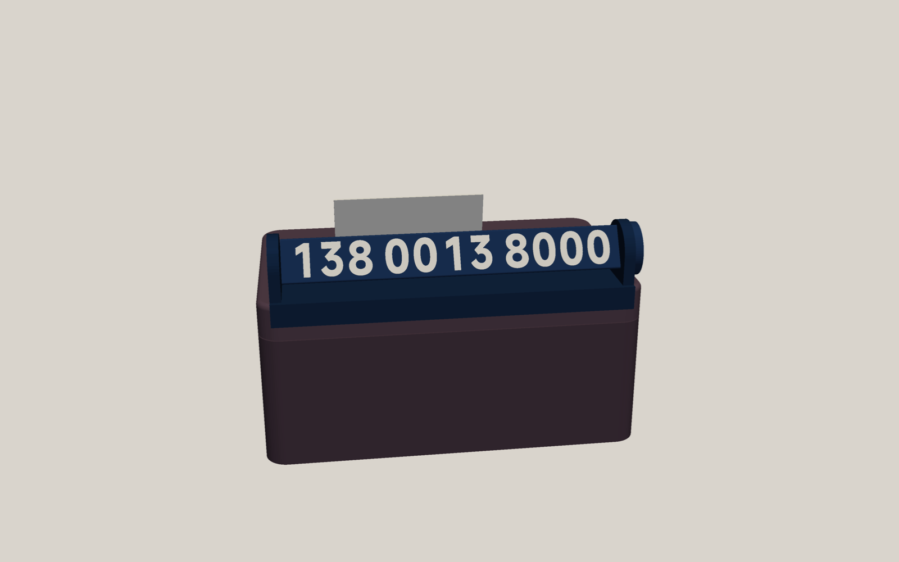
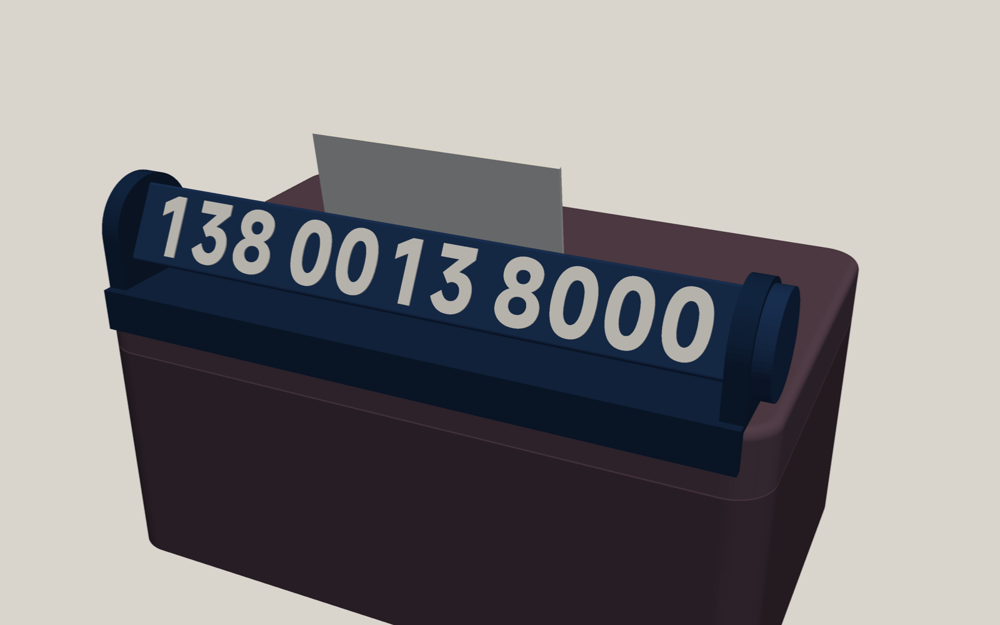
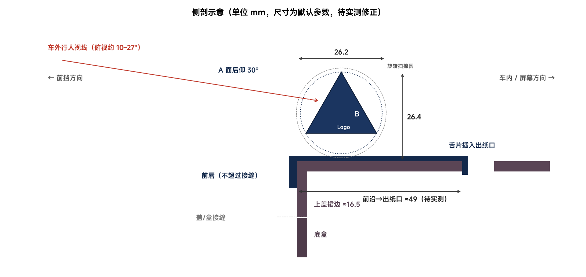

# YU7 纸巾盒旋转挪车号码牌 — 技术设计文档

> 状态：待评审（草案） · 作者：Claude · 日期：2026-10-12
> 适用：小米 YU7 + 官方 XIAOMI LIFE 车载磁吸纸巾盒（鸢尾紫） · 打印机：拓竹 P1S Combo · 耗材：拓竹 ABS 白 40100 / 天蓝 40601 / 藏青 40602 · 磁铁：N52 Ø8×3

## 1. 设计目标（用户视角）

我希望挪车电话直接"长"在小米纸巾盒上，而不是在仪表台上另放一个牌子：一根藏青色的三棱柱卧在纸巾盒上盖靠前挡的那条边上，平时纸巾照常从出纸口抽取、补纸时连盖带牌一起拿起；临时停车时拧一下端头的旋钮，"咔"地吸到下一档，就能在 **号码 A / 号码 B / Logo（不显示号码）** 三个面之间切换，旋钮端面的标记告诉我现在朝外的是哪一面。站在车头附近，透过前挡能清楚读出 11 位号码；开车时它不挡天际屏、不在前挡上产生刺眼倒影；夏天暴晒不变形、不松动、不异响；不用胶、不改动原装纸巾盒，随时可以完整取下。

## 2. 已知事实与约束

### 2.1 官方纸巾盒（来源：包装铭牌、百度百科、B 站开箱、用户照片）

| 项目 | 数值 / 结论 | 可信度 |
|---|---|---|
| 型号 / 外形 | O636，172.5 × 107.5 × 77.5 mm，约 380 g | 高（铭牌） |
| 材质 | PC 壳 + 手工包覆 PU 皮 + 超纤内衬，14 颗耐 95 ℃ 磁铁 | 高 |
| 开盖方式 | 磁吸提拉式浅罩盖，无铰链无卡扣（用户照片 6/7 已证实） | 高 |
| 上盖裙边高度 | 约 16–17 mm（接缝离底约 58–62 mm） | 低，**待实测** |
| 出纸口 | 居中直槽，两端全圆角，约 145–152 × 9–10 mm；槽沿内侧为裸塑料 | 低，**待实测** |
| 盖顶可用面 | 出纸口两侧各一条约 45–49 mm 宽的平带；槽两端只剩约 10 mm | 中 |
| 磁吸点 | 用户用小米磁吸按键实测：盖与盒体各有 4 个旋转对称的磁吸点；照片 8 显示盒体前侧面正中、接缝下方约 10 mm 处可吸住 | 中，**位置/极性待实测** |
| 颜色 | 鸢尾紫（实物为深梅紫色，接近仪表台皮面色） | 高 |

### 2.2 车内环境（来源：官方答网友问、调研、用户照片 1–9）

- **摆放**：盒子坐在中控屏与前挡之间仪表台的浅色凹槽里，长边左右向；正前方是深色皮面"眉沿"中间下探的舌形边，以及一片斜插的镀铬饰条。照片估算：舌形边离上盖前侧面约 20–25 mm，饰条下端几乎贴到盒子底部。→ **号码牌不能向前伸出上盖前侧面**。
- **天际屏**：前挡下沿是 1.1 m 宽、透光率 ≤ 0.01% 的黑区，中段投影模组就在纸巾盒凹槽正前方。→ 不能往前伸，也不能在纸巾盒上方立得太高（主驾看天际屏的视线越过中控屏上沿，余量估计只有 0–5 cm，**需实测**）。
- **车外可见性**：用户实拍（照片 1）——正常站姿能看到盖顶和上盖前侧面，以及底盒上半部分；侧面视野良好。
- **倒影**：凹槽一带的倒影落在前挡透明区（驾驶员路面视野）。几何推导：表面法线仰角 ≤ 约 36° 时倒影进不了主驾眼睛 → 显示面后仰 30°（法线仰角 30°）满足；朝上的大面积宜用深色。
- **温度**：官方称凹槽暴晒可超 90 ℃；国内实测仪表台 66–76 ℃。Bambu ABS：HDT 84/87 ℃（1.8/0.45 MPa），Vicat 94 ℃。N52：常规 ≤ 80 ℃，Ø8×3 薄片约 60–70 ℃ 起有少量不可逆退磁。→ 不用塑料弹片/预紧卡扣做定位；磁铁只做档位（轻微退磁不影响功能）。
- **安全**：不伸向副驾气囊方向；总重 ≤ 50 g；全圆角；磁铁全部包埋。

### 2.3 用户已确认的选择

车外能看到上盖侧面 · 盒子鸢尾紫 · 固定在原装上盖上（不改盒） · 隐藏面显示图案/Logo · 切换形式：**旋转三棱柱**。

## 3. 方案总览





（以上为粗略概念渲染，尺寸为默认参数，盒体为近似模型。）

**一句话**：一个卧在上盖前沿平带上的"桥式支架"（壳体），两端支架托着一根正三棱柱转子；转子三面各插一块可更换的显示面板（A / B / Logo），左端（主驾侧）旋钮里的 3 颗磁铁与支架里的 1 颗磁铁对吸，形成 120° 三档；壳体靠"前唇搭住上盖前沿 + 两片舌片插进出纸口"定位，可选一颗磁铁吸住上盖前侧面的原装磁吸点防跳动。

**为什么这样摆**：
1. 放在盖顶前沿平带上 → 不向前伸（避开眉沿、饰条、天际屏模组），也不会被抽出的纸巾挡住（纸巾在它后面）。
2. 三棱柱一面水平朝下时，朝外的面天然后仰 30° → 正对车外俯视 10–27° 的行人视线，且倒影进不了主驾眼睛。
3. 磁铁对吸做档位 → 无塑料弹簧，不怕高温蠕变；吸力还把转子轴向拉紧，减少晃动。

## 4. 详细设计

### 4.1 零件清单

| # | 零件 | 数量 | 颜色 | 打印方式 | 备注 |
|---|---|---|---|---|---|
| P1 | 壳体（底板 + 前唇 + 两端支架 + 两条臂 + 舌片） | 1 | 藏青 | 前唇外表面贴床（纹理 PEI） | 支架内嵌 1 颗磁铁（暂停放入） |
| P2 | 转子芯（三棱柱 + 两端轴颈 + 旋钮） | 1 | 藏青 + 白（旋钮标记） | 竖直打印，旋钮端贴床 | 旋钮内嵌 3 颗磁铁（暂停放入） |
| P3 | 显示面板 A | 1 | 藏青底 + 白字 | 正面贴床，0.6 mm 平齐嵌字 | 燕尾滑入转子芯 |
| P4 | 显示面板 B | 1 | 同上 | 同上 | |
| P5 | 显示面板 Logo | 1 | 藏青底 + 白/天蓝 | 同上 | |
| M | N52 Ø8×3 | 4（+1 可选） | — | — | 第 5 颗用于吸附上盖 |
| T | 试配件（磁铁孔、燕尾、盖沿） | 3 | 任意 | — | 先打，约 40 分钟 |

### 4.2 壳体与固定（P1）

坐标：X 沿盒长（+X 为主驾侧），Y 从前挡指向车内（上盖前侧面 Y=0），Z 向上（盖顶 Z=0）。

- **底板**：1.6 mm 厚，盖在上盖前沿平带上，范围 Y = 0 … ≈27 mm，长 160 mm，四角圆角与上盖俯视圆角一致。
- **前唇**：2.4 mm 厚，沿上盖前侧面下垂约 8 mm（保证距接缝 ≥ 5 mm，不影响合盖磁吸），内侧倒圆以贴合盖顶边圆角。
- **两条臂 + 舌片**：从底板后沿延伸到出纸口前沿（默认 Y ≈ 49 mm），舌片 10 mm 宽 × 1.8 mm 厚，下插出纸口 4 mm，靠近槽两端（默认 X = ±58 mm）。舌片前面贴着槽的前壁 → 壳体不能向前滑；前唇贴着上盖前侧面 → 不能向后滑；底板压在盖顶 → 不能向下。
- **防上跳（二选一或都做，按实测决定）**：
  - R3 磁吸（推荐，前提是实测确认上盖前侧面有可用吸点）：前唇正中局部加深，内嵌 1 颗 N52，吸住上盖原装磁吸点。
  - R2 倒钩：舌片底部向前伸 1.5 mm 小钩，勾住出纸口前沿内侧（需要实测顶板厚度 t）。
- **端支架**：5 mm 厚，墓碑形轮廓包住转子扫掠圆；轴承为朝车内开口的 U 形槽（Ø6.4，开口处收窄 0.3 mm 形成"咔"入，仅装配瞬间受力，不长期预紧）；主驾侧支架上方（12 点位置、半径 7.5 mm）内嵌 1 颗磁铁做档位定子。
- 支架顶部刻一个指针凹口，对准旋钮上的当前标记。

### 4.3 转子（P2 + P3–P5）

- **截面**：正三角形，边长 s = 21.5 mm（外接圆半径 12.4，扫掠直径 24.8），棱角倒圆 0.8 mm。
- **静止姿态**：一面水平朝下、顶角朝上 → 朝外（前挡侧）的面后仰 30°；朝车内的面前倾 30°（看不到）；朝下的面被底板遮住。
- **高度**：轴心高 = 底板 1.6 + 间隙 0.6 + 12.4 = 14.6 mm，顶角最高 ≈ **27.0 mm（离盖顶）**；深度 ≈ 27 mm。
- **显示面板**：1.6 mm 厚，正面宽 18.5 mm，长约 147 mm；两长边做 20° 燕尾，从转子远端滑入三棱柱各面的燕尾槽，远端由支架挡住不脱出。→ 以后换号码只需重打一块面板。
- **轴颈**：两端 Ø6，与 U 形槽单边间隙 0.2 mm；轴向总间隙 0.8 mm（磁铁吸力会把旋钮拉向支架，消除轴向晃动）。
- **旋钮**：Ø25 × 4.6 mm，外圈滚花；端面（贴床面）用白色平齐嵌入三个标记 **A / B / ◆**，分别位于三个棱的方向——哪个标记转到顶部指针处，就表示哪一面朝外。
- **磁铁档位**：旋钮内 3 颗磁铁在半径 7.5 mm 圆上按 120° 均布（位于三个棱的方向），全部"同一极朝支架"；支架内 1 颗，"异极朝旋钮"。两者隔着各 0.6 mm 塑料皮对吸（估算约 10 N），每转 120° 吸住一档。装磁铁用"叠一摞画记号"法统一极性（见 §6）。
- 摩擦与手感：支架外侧面在半径 ≤ 5 mm 处加一圈 0.3 mm 高的凸环作为止推面，减小摩擦半径，让档位更"脆"。

### 4.4 显示内容与排版

- **号码**：11 位手机号按 3-4-4 分组（如 `138 0013 8000`）。
- **字体**：默认 **MiSans Bold**（小米品牌字体，官方免费商用，模型内只含字形轮廓，不分发字体文件）；备选 HarmonyOS Sans SC Bold（Bambu Studio 自带，等宽数字）。
- **字号**：数字高 **15 mm**（默认，可调 12–16），横向压缩至 90%，等宽格排布（格宽 = 最宽数字 + 1.8 mm），组间额外 +3.5 mm → 11 位总长约 141 mm，笔画约 2.7 mm（≥ 1.0 mm 打印下限）。
- **配色**（推荐）：藏青底 + 白字，对比度约 15.8:1；藏青与鸢尾紫盒体协调，且朝上表面深色可减少前挡倒影。备选：白底藏青字（更凉快、更显眼，但与盒体反差大）。
- **Logo 面**（待选，默认 ①）：① 白色 "YU7" 大字（字高 13 mm）+ 天蓝色细线点缀 ② "XIAOMI" 字标 ③ "XIAOMI YU7" ④ 纯藏青 + 天蓝线条纹样。
- 嵌字工艺：面板正面朝下打印在纹理 PEI 上，数字与底色在首 0.6 mm（3 层 × 0.2 mm）同层平齐嵌入 → 哑光纹理表面、字边锐利、换料次数最少。

### 4.5 关键参数表（全部可在配置文件中修改）

| 参数 | 默认值 | 来源 / 说明 |
|---|---|---|
| 上盖长 × 宽 | 172.5 × 107.5 | 铭牌；待实测 |
| 上盖裙边高 | 16.5 | 调研估计；待实测 |
| 上盖俯视圆角 / 顶边圆角 | 10 / 2.5 | 照片估计；待实测 |
| 出纸口长 × 宽 | 148 × 9.5 | 调研估计；待实测 |
| 前侧面 → 出纸口前沿 | 49 | 调研估计；**待实测（关键）** |
| 顶板厚度 t | 3.0 | 估计；仅 R2 倒钩需要 |
| 上盖前侧面吸点位置 | X=0，Z=−8 | **待实测**；仅 R3 需要 |
| 数字高 / 横向压缩 | 15 / 0.90 | 可读性与长度折中 |
| 三棱柱边长 s | 21.5 | 由数字高 + 边距决定 |
| 牌高（离盖顶）/ 深 / 长 | ≈27 / ≈27 / 160（含旋钮 ≈165） | 推导 |
| 旋转间隙（扫掠圆 ↔ 壳体） | 0.6 | P1S 运动副经验 0.2–0.3/边，取大值防热胀 |
| 燕尾配合间隙 | 0.15 / 边 | 试配件校准 |
| 磁铁孔 | Ø8.3 × 3.3，盖皮 0.6 | 试配件校准 |
| ABS 收缩补偿 | 在切片里设 99.4% | 调研：ABS XY 收缩约 0.6% |

### 4.6 重量估算

壳体约 18 g + 转子芯约 12 g + 面板 3 × 4 g + 磁铁 4 × 1.1 g ≈ **47 g**（上限 50 g）。

## 5. 打印方案（P1S + 拓竹 ABS + 纹理 PEI）

| 盘 | 内容 | 关键设置 | 预计 |
|---|---|---|---|
| 0 | 试配件：磁铁孔条 Ø8.1–8.5、燕尾段、盖沿段（含舌片） | 单色 | ~40 min |
| 1 | 3 块显示面板 | 藏青 + 白；0.2 mm 层高；首 3 层嵌字 | ~1 h，冲刷 ~2 g |
| 2 | 转子芯（竖直） | 藏青 + 白（仅首 3 层标记）；第 ≈19 层暂停放 3 颗磁铁；5 mm brim | ~2.5 h |
| 3 | 壳体（前唇贴床） | 藏青；在支架磁铁腔封顶层前暂停放 1 颗磁铁（+ 可选前唇磁铁）；5 mm brim | ~2.5 h |

通用：Bambu ABS P1S 预设（喷嘴 260/270 ℃、热床 90 ℃）、纹理 PEI 涂胶、关门盖顶盖、开打前热床预热 10–15 分钟；3 层墙、25% 填充；耗材 80 ℃ 烘 8 h。每个暂停点会在 3MF 里预先设好，到点打印机停下，放入磁铁后点继续。可选：成品在热床上 80 ℃ 保温 2 小时做预退火，提前释放应力。

## 6. 装配与使用

1. **统一磁铁极性**：把 4–5 颗磁铁吸成一摞，用记号笔在每颗朝上的那一面画点（画点面全是同一极）。
2. **转子打印暂停时**：3 颗磁铁"画点面朝上"放入旋钮孔位。
3. **壳体打印暂停时**：支架磁铁"画点面朝转子一侧的背面"放入（即没画点的面朝旋钮），保证与旋钮磁铁相吸。文档会配图标明方向。
4. 三块面板按 A、B、Logo 顺序从转子远端滑入燕尾槽（每块背面有凸起标记，防装错面）。
5. 把转子轴颈从后方"咔"进两端 U 形槽，旋钮在主驾侧。
6. 上车：舌片插进出纸口前沿，前唇搭到上盖前侧面（R3 版本此时会被吸住）。
7. **切换**：拧旋钮，每 120° 一档，顶部指针对着的标记 = 当前朝外的面。
8. **补纸**：照常整盖提起，牌子随盖一起走。

## 7. 软件实现

- 工具链：Python 3.12（uv 虚拟环境）+ build123d 0.13（B-rep 参数化建模）+ fontTools（字形检查）+ pyvista（渲染）+ Bambu Studio 02.08 命令行（切片校验）。
- 目录结构：

```
yu7-tissue-plate/
  config.toml            # 号码、Logo、配色、实测尺寸（用户只改这里）
  src/yu7plate/
    params.py            # 参数数据类 + 配置读取与校验
    box_model.py         # 官方上盖参考模型（用于干涉检查与渲染）
    text_layout.py       # 号码/Logo 排版（等宽格、压缩、字形覆盖检查）
    veneer.py            # 显示面板 + 嵌字
    rotor.py             # 转子芯、轴颈、旋钮、磁铁孔、标记
    housing.py           # 壳体、支架、臂与舌片、可选磁铁孔/倒钩
    coupons.py           # 试配件
    checks.py            # 实体有效性、旋转干涉扫描、最小壁厚、盖沿配合
    export.py            # STEP / STL / 拓竹 3MF（每个零件指定耗材 + 暂停层）
    bambu.py             # 系统预设展平 + 命令行切片 + 报告
    render.py            # 预览图
  scripts/build_all.py   # 一键：建模 → 检查 → 导出 → 切片 → 渲染
  out/                   # 生成物
```

- 3MF：手写拓竹格式（零件级耗材分配 + 暂停层），再经 Bambu CLI 导出为工程 3MF，GUI 打开即带好颜色、耗材槽和暂停。
- 切片校验：P1S 0.4、Bambu ABS、0.20 mm Standard、纹理 PEI；系统预设先展平继承链（直接喂会"成功"但 G-code 错误）；读取 result.json 得到时间、克重、换料次数，并检查 G-code 中暂停指令的层高。
- **隐私**：号码只写在本地 config.toml；生成文件含号码，不要上传 MakerWorld。

### 7.1 验收标准（自动检查）

1. 所有零件为有效实体、网格水密。
2. 转子 0–360° 每 5° 扫描：与壳体最小间距 ≥ 0.4 mm（轴颈配合面除外）。
3. 与上盖参考模型：无干涉；舌片完全落在出纸口内；前唇下沿距接缝 ≥ 5 mm；不超出上盖前侧面。
4. 文字：所需字形全部存在；最小笔画 ≥ 1.0 mm；数字距面板边 ≥ 1.2 mm。
5. 磁铁孔四周壁厚 ≥ 0.8 mm；封皮 = 3 层。
6. 每个 3MF 命令行切片成功，耗材分配正确，暂停层位置正确；输出时间与克重报告。

## 8. 风险与对策

| 风险 | 影响 | 对策 |
|---|---|---|
| 27 mm 高度挡住天际屏中段 | 行车视线 | **打印前做驾驶位遮挡测试**；不行就降字高（12 mm → 约 23 mm 高）或改成后沿版本 |
| 车头正前方远处（> 2 m）看不清 | 可读性 | 用户已确认近处可见；字高可上调到 16 mm（长度允许范围内） |
| 暴晒软化/翘曲（藏青更热） | 变形 | 截面 ≥ 1.6 mm、无预紧卡扣、可选预退火；必要时换白色方案 |
| N52 高温轻微退磁 | 档位变软 | 仅用于档位，不承重；可选购 N52H/SH |
| 转子异响 | 体验 | 磁铁轴向拉紧；轴颈间隙试配；必要时轴颈贴一圈薄绒布胶带 |
| 舌片刮到纸巾 | 体验 | 舌片放在槽两端附近，宽 10 mm、厚 1.8 mm |
| 刮伤 PU 皮 | 外观 | 接触边全部倒圆；可选贴毛毡 |
| 上盖尺寸个体差异 | 装不上/松 | 先打盖沿试配件；参数化可调 |
| 磁铁装反 | 档位失效 | 叠摞画点法 + 暂停时的图示；装反可在继续打印前发现 |

## 9. 需要你确认 / 实测的事项

**必须（决定能否开模）**

1. **驾驶位遮挡测试**：在上盖靠前挡的边上放一个约 27 mm 高的东西（一摞硬币、小盒子都行），正常坐姿、天际屏常用档位，看中间的时钟/导航是否被挡；再试 22 mm。告诉我"不挡的最大高度"。
2. 上盖尺寸：长、宽（盖顶处）、裙边高（盖顶到接缝）、俯视四角圆角大约多大、顶边圆角大约多大。
3. 出纸口：长、宽，以及**上盖前侧面到出纸口前沿**的距离（沿盖顶量）。
4. 上盖前侧面磁吸点：盖在盒上的状态下，用 1 颗 N52 贴着上盖前侧面移动，找吸力最强处，量它离盖顶、离左端多远；翻面再贴，看是两面都吸（钢片）还是一面排斥（磁铁）。
5. 磁铁实测直径、厚度，以及手上有几颗（需要 4–5 颗）。

**偏好（可默认）**

6. 两个号码：现在告诉我，或之后自己填 `config.toml`。
7. Logo 面：① YU7（默认）② XIAOMI ③ XIAOMI YU7 ④ 线条纹样。
8. 旋钮在主驾侧（默认）还是副驾侧。
9. 配色：藏青底白字（默认）还是白底藏青字。
10. 有没有 502 胶 / 毛毡垫（可选）；热床板是否纹理 PEI；AMS 型号。

## 10. 未采用的方案

| 方案 | 不采用原因 |
|---|---|
| 底部磁吸转接座 | 抬高盒子、吸力随间隙骤降（1 mm 只剩约 30%）、要复刻凹槽曲面，显示位置还更低 |
| 打印替换上盖 | 失去官方 PU 皮外观；172×107 ABS 大平面易翘；配合松紧敏感 |
| 三棱柱挂在上盖前侧面外 | 需前伸约 25–30 mm，会撞眉沿舌形边/镀铬饰条，并侵入天际屏模组前方区域 |
| 磁吸翻面薄板 | 体积最小，但你选择了一拧切换的三棱柱 |
| 数字滚轮 / 按压跷板 / 滑盖 | 零件多、字小或只有两态、弹簧高温蠕变 |

## 11. 实施计划（评审通过后）

1. 建参数化模型 + 上盖参考模型 → 自动检查全部通过。
2. 生成试配件 3MF → 你打印试配（约 40 分钟）并反馈。
3. 按反馈微调参数 → 生成 3 个正式打印盘的 3MF + STEP/STL + 渲染图 + 中文打印装配说明。
4. 你打印装车，根据实际效果微调（字高、旋钮手感、间隙）。

## 附录：主要参考

- 官方：小米汽车答网友问第 167/169 集；xiaomiev.com YU7 页面；Xiaomi Life 车载磁吸纸巾盒包装铭牌（B 站 BV1MbguzDEk8）。
- 复刻件：MakerWorld 北溪 1353273 / 1553062、余火 1355102、空壳可 2107445；挪车牌机构参考：988609（双号旋转）、1088049（段落感翻转）、专利 CN213339505U（旋转式挪车牌）。
- 材料：Bambu ABS TDS V3.0；N52 数据表（Arnold、Shin-Etsu）；磁铁孔公差（Total Element）。
- 工具：build123d 0.13；Bambu Studio CLI；MiSans 字体授权（hyperos.mi.com/font）。
- 用户照片：用户本地照片（未收录；9 张，2026-10-12）。
