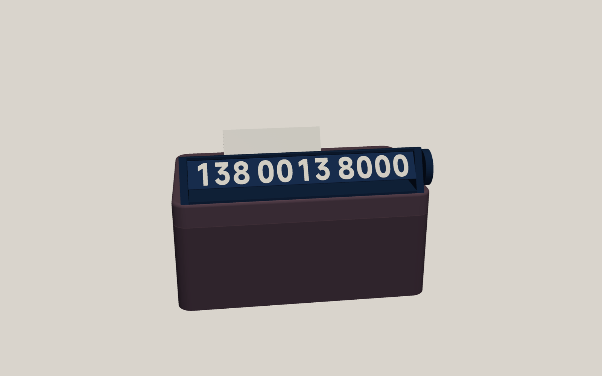
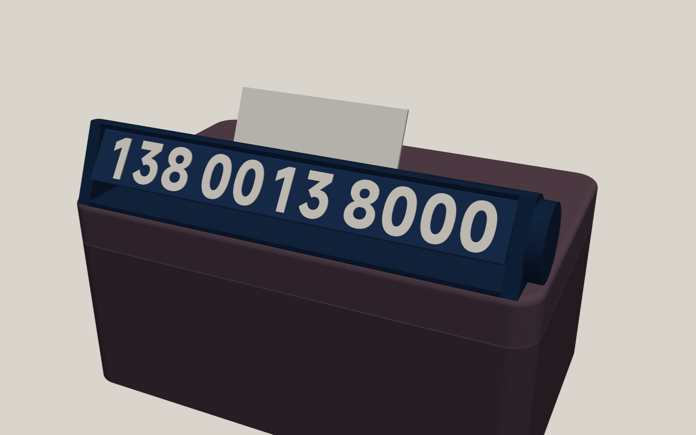
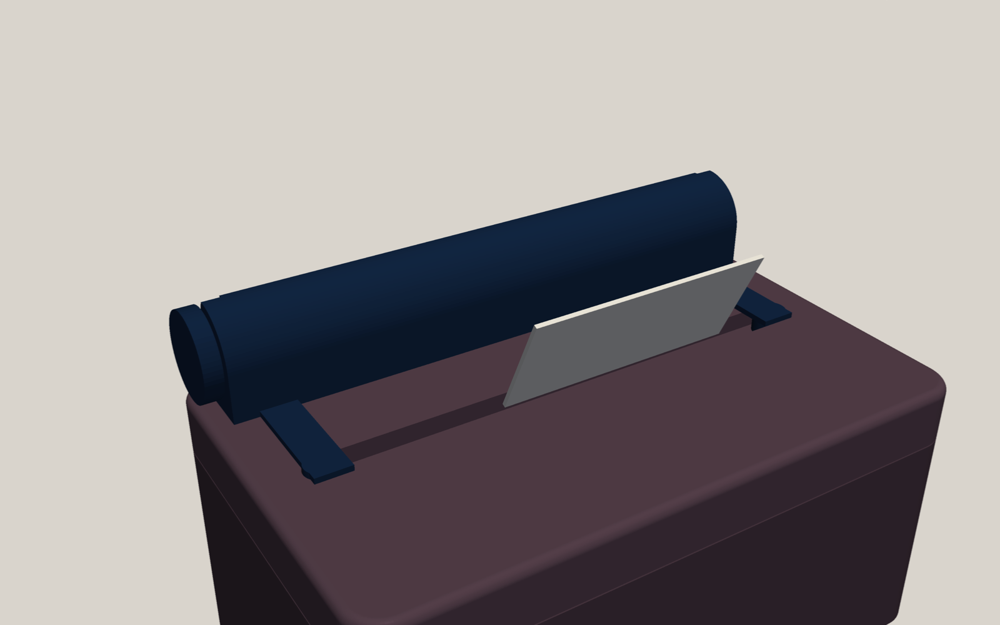

# YU7 纸巾盒旋转挪车号码牌 — 技术设计文档（v2）

## 1. 设计目标（用户视角）

我希望挪车电话直接"长"在小米纸巾盒上，不用在仪表台上另放一个牌子。上盖靠前挡的那条边上，卧着一根藏青色的三棱柱显示条。纸巾照常从出纸口抽，补纸时连盖带牌一起提起来。临时停车时，伸手拧一下主驾侧的旋钮，"咔"地吸到下一档，就能在 **号码 A / 号码 B / Logo（不显示号码）** 三个面之间切换；摸旋钮边缘的凸点，不用看就知道现在朝外的是哪一面。白天、不放前挡遮阳挡时，站在车头附近（目标：离前挡 2 m 内，以纸样实测为准）能透过前挡读出 11 位号码。开车时，它不挡天际屏，不在前挡上留下号码倒影，路过的人也没法从侧窗抄到另一组号码。夏天暴晒不变形、不松动、过坎不异响。不用胶，也不改动原装纸巾盒，随时可以整件取下。

> 已知限制（先说清楚）：前挡放遮阳挡时号码完全看不到；夜间/地库没有照明时需要手电；"离前挡 2 m 内可读"要用 §10 的纸样测试确认。

## 2. 已知事实与约束

### 2.1 照片对照（用户 2026-10-12 拍摄，用户本地照片，未收录）

| 编号 | 文件 | 内容 |
|---|---|---|
| 照片 1 | MVIMG_…124056 | 车外站姿隔前挡拍：屏背 + 纸巾盒，盖顶与上盖前侧面可见 |
| 照片 2 | …124111 | 车外俯拍：盒子坐在浅色凹槽里 |
| 照片 3 | …124139 | 低位侧拍：皮面眉沿 + 斜插的镀铬饰条 |
| 照片 4 | …124145 | 俯拍上盖、出纸口；纸巾向前挡方向倒伏 |
| 照片 5 | …124226 | 低位侧拍（同 3） |
| 照片 6 | …124311 | 提起上盖（磁吸罩盖，无铰链） |
| 照片 7 | …124526 | 小米磁吸按键吸在上盖底面（靠一端） |
| 照片 8 | …124549 | 磁吸按键吸在底盒前侧面正中、接缝下方 |
| 照片 9 | …125044 | 屏上方视角，天际屏与黑区 |

### 2.2 官方纸巾盒

| 项目 | 数值 / 结论 | 可信度 |
|---|---|---|
| 型号 / 外形 / 重量 | O636，172.5 × 107.5 × 77.5 mm，约 380 g | 高（铭牌） |
| 材质 | PC 壳 + 手工包覆 PU 皮 + 超纤；14 颗耐 95 ℃ 磁铁 | 高 |
| 开盖 | 磁吸提拉式浅罩盖，无铰链、无卡扣（照片 6） | 高 |
| 上盖裙边 | 约 16–17 mm | 低，**待量** |
| 出纸口 | 居中直槽，两端半圆，约 145–152 × 9–10 mm；槽沿内侧为裸塑料 | 低，**待量** |
| 盖顶可用面 | 出纸口两侧各一条约 45–49 mm 宽的平带 | 中 |
| 磁吸点 | 用户实测：盖与盒各有 4 个旋转对称的吸点；照片 7 中按键吸在盖底面，照片 8 中吸在盒体前侧面接缝下方。**上盖吸点的具体位置、是钢片还是磁铁，未知** | 低，**待测** |
| 颜色 | 鸢尾紫（实物为深梅紫） | 高 |

### 2.3 车内环境与硬约束

1. **不能往前伸**：盒子正前方 20–25 mm 处是皮面眉沿的舌形边和一片斜插镀铬饰条（照片 3/4/5），天际屏中段投影模组也在正前方。→ 只有两小段前唇允许贴着上盖前侧面（前伸 ≤ 2.4 mm、位于盖顶以下）；其余部分不得超出上盖俯视轮廓。
2. **高度上限未知**：主驾看天际屏的视线越过中控屏上沿；调研估计屏后物体可比盒顶高出的余量只有 0–5 cm（低可信）。→ **打印前必须用纸样实测**（§10 步骤 1），按 §9 决策表选方案。
3. **倒影（两面都要管）**：凹槽一带物体的倒影落在前挡透明区，也就是驾驶员的路面视野。几何结论：
   - 朝外面：法线仰角 ≤ 90° − 2θ（θ 为前挡下段倾角 25–29°，阈值 32–40°）时，倒影进不了主驾眼睛。后仰 30° 刚好满足，余量很小，所以档位停位误差要小（目标 ±3° 内）。
   - **朝车内面**：法线朝后上方仰 30°，正对主驾在前挡里的镜像眼点，**一定会被看到倒影**；而这一面永远是另一块号码。→ 必须用藏青色**后罩**遮住（§4.2）。
   - 所有朝上的面一律用藏青哑光。
4. **车外可见性**：用户确认站姿能看到盖顶、上盖前侧面和底盒上半部（照片 1，拍摄距离较近）。号码能读多远尚未验证。
5. **温度**：官方称凹槽暴晒可超过 90 ℃，国内实测仪表台 66–76 ℃。Bambu ABS 的 HDT 为 84/87 ℃，Vicat 94 ℃。N52 Ø8×3 薄片在约 60–70 ℃ 起有少量不可逆退磁，80 ℃ 时热态吸力约 −14%。→ 不用塑料弹片或预紧卡扣定位；磁铁只做档位、不承重；**磁铁不在打印中途埋入**（热床 90 ℃ 会把它们烤到退磁区），全部打完后压入并点胶。
6. **纸巾**：照片 4 显示弹出的纸巾会向前挡方向倒伏，可能搭到显示条上。
7. **安全**：总重 ≤ 55 g；全圆角；磁铁全部胶固；不伸向副驾气囊方向；整件在 X、Y、Z 三个方向都有几何限位。

### 2.4 用户已确认的选择

车外能看到上盖侧面 · 盒子鸢尾紫 · 固定在原装上盖上（不改盒） · 隐藏面显示图案/Logo · 切换形式：**旋转三棱柱**。

## 3. 方案总览

### 3.1 默认方案 K：固定轴旋转三棱柱 + 后罩





（粗略概念渲染，盒体为近似模型，尺寸以 §4.7 参数表为准。）

一句话：一个卧在上盖前沿平带上的藏青壳体，壳体与后罩一体，两端支架上开闭口轴承孔。里面关着一根三棱柱转子，由三块面板（A / B / Logo）粘成，转子拆不出来。主驾侧旋钮里的 3 颗磁铁与支架里的 1 颗磁铁对吸，形成 120° 三档。壳体靠两块插进出纸口两端半圆的定位塞（前后左右都能定位）和两小段前唇固定，用倒钩防上跳；如果实测确认上盖有合适的吸点，也可以改用磁铁。

为什么这样设计：

| 决定 | 原因 |
|---|---|
| 放在盖顶前沿平带 | 不往前伸（避开眉沿、饰条、天际屏模组）；放后沿的话，纸巾会立在号码前面、挡住抽纸的手 |
| 三棱柱一面朝下静止 | 朝外的面天然后仰 30°，正对车外俯视 10–27° 的行人，且在倒影阈值以内 |
| 一体后罩 | 遮住朝车内那一面（倒影、侧窗隐私），挡住前倒的纸巾，同时把转子锁在里面 |
| 闭口轴承孔 + 销轴 | 不用卡扣，转子不会从槽口脱出（审查发现换档时磁力侧推可达 3.5 N） |
| 斜接管转子 | 三块面板都能正面朝下打印，字最清楚，数字铺满整个面；比"面板插槽"矮 5–7 mm |
| 磁铁打完再压入 | 不被热床烤退磁，不需要中途暂停，装之前还能先试吸力和极性 |

### 3.2 两个备选（按 §9 决策表启用）

- **方案 F：躺面翻转**。三棱柱一面直接落在底板上，轴颈在竖槽里可以上下移动。不要旋钮，从屏幕上方往前推一下棱顶，就翻到下一面。静止高 ≈ 18.9 mm，翻转瞬间 ≈ 21.6 mm，比 K 低约 8.6 mm。代价有三点：只靠重力保持，过大坎可能轻跳（底部贴毛毡消声；加磁铁压紧则高度 +2.2 mm）；没有后罩，朝车内那一面的白字会进倒影，需要约定"开车时显示 A，此时朝车内的是深色 Logo 面"；手感偏轻。
- **方案 P：前侧面磁吸薄板**（三棱柱方案都放不下时的退路）。约 5 mm 厚，直接吸在上盖前侧面，A/B 两面翻转使用，Logo 板备用。前提是 §10 步骤 3 确认上盖前侧面有吸点。

## 4. 方案 K 详细设计

坐标：X 沿盒长（+X 为主驾侧），Y 从前挡指向车内（上盖前侧面 Y=0），Z 向上（盖顶 Z=0）。

### 4.1 零件清单

| # | 零件 | 数 | 颜色 | 打印方向 | 说明 |
|---|---|---|---|---|---|
| H | 壳体（底板 + 后罩 + 两端支架 + 定位塞 + 前唇） | 1 | 藏青 | 竖立打印（X 轴朝上），主驾侧支架在最上 | 一体，无需支撑；轴承孔、磁铁孔都是竖直孔 |
| PA/PB/PL | 面板 A / B / Logo | 3 | 藏青底 + 白字 | 正面贴纹理 PEI，同一盘 | 长边 30° 斜接，粘成三棱管 |
| E1/E2 | 三角端堵（带六角孔） | 2 | 藏青 | 平放 | 粘进管两端 |
| K | 旋钮 + 销轴（一体） | 1 | 藏青（+ 白色标记） | 旋钮外端面贴床 | 3 颗磁铁打完后压入 |
| F | 远端销 | 1 | 藏青 | 平放 | 带帽，粘进远端端堵 |
| M | N52 Ø8×3 | 4 | — | — | 旋钮 3 + 支架 1，均为打完后压入 + 点 502 |
| T | 试配件（见 §6 盘 0） | — | 藏青 | — | 先打，约 50 分钟，磁铁可以取出重复使用 |

### 4.2 壳体（H）

- **底板**：1.6 mm 厚，压在前沿平带上，范围 Y = 0 … 26.3 mm，长 160 mm。
- **后罩**：与转子同心，内半径 12.15（扫掠圆 + 0.6），壁厚 1.6，从后侧（0°）包到顶部略偏前（95°）。罩顶 Z = 27.5 mm，不遮挡 A 面（已核算：车外俯视 20–45° 的视线都从罩前缘上方越过 A 面上沿）。
- **两端支架**：5 mm 厚，各开 Ø4.4 闭口轴承孔，孔心 Y = 12.55，Z = 13.75。支架外形整体缩在 A 面平面之后，斜看时不遮挡首位和末位数字。主驾侧支架外侧面、轴承孔正下方 7.7 mm 处，开 Ø8.3 × 3.2 的定子磁铁孔，孔壁到轴承孔 ≥ 1.3 mm。
- **定位塞**：两块，插进出纸口两端的半圆（半径 = 槽宽/2 − 0.2），下插 4 mm；负责 X、Y 两个方向的定位，并且避开纸巾主要的出纸区。
- **前唇**：只在两端各一段，长 20 mm、厚 2.4 mm、下垂 = 实测裙边高 − 5 mm（默认 8 mm），内侧下缘做 1 mm × 45° 引导倒角。上盖前侧面中间露出原装皮面。
- **防上跳（必须）**：
  - R2 倒钩（默认）：每块定位塞前侧向前伸 1.5 mm 小钩，勾住出纸口前沿内侧（需要实测顶板厚 t）。装法：先把塞子斜插进槽端，向前推使钩子挂住，再把前唇放下贴住前侧面；前唇挡住后退，钩子就不会脱开。
  - R3 磁吸（可选）：如果 §10 步骤 3 查出上盖吸点落在底板或后脚投影范围内，就在正对位置埋 N52（按实测极性），可以替代或加强 R2。
- **约束汇总**：+Y 由前唇限位；−Y 由定位塞前壁限位；±X 由定位塞的半圆限位；−Z 由底板限位；+Z 由倒钩（或磁铁）限位。

### 4.3 转子（斜接管）

- **截面**：正三角形，边长 s = 20 mm，棱倒圆 R0.5。每个面的平面宽 18.3 mm，外接圆半径 11.55（扫掠直径 23.1）。
- **面板**：三块，厚 2.0 mm，长 149.4 mm，两长边做 30° 斜接（面朝下打印时斜边是向上的坡面，不需要支撑）。三块粘成三角管：默认用 502（CA），有丙酮的话也可以溶焊，耐热与 ABS 本体相同。
- **端堵**：三角形，边长 12.76（比管内三角小 0.3），长 8 mm，中心开六角孔，粘进管两端。
- **销轴**：Ø4 轴颈，在 Ø4.4 孔里转动。主驾侧轴颈与旋钮一体，前端六角头插进端堵传递扭矩；远端销带 Ø7 帽，挡在远端支架外侧。
- **装配（转子被关在壳里）**：①粘面板管和端堵；②从前窗把管子放进壳体；③远端销从外侧穿过支架孔插进远端端堵，点胶；④旋钮的六角轴从主驾侧支架孔插进近端端堵，点胶。转子两端都被销帽和旋钮挡住，拆不出来。
- **静止姿态**：一面水平朝下，顶棱朝上。朝外的面后仰 30°；朝车内的面藏在后罩里；朝下的面对着底板。
- **面的循环顺序**：往同一个方向拧，依次是 A → B → Logo → A。

### 4.4 档位与手感

- **旋钮**：Ø24.4 × 5 mm，外缘用凸棱防滑，不切槽，以免削薄磁铁孔壁。内侧面在半径 7.2 mm、三个面的法线方向，各有一个开口的 Ø8.3 × 3.2 磁铁孔，磁铁压入后比表面低 0.3 mm，再点 502 固定。
- **定子**：支架内 1 颗磁铁，位于 6 点方向，节圆比旋钮磁铁大 0.5 mm。这样停档时磁力有一个向下的分量，把轴颈压在孔底，消除颠簸异响。
- **止推**：旋钮内侧轴根处有一圈 0.6 mm 高、半径约 2.5 mm 的凸环，只有它和支架接触，摩擦半径很小。两组磁铁面间距约 1.2 mm，估算吸力 7–9 N，停档摩擦力矩约 8–10 N·mm，档位回正力矩峰值约 30 N·mm，停位误差约 ±2–3°。具体手感用盘 0 的档位试件确定。
- **状态标记**：旋钮外端面的三个棱方向上，用白色嵌入 A / B / ◆；外缘对应位置做触觉凸点（A = 1 点、B = 2 点、Logo = 一条横棱），转到正上方的那个就是当前朝外的面。主驾看不到旋钮时也能摸出来。

### 4.5 显示内容与排版

- 号码：11 位，按 3-4-4 分组。字体默认 **MiSans Bold**：小米品牌字体，官方免费商用；模型里只有字形轮廓，不分发字体文件，字体文件复制到项目 `fonts/` 目录使用。
- 字高 **15 mm**（平头数字；"0/8"等圆头字含过冲约 15.5 mm），可调范围 12–15.5 mm。横向压到 90%，等宽格排布（格宽 = 最宽数字 + 1.8 mm，组间再加 3.5 mm），按基线对齐。11 位实际墨迹宽约 136–141 mm，竖笔约 2.9 mm。
- 白字嵌入深度默认 **0.8 mm（4 层）**，避免压在藏青底上透色发灰；盘 0 附 3/4/5 层对比条，装车隔着前挡看过后再定。对比度：名义值约 15.8:1；隔着前挡叠加天空反射后，实际约 2–4:1。
- Logo 面（待选，默认 ①）：① 白色 "YU7" + 天蓝细线；② "XIAOMI"；③ "XIAOMI YU7"；④ 纯藏青 + 天蓝线条纹样。有后罩挡着，Logo 面转到朝车内时也不会进倒影。

### 4.6 配色

全部藏青（40602）：壳体、后罩、转子底色。数字和标记用白色（40100），点缀用天蓝（40601）。取消"白底藏青字"方案，原因有两条：朝上和朝后的浅色面会进倒影；白壳和深梅紫盒体反差太大。藏青件暴晒时温度更高，对策是截面 ≥ 1.6 mm、不用预紧卡扣，可选做退火（只对不含磁铁的零件做）。

### 4.7 关键参数表（全部可在 config.toml 修改）

| 参数 | 默认 | 来源 / 说明 |
|---|---|---|
| 上盖长 × 宽 / 裙边高 | 172.5 × 107.5 / 16.5 | 铭牌 / 调研；待量 |
| 上盖俯视圆角 / 顶边圆角 | R10 / R2.5 | 照片估计；待量（硬币比对） |
| 出纸口 长 × 宽 / 前沿距前侧面 / 两端距盖端 | 148 × 9.5 / 49 / 12.25 | 调研；**待量（关键）** |
| 顶板厚 t（槽口处） | 3.0 | 估计；R2 倒钩需要 |
| 数字高 / 横向压缩 | 15 / 0.90 | 可读性与长度折中，上限 15.5 |
| 三棱柱边长 s / 面板厚 | 20 / 2.0 | s ≈ 数字高 + 5 |
| 轴心（Y, Z） | 12.55, 13.75 | = 1.6 + 0.6 + R |
| **高度包络**：三棱柱顶 / 旋钮顶 / 后罩顶 | 25.3 / 25.95 / **27.5** | 后罩顶 ≈ 10.2 + 1.155 × 数字高 |
| 壳体深度（Y）/ 长度（含旋钮） | 26.3 / 165.4 | 不超出上盖俯视轮廓 |
| 旋转间隙 / 轴承间隙 / 轴向间隙 | 0.6 / 0.2 每边 / 0.6 | 试配校准 |
| 磁铁孔 | Ø8.3 × 3.2（开口，压入 + 502） | 试配件校准 |
| ABS 收缩 | 切片设 99.4% | 调研：XY 方向收缩约 0.6% |

### 4.8 重量

壳体约 15 g + 面板 3 × 5.3 g + 端堵、旋钮、销约 4 g + 磁铁 4 × 1.13 g ≈ **40 g**（上限 55 g），以切片报告为准。

## 5. 方案 F（躺面翻转）要点

- 同一根斜接管转子（s = 20），两端用短轴颈插在支架的**竖槽**里，竖槽升程约 5.8 mm，顶部封闭。不需要旋钮和档位磁铁。
- 静止时一面落在底板上，朝外的面正好后仰 30°，没有档位误差。翻面时往前推棱顶，转子绕轴转动，轴在竖槽里抬升后落下，进入下一档。
- 高度：静止 1.6 + 0.866 s = 18.9 mm，翻转峰值 1.6 + s = 21.6 mm。如果底板里埋磁铁压紧（底板 3.8 mm），分别为 21.1 / 23.8 mm。
- 倒影：朝车内那一面没有后罩。约定 A 后面接 Logo：显示 A 时，朝车内的是深色 Logo 面，没有白字倒影；显示 B 或 Logo 时开车，会有白字倒影。
- 状态：从车内看不到朝外的那一面，每块面板端部印一个 6 mm 小标签，从屏幕上方能看到朝车内那一面的标签，据此推断。

## 6. 打印方案（P1S + 拓竹 ABS + 纹理 PEI）

| 盘 | 内容 | 设置要点 | 预计 |
|---|---|---|---|
| 0 试配 | ①磁铁孔条 Ø8.1–8.5（开口）；②档位试件（旋钮 + 半支架 + 销，磁铁压入可取出）；③盖沿试件（一段底板 + 定位塞 + 倒钩 + 前唇）；④白字 3/4/5 层对比条；⑤面板全长 + 30 mm 芯段（查弓弯与配合） | 藏青单色（④ 双色） | ~50 min |
| 1 面板 | 3 块面板，同一盘 | 藏青 + 白；0.2 mm 层高；白字 0.8 mm；首层象脚补偿 0；四角 mouse ear | ~1 h |
| 2 壳体 | 竖立（X 轴朝上），高 160 mm | 藏青；5 mm brim；3 墙 15% 填充；外墙降速；预计无支撑（检查报告确认） | ~3 h |
| 3 小件 | 端堵 ×2、旋钮 + 销、远端销 | 藏青 + 白（旋钮标记 4 层） | ~30 min |

通用：Bambu ABS P1S 预设（喷嘴 260/270 ℃、热床 90 ℃），纹理 PEI 涂胶，关门、盖好顶盖，开打前热床预热 10–15 分钟；耗材 80 ℃ 烘 8 h。**全程不需要暂停。** AMS 槽位：1 白 40100、2 天蓝 40601、3 藏青 40602。

## 7. 装配与使用

1. **统一磁铁极性**：把 4 颗磁铁吸成一摞，在每颗朝上的那一面画点。画点的面都是同一极。
2. 旋钮的 3 颗磁铁：画点面朝外（露在旋钮内侧面）压入。支架的 1 颗：**先不点胶**，画点面朝里压入，拿旋钮靠近试一下，能吸住、转动时有三档"咔"感就对了；如果被推开，就把支架这颗翻面。确认无误后再点 502。
3. 粘面板管：三块面板正面朝外拼成三角，两端先塞上端堵定形，再沿斜接缝内侧点胶，用橡皮筋箍住，固化 10 分钟。
4. 把管子从前窗放进壳体，先插远端销、再插旋钮轴，两处都点胶。拧一圈检查三档。
5. 上车：上盖取下来操作更方便。先把两块定位塞斜插进出纸口两端、向前推挂住倒钩，再放下前唇贴住前侧面。
6. **切换**：拧旋钮，每 120° 一档。正上方的标记或凸点表示当前朝外的面（A = 1 点、B = 2 点、Logo = 横棱）。
7. **补纸**：捏住上盖两个短边提起，不要抓号码牌或旋钮。
8. 下车前把露出的纸巾往车内一侧捋一下，免得它倒下来盖住号码。

## 8. 软件实现与交付物

- 工具链：Python 3.12（uv 虚拟环境）、build123d 0.13（参数化 B-rep）、fontTools（检查字形覆盖）、pyvista（渲染）、Bambu Studio 02.08 命令行（切片校验）。
- 目录结构：

```
yu7-tissue-plate/
  config.toml           # 号码、Logo、配色、实测尺寸（用户只需改这里）
  fonts/                # MiSans-Bold.ttf 等（本地使用，不分发）
  src/yu7plate/
    params.py           # 参数 + 配置读取与校验
    box_model.py        # 上盖参考模型（检查与渲染用）
    text_layout.py      # 号码/Logo 排版（等宽格、压缩、基线对齐、字形检查）
    panels.py           # 三块斜接面板 + 嵌字
    rotor_parts.py      # 端堵、旋钮 + 销、远端销
    housing.py          # 壳体、后罩、支架、定位塞、倒钩、前唇
    coupons.py          # 试配件
    checks.py           # 有效性、旋转干涉、包络高度、按打印方向的悬垂、最小壁厚、档位力矩/摩擦
    export.py           # STEP / STL / 拓竹 3MF（零件级耗材分配）
    bambu.py            # 预设展平 + 命令行切片 + 报告
    render.py           # 预览图
  scripts/build_all.py  # 一条命令：建模 → 检查 → 导出 → 切片 → 渲染
  out/                  # 生成物
```

- config.toml 示例：

```toml
[numbers]
a = "13800138000"     # 11 位，以 1 开头；不合规直接报错，不会自动缩字
b = "13900139000"
[display]
logo = "YU7"          # YU7 | XIAOMI | XIAOMI YU7 | pattern
digit_height = 15.0   # 12–15.5
knob_side = "driver"  # driver | passenger
[lid]                 # 实测值（mm）
length = 172.5
depth = 107.5
skirt = 16.5
slot_length = 148.0
slot_width = 9.5
slot_front_offset = 49.0
panel_thickness = 3.0
```

- 生成命令：`uv run scripts/build_all.py`。
- 交付物（`out/`）：`plate0_coupons.3mf`、`plate1_panels.3mf`、`plate2_housing.3mf`、`plate3_small.3mf`（Bambu Studio 打开即带好颜色和耗材槽）、`step/*.step`、`stl/*.stl`、`renders/*.png`、`report.md`（检查结果、每盘时间与克重、换料次数）。附中文打印装配说明。
- **隐私**：号码只存在本地 config.toml。含号码的 3MF 不要上传 MakerWorld；**云打印也会把 3MF 传到拓竹云**，建议用局域网或 SD 卡打印。

### 8.1 自动检查（每次生成都跑）

1. 所有零件都是有效实体，网格水密。
2. 转子 0–360° 每 2° 扫描一次，与壳体的最小间距 ≥ 0.4 mm（轴承配合面除外）。
3. 与上盖参考模型无干涉。定位塞完全落在槽端半圆内；前唇下沿距接缝 ≥ 5 mm；除前唇外不超出上盖俯视轮廓。
4. 高度包络最高点 ≤ 用户实测的允许高度 H_max。
5. 文字：所需字形都在；最小笔画 ≥ 1.0 mm；数字距面板边 ≥ 1.2 mm；方位角 ±45° 内 11 位全部可见。
6. 按各零件的打印方向统计朝下的面：无支撑处倾角 ≤ 50°，否则报告位置。最小壁厚 ≥ 0.84 mm（2 条线宽）。
7. 档位模型（磁荷模型）：回正力矩峰值 / 停档摩擦力矩 ≥ 3。
8. 每个 3MF 都能命令行切片成功，耗材分配正确；报告时间和克重。

## 9. 风险与决策表

### 9.1 高度决策（用 §10 步骤 1 测得的 H_max，取主驾、副驾、各档位中的最小值）

| H_max | 采用 | 数字高 |
|---|---|---|
| ≥ 28 mm | 方案 K（默认） | 15 mm |
| 25–28 mm | 方案 K，缩字 | 13 mm（后罩顶 ≈ 25.2） |
| 22–25 mm | 方案 F（重力版） | 15 mm（峰值 21.6） |
| < 22 mm | 方案 P（前侧面磁吸薄板） | 15 mm |

### 9.2 其他风险

| 风险 | 对策 |
|---|---|
| 车外读不清 | 纸样测试先定可读距离，字高上限 15.5（受面板长度限制） |
| 纸巾倒下来盖住号码 | 后罩挡住大部分；下车前捋一下；纸样测试时统计 |
| 主驾够不着、看不到旋钮 | 用触觉凸点；纸样测试时一并确认；够不着就改到副驾侧，或下车后在车外切换 |
| 暴晒软化/翘曲 | 无预紧卡扣、截面 ≥ 1.6、藏青件可选退火；明年夏天实测温度 |
| N52 轻微退磁 | 只用于档位；必要时换 N52H/SH |
| 转子异响 | 定子偏心预压 + 小半径止推；盘 0 实测 |
| 磁铁装反 | 点胶前先用旋钮试吸（§7 第 2 步） |
| 上盖尺寸个体差异 | 先打盖沿试件；参数化可调 |

## 10. 需要你做的事（按顺序）

**步骤 1：纸样测试（打印前必须做，约 30 分钟）** — 用 A4 按 100% 打印 [纸样测试模板](../../concept/renders/paper_template.pdf)，先量校准线确认是 100 mm。
- ① 天际屏遮挡：把高度标尺立在上盖靠前挡的边上（离前沿约 12 mm）。主驾按平时的坐姿坐好，天际屏分别调到常用档和最高档，扫视整条黑区（中间的导航、时钟和两侧）；从 30 mm 往下逐档剪短。副驾也看一遍。回报："常用档 / 最高档 / 副驾，刚好不挡的高度各是多少 mm"。
- ② 车外可读：折好纸三棱柱，A 面朝外放在盖顶前沿，下面垫约 8 mm（例如 10 张银行卡）。在车头旁、车头前 1 m、2 m、3 m 处，各用站姿眼高拍一张。回报"最远能完整读出号码的距离"，照片发我。
- ③ 倒影：同样摆放，白天坐主驾，看前挡上有没有 B 面白字的倒影，拍照。
- ④ 纸巾：抽几张纸，看会不会倒下来盖住 A 面。
- ⑤ 旋钮：系好安全带坐在主驾，能不能摸到盒子主驾侧那一端？能不能不看就拧？

**步骤 2：量上盖（卡尺 + 钢尺）** — 先用美纹纸在上盖朝前挡的那条长边贴个记号。

| 项目 | 工具 | 量法 | 预计 | 精度 |
|---|---|---|---|---|
| 盖长、盖宽 | 钢尺 | 盖顶处，各量 2 处 | 172.5 / 107.5 | 0.5 |
| 裙边高 | 卡尺深度尺 | 盖顶到盖/盒接缝，前侧面中间 | 16–17 | 0.2 |
| 俯视四角圆角 | 硬币比对 | 1 元 R12.5、5 角 R10.25、1 角 R9.5，哪个最贴 | ~R10 | — |
| 出纸口长、宽 | 卡尺 | 在盖面处量；宽在中间量 | 145–152 / 9–10 | 0.2 |
| 前侧面 → 出纸口前沿 | 卡尺外爪 | 一爪贴上盖前侧面外壁，另一爪伸进槽贴住前壁；前后两条长边都量 | ~49 | 0.2 |
| 出纸口两端 → 盖左右端 | 钢尺 | 左、右各量 | ~12 | 0.5 |
| 槽口处顶板厚 t | 卡尺 | 外爪夹住槽沿 | ~3 | 0.1 |
| 盖顶平不平 | 钢尺侧立 | 沿前沿平带放钢尺，看下面有没有缝 | — | — |

**步骤 3：找上盖吸点** — 把上盖单独放在木桌上（远离盒体），用小米磁吸按键或回形针扫一遍盖顶、盖底面和四个裙边，记下每个吸点在哪个面、离主驾侧端多远、离前沿多远。再用画点磁铁在约 5 mm 外判断：两面都吸 → 钢片；一面被推开 → 磁铁，记下画点面是吸还是推。拍照标注。

**步骤 4：偏好与条件**

1. 两个号码：现在告诉我，或之后自己填 config.toml。
2. Logo 面：① YU7（默认）② XIAOMI ③ XIAOMI YU7 ④ 线条纹样。
3. 旋钮放主驾侧（默认）还是副驾侧。
4. 磁铁实测直径和厚度，手上有几颗（需要 4 颗，加试配件可重复使用）。
5. 家里有没有 502、丙酮（洗甲水）、毛毡垫；热床是不是纹理 PEI；AMS 型号；用云打印还是局域网 / SD 卡。
6. 停车时常不常放前挡遮阳挡？需不需要夜间可读？号码面要不要加电话图标？

## 11. 未采用的方案

| 方案 | 原因 |
|---|---|
| 面板燕尾插进三棱柱各面（v1） | 60° 棱处相邻两槽互相切穿，芯体会断成 4 块（5 位审查一致确认）；保住棱需要 s ≥ 27，顶高约 34 mm |
| 转子整根竖打（v1） | 棱柱端面悬空约 170 mm² 需要支撑；细颈跨层受力易晃易断 |
| U 形槽卡入（v1） | 没有真实过盈；换档时磁力侧推可达 3.5 N，会把转子推出槽 |
| 打印中途暂停埋磁铁（v1） | 热床 90 ℃ 会烤退磁；暂停还会造成冷接缝 |
| 底部磁吸转接座 | 抬高盒子，吸力随间隙骤降，要复刻凹槽曲面，显示位置还更低 |
| 打印替换上盖 | 失去官方 PU 外观；大平面 ABS 易翘；配合松紧敏感 |
| 三棱柱挂在上盖前侧面外 | 要前伸 12–26 mm，会撞眉沿和饰条，侵入天际屏模组前方 |
| 数字滚轮 / 按压跷板 / 滑盖 | 零件多、字小，或只有两态；弹簧高温蠕变 |

## 12. 实物验收

1. 三档都能吸稳，停位误差 ±3° 内；过减速带不会自己转。
2. 提起上盖、侧翻 90° 摇晃，壳体和转子都不脱落。
3. 连续抽 10 张纸不挂纸，定位塞不刮纸。
4. 颠簸路面无异响。
5. 车外：在步骤 1 定下的距离内能读出号码；主驾不挡天际屏；前挡上看不到号码倒影。
6. 暴晒一天后翘曲 ≤ 0.5 mm（明年夏天补测，并记录温度）。

## 13. 实施计划（评审通过、步骤 1–3 数据到位后）

1. 写参数化模型和上盖参考模型，自动检查全部通过。
2. 生成盘 0 试配件 → 你打印试配（约 50 分钟），按 §12 判据反馈。
3. 微调参数 → 生成正式三盘 3MF + STEP/STL + 渲染图 + 中文打印装配说明。
4. 你打印装车，再按实际效果微调字高、手感和间隙。

## 附录 A：主要参考

- 官方：小米汽车答网友问第 167/169 集；xiaomiev.com YU7 页面；纸巾盒包装铭牌（B 站 BV1MbguzDEk8）；外观专利 CN309952701S。
- 复刻件：MakerWorld 北溪 1353273 / 1553062、余火 1355102、空壳可 2107445。挪车牌机构参考：988609（双号旋转）、1088049（段落感翻转），专利 CN213339505U（旋转式挪车牌）。
- 材料：Bambu ABS TDS V3.0；N52 数据表（Arnold、Shin-Etsu）；磁铁孔公差（Total Element）。
- 工具：build123d 0.13；Bambu Studio CLI；MiSans 授权（hyperos.mi.com/font）。

## 附录 B：文档信息

- 状态：待评审。版本：v2。v1 草案经 5 个视角（机械/打印、车内使用与安全、数值复核、完整性、替代方案）审查后修订：转子改为斜接管，轴承改为闭口孔，新增后罩，磁铁改为打完后压入，定位改为槽端定位塞，补充决策表、纸样测试与测量表。
- 作者：Claude · 日期：2026-10-12。
